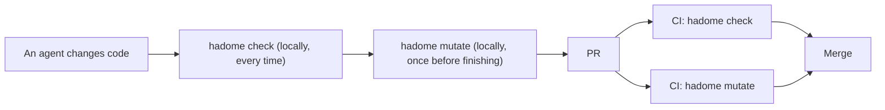
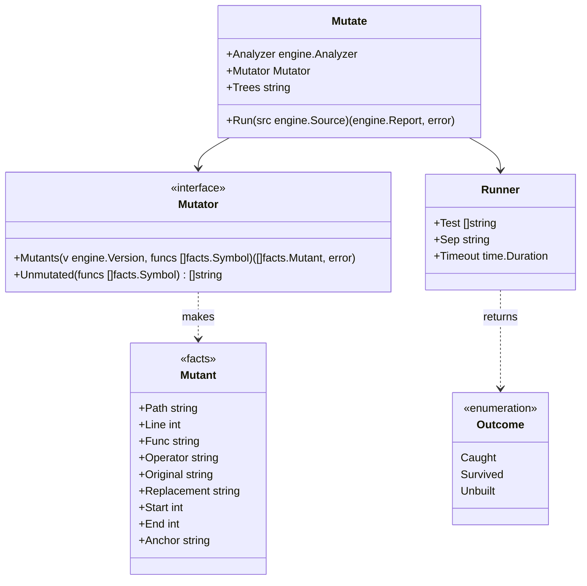
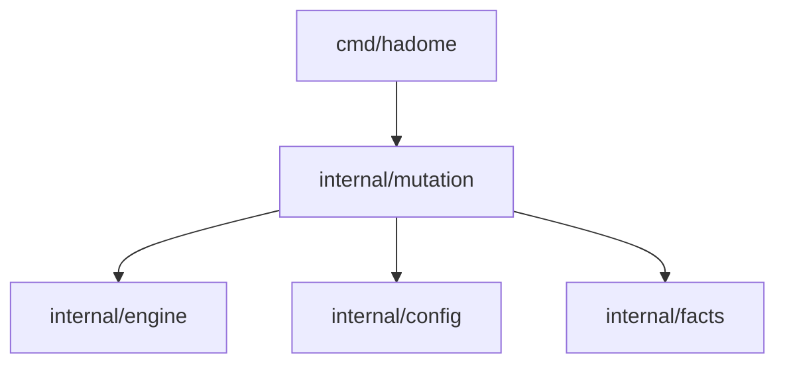
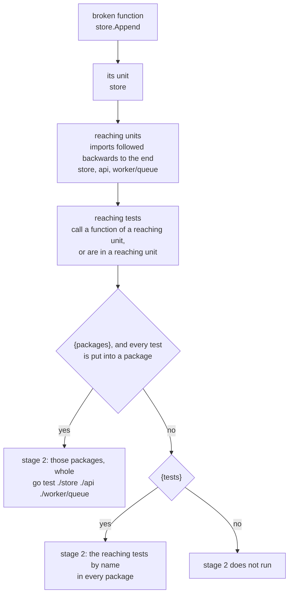

# Mutation

## Responsibility

Package `internal/mutation` breaks the code a change touched, a little and on purpose, and checks whether the tests notice. Broken code is called a **mutant**. When a test fails, the mutant is **caught**; when the tests pass, it **survived**. When the build of no test command in configuration compiles the mutant's file, it is **not built**: no test is run for it, and it is not counted as survived.

The `tests/` rules only see what a test calls. A test can call code without checking its result, and then it guards nothing. Mutation asks "if the product code breaks, does a test really fail?", so it measures what the tests guard more truly than the `tests/` rules.

Does:

- Picks the functions the change touched, and asks the adapters to make mutants of them
- Copies the version's tree into a working directory fixed per repository, applies the mutants one at a time, and runs the test command from configuration
- Reports as regressions only the mutants that survive in head and that the change added

Does not:

- Guess the test command. Configuration always names it; hadome never calls `go`, `pytest`, `cargo` and the like on its own
- Call existing mutation tools (gremlins, mutmut, Stryker, PIT, cargo-mutants). This keeps the six languages that have mutators (Go, TypeScript, Python, Rust, Java, Kotlin) behaving the same, and keeps hadome from chasing how outside tools are installed and what they print
- Break code the change did not touch. Breaking the whole repository every time would make the time depend on the repository's size, not the change's
- Run inside `hadome check`. It runs the tests many times, so it is a separate command, `hadome mutate`

## The development flow

`hadome check` and `hadome mutate` differ in speed and in how deep they check. So they take different places in the flow.

| | `hadome check` | `hadome mutate` |
|---|---|---|
| Checks | How tests are written, and what they call | Whether breaking the code fails a test |
| Runs code | No | Runs the configured test command |
| Time | Seconds | Minutes: the number of mutants × the test time |
| Agent, locally | Before finishing every change | Once before finishing, when configured |
| CI | Required on every PR | Recommended as required on every PR |



### Keeping it in use

hadome cannot change a user's CI settings or branch protection. Whether it is required on PRs is for the repository's owner to decide. Within that, four things keep it in use.

1. Once in, it cannot be taken out without a person's review. A change that removes or weakens the `mutation` setting asks for review as `config/loosened` (exit code `3`), like other settings. An agent cannot drop it for being slow
2. To tell agents, the `hadome agents` block says "when `mutation` is configured, run `hadome mutate` before finishing a change"
3. To show how to add it to CI, [ci.md](../ci.md) has a GitHub Actions example with `check` and `mutate` as separate jobs
4. To make starting easy, `hadome init` writes a `mutation` setting with a test command for the languages it found, as a comment. It never turns a guessed command on

### Steps for agents

`docs/for-agents.md` holds the section below.

````markdown
## Trying mutations

Only when `.hadome.yml` has `mutation`. Run it once before finishing a change, after `hadome check` exits `0`.

```sh
hadome mutate --format json
```

| Exit code | Meaning | What to do |
|---|---|---|
| `0` | Every way of breaking the code the change touched failed a test | Finish |
| `1` | Some way of breaking it goes unnoticed by the tests | Add tests as each entry's `fix` in `regressions` says, and run it again |
| `2` | The tests failed with nothing broken, or the configuration is invalid | Fix the tests first. Do not remove the `mutation` setting |
| `3` | A person must review something (mutants beyond the limit went untried, and the like) | Stop. Tell the person what was listed |

- Do not change the code to make the tests pass. `1` says the tests are not enough
- Write `gate:allow mutation/survived reason: <reason>` only after confirming the replacement does not change behaviour (an equivalent mutant). The reason says why the result stays the same
- Do not remove or weaken the `mutation` setting for being slow. Such a change gives `3`

How to confirm: `hadome mutate` exits `0`.
````

The short version `hadome agents` prints gains one line: "when `mutation` is configured, run `hadome mutate` before finishing a change" (item 2 above).

## Shape



- `Mutant` is a language-neutral fact, so it lives in `facts`. That lets the adapters make mutants without depending on `internal/mutation`
- The adapters implement `Mutator`, because only they read syntax trees. `Unmutated` lists the languages that have no way of breaking code; functions touched in them go to a person's review as untried. A mutant is a range of text and what replaces it; the adapters run no code, so their invariants (no code run, no process started) still hold
- `Mutate.Trees` is the working directory the versions' trees are copied into (see "The working directory" below). The `hadome mutate` command works it out with `TreesFor` and passes it; tests pass a temporary directory
- `Runner` lives in this package. It copies the version's tree into the working directory, applies a mutant, runs the test command and restores the file. Like the gates (`internal/gate`), starting processes happens outside the engine
- The report's shape, exception markers and exit codes are the engine's, used as they are. After trying the mutants, `Mutate` hands the results to `engine.Check` as one rule (`mutation/survived`) that returns them per version. The rules of "How to compare" below are exactly the engine's comparison of findings
- `hadome check` does not know `mutation/survived`, so it would report that rule's exception markers as naming an unknown rule or as unused. `engine.Engine.Elsewhere` names the rules another command reports: `check` leaves `mutation/survived` to `mutate`, and `mutate` leaves every other rule to `check`. Markers of those rules are left alone

The dependency diagram gains these arrows.



## Where to break

Only functions that are one of these:

- A function whose code the change changed (new functions included)
  - A version may hold several functions with the same ID. For example: functions of the same name in files split by build tags (`*_unix.go` and `*_windows.go`), or the several `init` functions of one Go package
  - So functions are matched with base by their body as well as their ID. A function is unchanged when base still has a function with the same ID and the same body. Each base function pairs with one head function only. For example, changing only `run` in `run_unix.go` does not select `run` in `run_windows.go`
- A function called (`Test.Calls`) by a test the change rewrote. This catches a change that weakens only a test and leaves the code alone

## How to break

A few kinds only. Each changes one place, and most tests can notice it.

| Kind | Example |
|---|---|
| Flip a comparison | `<` → `>=`, `==` → `!=` |
| Negate a boolean | `ok` → `!ok`, `true` → `false` |
| Swap arithmetic | `+` → `-`, `*` → `/` |
| Return the zero value | `return total` → `return 0` (each language's zero value) |
| Remove a call statement | remove the line `store.Append(row)` |

A break that gives back the same value is not made a mutant. It changes nothing, so no test can catch it, and it would be reported as a false survivor.

- `return 0` is not broken by returning the zero value
- A return of a constant whose value is the zero value is not broken either. For example, with `ExitOK = 0`, `return engine.ExitOK` is not broken
- In Go, the constant's value is read, from syntax only, from its declaration in the same package or in a package of the same module. The value is computed as a constant expression. The expression may use literals, `false` and `true`, `iota`, constants declared earlier in the same file, conversions, and operators on numbers, strings and booleans. For example, `const Off Level = 1 - 1` is a constant whose value is zero
- In TypeScript, Python, Rust, Java and Kotlin, only declarations in the same file are read ([adapters-treesitter.md](adapters-treesitter.md), "Mutants")
- A constant whose value cannot be read (one from another module, a value written as an expression that uses something that cannot be read, or one declared with different values in two files) is broken where it is returned

Go's zero value comes from the declared result type.

| Result type | Zero value |
|---|---|
| Number types (`int`, `float64`, `byte`, and so on) | `0` |
| `string` | `""` |
| `bool` | `false` |
| Pointers, slices, maps, channels, functions, interfaces (`error` and `any` included) | `nil` |
| A named type (`type Code int`, and so on) | The zero value of its underlying type. When that is a struct, the type as written followed by `{}`, such as `status.Code{}` |

- The underlying type of a named type is read, from syntax only, from its declaration in the same package or in a package of the same module. For example, when package `status` has `type Code int`, `return code` in `func Parse(s string) status.Code` becomes `return 0`
- These functions get no mutant of this kind:
  - functions with more than one result
  - functions whose result type is a fixed-size array, a struct type itself (`struct{ … }`), a type parameter, or a type with type arguments (`Set[int]`)
  - functions returning a type whose underlying type cannot be followed (a type of another module, or one declared in two files)

A mutant's anchor is the function's name, the kind, and the normalised original line, with no line number. When a change moves the function, the mutant still matches.

After each mutant it tries, it writes one progress line to standard error: which mutant it is, the file and line, the function, the kind of break, and whether a test noticed. The language is the report's: `--lang`, else `messages` in head's configuration. Example: `mutate 1/2 calc/calc.go:5 calc.Sign, flip a comparison: caught`

## Files outside the build

Breaking a file that the build running the tests does not compile makes the tests run none of its code. The tests pass as a matter of course, and whether the code is guarded is unknown. For example, a file with `//go:build !cgo` is not compiled by `go test` with cgo on. Reporting its mutants as survivors would make regressions that no added test could remove.

So configuration can list, under `builds`, commands that run the tests in other builds. A mutant is tried with the commands that compile its file. The mutants of a file that no command compiles are set apart as **not built**.

### Trying other builds

```yaml
mutation:
  test: [go, test, ./...]
  builds:
    - [env, CGO_ENABLED=0, go, test, ./...]
    - [go, test, -tags, integration, ./...]
```

- Each element of `builds` is a test command of the same shape as `test`. `{tests}` and `{packages}` can be written in it by the same rules as in `test`
- Whether a command compiles a file is decided per command, by the rules in "What Go decides" below
- A file in a language other than Go is taken as compiled by every command, because outside Go whether a file is in the build is not told apart (see "Deliberately left out" below)

A mutant is tried with the commands that compile its file, in the order `test`, then `builds`.

| Result | What happens |
|---|---|
| A test fails in a stage of a command | The mutant is caught there |
| The tests pass through stage 3 of a command | The mutant is tried with the next command that compiles the file, from stage 1 |
| The tests pass with every command that compiles the file | The mutant survived |

For example, `store/store.go`, which does not depend on cgo, is compiled both by `test` and by the `CGO_ENABLED=0` command. When it survives `test`, it is tried with the `CGO_ENABLED=0` command too. A file with `//go:build !cgo` is not compiled by `test`, so it is tried with the `CGO_ENABLED=0` command from the start.

- **Why the next command is tried too.** Different builds compile different tests. For example, a test file with `//go:build !cgo` does not run under `test`. Deciding with the first command alone would report as a survivor a mutant that another build's tests catch
- **Time.** Most mutants are caught by the first command. Only the survivors are tried with the next one
- **The stages are made per command.** Stages 1 to 3 are made from the command in use (see "Narrowing the tests run" above). Stage 2's command is one per pair of test command and unit
- **One run before breaking.** A `builds` command, like `test`, runs once before anything is broken (see "Configuration" below), the first time a mutant is tried with it. When its stage 3 fails before breaking, there is no result and the exit code is `2`
- **The same in base.** A mutant tried again in base uses the commands in the same order. Whether a command compiles the file is decided from base's file. A mutant that no command compiles in base is treated as absent from base (step 3 of "How to compare" below)
- The progress line of a mutant tried with a `builds` command names that command

### Other operating systems and architectures

A `builds` command whose GOOS or GOARCH differs from the environment hadome runs in is not run. For example, on macOS `[env, GOOS=windows, go, test, ./...]` is not run.

- **Why it is not run.** The test programs of another OS or architecture often cannot start in this environment. Whether they can (whether an emulator is installed, and the like) must not change the result
- **Nor is it only cross-compiled.** A build that compiles has run no test, so whether the tests catch the mutant is unknown
- Such a file (for example, `runner_windows.go` on macOS) is **not built** (below). Running `hadome mutate` in an environment that compiles it (for example, a Windows CI job) tries it there

### Not built

The mutants of a file that no command, neither `test` nor any of `builds`, compiles are handled as follows.

- **No test is run for them.** Their progress line says `not built`
- **They are counted neither as survived nor as caught.** They are never a regression (exit code `1`)
- **They go to a person's review (exit code `3`).** One review of `mutation/survived` per file names the file and how many mutants were not tried. Untried mutants are not passed silently (invariant 5)
- **They do not count toward `max-mutants`.** The limit is on the mutants whose tests are really run

### What Go decides

Whether a Go file is in the build is decided from syntax only. No command such as `go list` is run.

| What is read | Example |
|---|---|
| The `//go:build` line | `//go:build !cgo`, `//go:build ignore`, `//go:build linux && amd64` |
| `_GOOS` and `_GOARCH` in the file name | `poll_windows.go`, `asm_arm64_test.go` |
| A file name starting with `_` or `.` | `_scratch.go` |

These are the rules of `MatchFile` in `go/build`. The environment matched against is decided per test command (`test` and each element of `builds`) as follows.

- It starts from the environment hadome runs in. GOOS, GOARCH and cgo follow `go/build`'s default (`go/build.Default`). cgo follows `CGO_ENABLED`, and without it, whether a C compiler is found
- When the command has an element `CGO_ENABLED=0`, `GOOS=…` or `GOARCH=…`, that is used. For example, `[env, CGO_ENABLED=0, go, test, ./...]`
- When the command has `-tags`, those tags are taken as satisfied. For example, `[go, test, -tags, integration, ./...]` or `-tags=integration`

## How to compare

Like the other rules, only what the change added is a regression.

1. In head, run every mutant in the places to break. A caught one is done. When the configuration has `{tests}` or `{packages}`, narrow the tests run (see "Narrowing the tests run" below)
2. For each surviving mutant, look for a mutant with the same anchor in base
3. If base has none (a new function, a new line or a rewritten line), it is a regression: adding code means adding a test that guards it
4. If base has one, run it in base too. If base caught it, it is a regression (the tests got weaker). If it survived in base as well, it is an old gap and is not reported

Base runs only what survived in head, so most of the time is one run of head.

### Narrowing the tests run

The number of mutants depends on the size of the change, not on the number of tests. But trying each mutant runs the whole test command, so in a repository with many tests each run is long. For example, if the whole suite takes 5 minutes, 15 mutants take 75 minutes.

So hadome can run only the tests that call the broken function. Which test calls which function is known from the `Test.Calls` the adapters read. How test names and packages are passed differs between languages, so hadome does not guess it. Configuration writes these into `test`:

| Placeholder | What goes in | Example |
|---|---|---|
| `{tests}` | The names of the tests that call the broken function, as they are, joined by `tests-separator` | `-run, "^({tests})$"` |
| `{packages}` | The packages those tests are in, spread into one element per package (see "Packages" below) | `go, test, "{packages}"` |
| `{module}` | The directory of a Go module; the command runs once per module (see "Modules" below) | `go, -C, "{module}", test, "{packages}"` |

For each mutant, the stages below run from the narrowest. When the tests fail in a stage, the mutant is caught there. Only a mutant that passes every stage up to the last survived.

| Stage | Tests run | With `{packages}` | Without `{packages}`, with `{tests}` |
|---|---|---|---|
| 1 | The tests that call the broken function | in their packages, with the names | — |
| 2 | The tests that reach the broken function (see "The callers' stage" below) | their packages, whole, not narrowed by name | every package, with the names |
| 3 | All the tests | every package, not narrowed by name | not narrowed by name |

- A stage that uses a placeholder the configuration does not have is the same command as the stage before. The same command runs only once. For example, with only `{tests}`, stages 2 and 3 run; with neither, only stage 3 runs
- A mutant with no test found calling the broken function skips stage 1. When no test is found reaching it either, only stage 3 runs
- When the tests stage 2 runs are all the tests, stage 2 does not run. For example, when the packages of the tests that reach the function are every package that has tests
- Every stage's command also runs once before anything is broken (see "One run before breaking" below). A stage whose command fails then is not used to judge the mutant, which goes to the next stage: whether it failed because of the break or would fail anyway cannot be told

Stacking the stages gives the same verdict as stage 3 alone.

- **Caught in an earlier stage.** The tests stages 1 and 2 run are all part of all the tests. A test that failed in an earlier stage runs and fails in stage 3 as well. So a mutant caught in an earlier stage is caught in stage 3 too
- **Passed an earlier stage.** The next stage checks it again. When finding the callers misses one and leaves that test out, stage 3 runs it, so no false survivor reaches the report
- **Time.** Most mutants are caught in a narrow stage. Only those that pass stages 1 and 2 run all the tests

The command with `{tests}` taken out drops the element holding `{tests}`, and the element before it when that one is a flag (starts with `-`). For example, stage 3 of `[go, test, "{packages}", -run, "^({tests})$"]` is `[go, test, ./...]`.

#### The callers' stage

Stage 2 runs the tests that do not call the broken function directly but reach it through other functions. For example, when a test calls `api.Handle` and `api` imports `store`, the test reaches a mutant of `store.Append`. Stage 1 does not run that test, because `store.Append` is not in its `Calls`.

**Responsibility**

- Finds the tests that reach the broken function, from the version's facts alone
- Turns them into the form the configured test command can run (packages or names) and makes stage 2's command

**Does not**

- Start a command to find the callers (`go list -deps` and the like). It would depend on fetching modules and on caches. Only the facts the adapters already read are used
- Decide the verdict. A mutant that passes stage 2 is checked again in stage 3. Stage 3 always decides a survivor
- Run the tests instrumented. Which tests reach the function is read without running code

**Finding the tests that reach the function**

The unit is the one the dependency rules use (`facts.File.Unit`): a package in Go, a directory in TypeScript, a package in Java and Kotlin ([adapters.md](adapters.md)).

1. The broken function's unit is found from the function's file
2. The set of reaching units starts with the broken function's unit alone. Following the product code's imports (`facts.Import` with `Internal` true) backwards, each unit that imports a reaching unit is added, until nothing more is added
3. The reaching tests are the tests that are not skipped and either
   - have a `Calls` entry that calls a function of a reaching unit, or
   - are in a file of a reaching unit
4. Stage 2's command is made from the reaching tests
   - With `{packages}`, when every reaching test is put into a package by the same rules as stage 1: their packages go into `{packages}` and `{tests}` is taken out
   - Otherwise, with `{tests}`: the reaching tests' names go into `{tests}`, and `{packages}` is every package
   - Otherwise stage 2 is the same command as all the tests, and does not run



- **Why follow to the end.** Stopping at some depth of imports would send mutants of deep functions down to stage 3. There are far fewer units than functions, so following to the end costs little
- **Why follow units.** Every language's adapter turns the product code's imports into facts of the same shape. Facts of calls between functions are not uniform across languages
- **One per unit.** The reaching units depend only on the broken function's unit. Mutants of functions in the same unit use the same stage 2 command, so stage 2's runs before breaking are as many as the units broken
- **Base too.** Stage 2 of a mutant tried again on base is worked out from base's facts

#### Packages

What a package is differs between languages. hadome defines `{packages}` for Go only.

| Language | Package | `{packages}` in stages 1 and 2 | `{packages}` in stage 3 |
|---|---|---|---|
| Go | The directory of the `_test.go` file | `./store`, `./worker/queue`; the root directory is `.` | `./...` |
| TypeScript, Python, Rust, Java, Kotlin | Not defined | — | — |

- `{packages}` takes a whole element. For example, `"{packages}"` is accepted and `"./{packages}/..."` is not, because it spreads into one element per package. It cannot be written twice either
- When the test command has `-C <directory>` (or `-C=<directory>`), the paths are seen from that directory. A test outside it, or in another module than that directory's, is not put into any package
- When the test command has `{module}`, the paths are seen from each module's directory (see "Modules" below)
- When a test that calls the broken function is not a Go test, or is not put into a package, the mutant skips stage 1: narrowing by package would leave that test out. Stage 2 too, when a reaching test is such a test, narrows by name instead of by package

`{packages}` cannot be used outside Go. So that no placeholder silently does nothing, these are configuration errors:

- `{packages}` in a configuration whose `languages` lacks `go`. `hadome config check` and every command that reads the configuration stop with exit code `2`
- `{packages}` in a configuration without `languages` when head has no Go file. `hadome mutate` stops with exit code `2`

`{module}` can be used only in Go too. In the two cases above, it is a configuration error just like `{packages}`.

#### Modules

A Go repository may hold two or more `go.mod` files. For example, nested modules, or a workspace joined by `go.work`. `go test` handles only the packages of the module of the directory it runs in.

| Command run in the root | Tests that run |
|---|---|
| `go test ./...` | Only the root module's tests. The tests of the nested module `tools/` do not run. The same holds with `go.work` |
| `go test ./tools/lint` | Without `go.work`, it fails because the root module has no such package |

So a mutant that breaks code in `tools/`, tried with `./...` in the root alone, runs none of `tools/`'s tests. If it survives, it has not survived all the tests.

- A **module** is a directory holding `go.mod`
- A file's module is the nearest module that contains the file. This is the same rule the adapter uses for import paths

**With `{module}`**

A command holding `{module}` runs once per module. `{module}` gets the module's directory seen from the root; the root module is `.`. `{module}` can also be part of an element. For example, `-C={module}`.

| Stage | Modules it runs in | What `{packages}` gets | What `{tests}` gets |
|---|---|---|---|
| 1 | The modules holding tests that call the broken function | Those tests' packages in that module | Those tests' names in that module |
| 2 | The modules holding reaching tests | The reaching tests' packages in that module | The reaching tests' names in that module |
| 3 | Every module holding a `_test.go` file | `./...` | Taken out |

For example, a test in `tools/lint/lint_test.go` gets `./lint` for `{packages}` in the `tools` module.

- **The verdict of a stage.** It is decided from the runs of all the modules together. When a test fails in any run, the mutant is caught. When every run passes, the mutant goes to the next stage
- **The run before breaking and the time limit.** Each is decided for each module's run. A run that fails before breaking is not used for the verdict. When any run of stage 3 fails before breaking, there is no result and the exit code is `2`
- **Stage 2's command.** It is still one per unit. The runs per module are that one command run once per module
- **A module without tests.** A module without any `_test.go` file is not run in stage 3, because it has no tests to run. When another module's tests reach its code, they run in that other module's run

**Without `{module}`**

The module containing the directory the command runs in (the root, or the directory of `-C`) is the command's module. In a version with two or more modules, the mutants of Go files outside the command's module are handled as follows.

- **Their tests are run.** A caught mutant is caught, because every test run is a test of the repository
- **A survivor is not a regression.** One review per file (exit code `3`) names the file and the module whose tests were not run. Those tests did not run, so the mutant has not survived all the tests (invariant 5)
- **Only the tests of the command's module go into `{packages}` too.** A test in another module is treated as a test that is not put into a package (see "Packages" above)

When the test command is a shell script that goes through the modules one by one, hadome cannot see it. Such a repository uses `{module}`.

A regression is reported as `mutation/survived`.

```json
{
  "rule": "mutation/survived",
  "file": "store/store.go",
  "line": 21,
  "message": "store.Append: changing `<` to `>=` does not fail any test",
  "why": "the code can do the opposite of what it does now and the tests still pass",
  "fix": "add a test that checks the result of this comparison"
}
```

A replacement may not change behaviour at all (an **equivalent mutant**), such as a loop where `i < n` and `i != n` give the same result. Such a mutant gets a reasoned exception marker (`gate:allow mutation/survived reason: <reason>`).

## Configuration

```yaml
mutation:
  test: [go, test, ./...]   # required; run in the root of the version's copy for each mutant
  timeout: 2m               # optional; the limit of one test run. Default: three times one run of the same command before breaking anything
  max-mutants: 100          # optional; how many mutants one run tries at most. Default: 100
  builds:                   # optional; commands that run the tests in other builds, for files test does not compile
    - [env, CGO_ENABLED=0, go, test, ./...]
```

The default `max-mutants` of 100 is about 17 minutes at most with a 10-second test run.

An example that narrows the tests:

```yaml
mutation:
  test: [go, test, "{packages}", -run, "^({tests})$"]   # {packages} gets the tests' packages, {tests} their names
  tests-separator: "|"                                 # optional; what joins the names. Default: "|"
```

- **One run before breaking.** Each stage's command runs once before anything is broken: per version (head and base), the first time the command is needed, and the result is kept for the rest of the run
  - Stage 3 (all the tests) runs before any mutant is tried. If it fails, nothing is broken and the exit code is `2`: with tests that already fail, whether a mutant was caught cannot be told
  - When the command of stage 1 or 2 fails, that stage is not used and the mutant goes to the next stage (see "Narrowing the tests run" above). A progress line names the command and says the stage was skipped
  - Stage 2's command is one per pair of test command and unit of the broken function. Its run before breaking is once per pair too
- **The comment added in the run before breaking.** In the run before breaking, a one-line comment is added at the end of every file that holds a mutant, and removed afterwards
  - The comment holds a mark used for that run only. For example: `// hadome mutate baseline 9c1e04d2-3`
  - The language decides how the comment is written: `#` in Python, `//` in the other languages
  - Why: build caches and test result caches are looked up by file contents. With the same contents as before, only the run before breaking hits the cache and is measured short. The limit then becomes too short, and a timeout wrongly catches a mutant. With the comment, the cache misses in the same files where a mutant makes it miss
- **The time limit.** Per command, three times that command's run before breaking, plus one second. For example, stage 1's limit comes from stage 1's command, stage 2's from that unit's stage 2 command, and stage 3's from all the tests. When `timeout` is written, every stage uses it
- **A timeout** against a confirmed limit counts as caught: a mutant that made the tests stop finishing did not let them pass
- **Confirming the limit.** The limit comes from the run before breaking, so when the machine gets loaded, tests with nothing broken go past it too. Counting that as caught would miss mutants that survived. So when a run with a mutant goes past its limit:
  1. The command's run before breaking runs again, and the limit is worked out again from its time
  2. When the new limit is longer than the old one, the machine is loaded. The limit is raised to the new one, and the run with the mutant runs again
  3. When the new limit is not longer, the limit is confirmed. The timeout counts as caught
  - A run with a mutant runs again at most twice. If it still times out after that, it counts as caught. So a mutant that truly made the tests stop finishing still ends, after at most three runs with the mutant and two runs before breaking
  - When the repeated run before breaking fails, the limit cannot be confirmed. The timeout counts as caught
  - A raised limit is used for that command for the mutants that come after too
  - When `timeout` is written, the limit is not confirmed. The written value is the limit
- Removing `mutation`, lowering `max-mutants` or changing `test` loosens the rules and asks for a person's review. Adding or taking out `{tests}`, `{packages}` or `{module}` is changing `test`. So is changing `timeout` or `tests-separator`. So is changing `builds`, including adding, taking out or rewriting an element. `max-mutants` uses the direction where a smaller number is looser (`LooserWhenLower`)
- Adding `mutation` when base has none does not loosen anything, because base did not run `mutate` at all (`OmittedIsOff`)

## The working directory

The versions' trees are copied into a directory fixed per repository and per version role (head and base). With the same path every time, build caches looked up by path hit in the next run too. For example, a Go test program holds the path it was built from.

| What | Path |
|---|---|
| Copy of head | `<cache directory>/hadome/mutate/<repository mark>/head` |
| Copy of base | `<cache directory>/hadome/mutate/<repository mark>/base` |
| Lock file | `<cache directory>/hadome/mutate/<repository mark>/lock` |

- The **cache directory** is what Go's `os.UserCacheDir` returns. For example: `~/Library/Caches` on macOS, `$XDG_CACHE_HOME` or `~/.cache` on Linux, `%LocalAppData%` on Windows
- The **repository mark** is the first 16 characters of the SHA-256 of the repository root's absolute path, with symbolic links followed. The root is the directory `hadome mutate` runs in when comparing revisions, and the head directory when comparing with `--head-dir`

### Making the contents match

At the start of a run, the copy is made exactly the same as the version, so that nothing left by an earlier run changes the result.

| File in the copy | What happens |
|---|---|
| Not in the version | Removed. This removes build output of earlier runs and broken files left by a run that stopped halfway. Directories not in the version are removed too |
| Different from the version | Written again |
| Same as the version | Left alone, so that caches looked up by modification time hit too |

- hadome never removes the copies: the next run uses them. When they are no longer needed, `<cache directory>/hadome/mutate` can be removed by hand

### Never two at once

Two `hadome mutate` runs on the same repository at once would fight over the copies. So the second stops instead of waiting.

- The second stops with exit code `2`. Its message names the process number of the one running and the path of the lock file. Waiting would leave the user unable to see why nothing moves
- The lock is an operating system file lock on the lock file: `flock` on Unix, and opening it so that no one else can open it on Windows
- When the process ends, even when it crashes, the operating system releases the lock. So a stale lock never stops a run. The lock file itself stays, and the next run uses it when no lock is held

## The test processes

One run of the test command is not one process but a tree of processes. For example, `go test` builds and starts a test program (`calc.test`) for each package, and starts `compile` and `link` to build them. Stopping `go` alone leaves the others running without a parent. Test programs that stopped finishing, left behind mutant after mutant, slow the machine down and in the end stop it.

So hadome ends the tree as a whole.

| When | What hadome does |
|---|---|
| The time limit is reached | Ends the whole tree. Once the limit is confirmed, the mutant counts as caught (see "Confirming the limit" above) |
| An interrupt (Ctrl-C, `SIGTERM`, `SIGHUP`) | Ends the whole tree, then ends itself by the same signal |
| The command exits | Ends whatever is left of the tree, without a word. The command's exit code decides the result |

- **How.** On Unix (macOS, Linux), the command starts in a process group of its own, and the whole group is ended with `SIGKILL`. On Windows, the command is put in a job object, and the whole job is ended
  - On Windows, the command starts suspended and runs only once it is in the job, so that it cannot start a child before it is in the job
- **Why hadome takes the interrupt.** The command is outside the terminal's process group, so the terminal's Ctrl-C does not reach it. hadome takes it instead and ends the tree. A signal hadome was started ignoring (`SIGHUP` under `nohup`, and the like) stays ignored
- **Why leftovers are ended without a word.** A process the test command leaves behind (a server it started, a daemon of the build tool) gets into the next mutant's run and makes its result flaky. For a command that leaves one every time, reporting it would only repeat the same line
- **When hadome crashes on Windows.** The job is made to end what it holds when its last handle closes (`JOB_OBJECT_LIMIT_KILL_ON_JOB_CLOSE`). However hadome ends, the tree does not stay

## Invariants

1. When the tests fail on a tree with nothing broken, `hadome mutate` gives no result and returns exit code `2`
2. The repository's working tree is never changed. Only a version copied to the working directory is broken
3. The same pair of versions and configuration always make the same mutants in the same order
4. A mutant that already survived in base never fails a change
5. Mutants that could not be tried (beyond the limit, in a file outside the build, and functions touched in a language without a mutator) are reported, never passed silently, with exit code `3` (a person's review). A mutant not tried can be called neither caught nor survived
6. A mutant that survived only a narrowed run is never reported. Only one that also survives all the tests of every command that compiles its file is
7. Stacking the stages gives the same verdict as stage 3 (all the tests) of each command that compiles the file alone. The tests stages 1 and 2 run are all part of all the tests
8. The tests stage 2 runs are decided from the version's facts alone. No command is started to find the callers
9. Stage 2's command is one per pair of test command (`test` or an element of `builds`) and unit of the broken function
10. A command that fails before anything is broken never catches a mutant
11. Before the tests run, the copy always holds exactly the version
12. Two `hadome mutate` runs never run tests on the same repository at once
13. No process the test command started is running after that run ends, whether it ends by the time limit, an interrupt or the command exiting
14. A timeout catches a mutant only in these three cases (see "Confirming the limit" above)
    - It goes past a limit confirmed by running the run before breaking again
    - The repeated run before breaking fails, so the limit cannot be confirmed
    - It still goes past the limit after two retries that each raised the limit
15. The number of test runs for one mutant is bounded. A mutant that made the tests stop finishing still ends
16. A mutant is tried only with the commands that compile its file. A command that does not compile it never makes it caught or survived
17. A command whose GOOS or GOARCH differs from the environment hadome runs in is never run
18. In a version with two or more Go modules, a mutant is never reported as a survivor without the tests of its file's module having run
19. With `{module}`, stage 3 runs the tests in every module holding a `_test.go` file

## Deliberately left out

- Running mutants in parallel. One at a time keeps tests from flaking over what the test command shares (ports, temporary files)
- Caching results. A different pair of versions gives different results, so results can rarely be reused
- A mode that breaks the whole repository. Its time would depend on the repository's size, not the change's
- Reusing each language's builds (why existing tools are fast). Making six languages behave the same comes first
- Putting the mutants together and building once. For example, Go mutants put behind a switch in an environment variable, with the tests run once per value of the switch. `go test` links the test program again whenever the test result is not cached, so only the compile of the broken packages is saved. Trying again one at a time what survived in the shared tree can cost more than that
- Running the tests with instrumentation to measure which lines each test passes through (how PIT and Stryker narrow). It needs to get inside each language's test runner, which goes against not calling outside tools. `Test.Calls`, read without running code, narrows instead
- Finding the reaching tests by calls between functions. Calls from product functions to product functions are not facts of the same shape in every language. The reaching tests are found by following units' imports backwards
- Following the imports of test files. Test files' imports are not in the facts. What a test reaches is found from its `Calls` and from the unit of its file
- Catching in stage 2 the calls decided at run time (reflection, plugins, another program a test builds and starts). What it misses, stage 3 checks
- Guessing how to split the command per module (hadome adding `-C`, and the like). Where a directory goes in a command differs by runner and script. It is written with `{module}`
- Narrowing by package in languages other than Go. pytest narrows by file path and `::`, Jest by a regular expression of file paths, cargo by crate and test path. The forms differ by runner and do not fit one `{packages}`. Outside Go, `{tests}` narrows
- Ending the tree when hadome itself is stopped with `SIGKILL` on Unix. `SIGKILL` cannot be caught, so hadome stops before it ends the tree. macOS has no way to end children when their parent ends
- Waiting for the lock to be released. While waiting, the user cannot see why nothing moves. The second run stops and says why
- Telling which files are outside the build in languages other than Go. TypeScript's `exclude` in `tsconfig.json`, Rust's `#[cfg(...)]` and Python's branches at run time differ widely by language. Only Go is told apart. A mutant of another language is tried with every command of `test` and `builds`
- Asking `go list` which files are in the build. Starting a command depends on module downloads and caches. What syntax cannot tell (a `mutation.test` that calls a shell script that changes the environment, and the like) is not told apart
- Guessing the environment to run the tests in from build conditions (adding `CGO_ENABLED=0` on seeing `//go:build !cgo`, and the like). `test` and `builds` in configuration decide the environments the tests run in. When the test command is a shell script, whether an added variable takes effect is unknown
- Trying mutants by cross-compiling only. A build that compiles has run no test, so whether the tests catch the mutant is unknown
- Running the tests of another OS or architecture (through a wrapper such as `go_windows_amd64_exec`, or an emulator). Whether they can start depends on the tools installed on the machine. Such files are tried by running `hadome mutate` in an environment that compiles them
- Agent hooks (settings that run `hadome mutate` when an agent finishes its work). They would depend on a particular agent product. Agents are told through the `hadome agents` block, and CI makes it required
