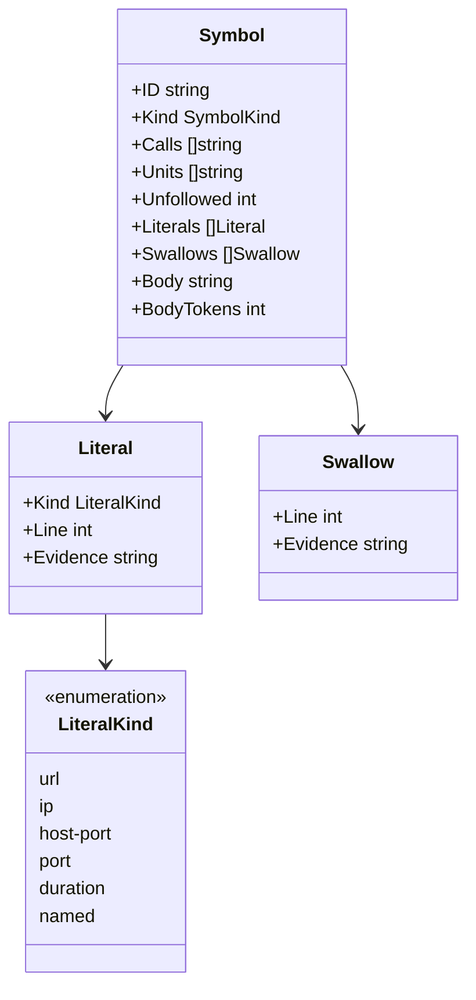

# ルール: `code/`

## 目的

`code/` ルールは製品のコードに次の3つを足す変更を止めます。どれも、その変更の差分だけを見ると問題が無く、あとで別の場所で困る書き方です。

| 書き方 | あとで困ること |
|---|---|
| 設定に置く値をコードに書く | 次の環境や、次に値を変える人が、すべての写しを探すことになる |
| 捕まえたエラーを捨てる | 失敗が黙って消え、問題が別の場所で表に出る |
| 同じ本体の関数を作る・片方だけ直す | 直しを2回することになる。片方だけ直すと、写しにバグが残る |

エージェントはこれらをよく書きます。目の前の値でコードは動きますし、エージェントは目の前の機能に要るものを書くからです。

ほかのルールと同じく、チェックを落とすのは変更が悪くしたものだけです。base にすでにあるものは止めません。

## ルール

| ルール | 種類 | 悪化になるとき |
|---|---|---|
| `code/config-literal` | 見つけるルール | 関数の中の、設定に置く値が増える |
| `code/swallowed-error` | 見つけるルール | 関数の中の、エラーを捨てる場所が増える |
| `code/duplicate` | base と比べて見つけるルール | 本体が同じ関数の組が、base の組より大きくなる |
| `code/diverged-copy` | base と比べて見つけるルール | base で本体が同じだった関数のうち、一部だけが変わり、残りが base の本体のまま |

どれも既定で有効です。測るのは製品のコードの関数とメソッドだけで、テストのファイルと生成されたファイルは測りません。

対象の言語は関数を持つ Go・TypeScript・JavaScript・Python・Rust・Java・Kotlin です。Terraform・Ansible・SQL は対象にしません。Terraform と Ansible は、ファイルそのものが設定です。SQL には、ここで扱う関数とエラーの形がありません。

### 悪化にするのは確実に言えるものだけ

3つのルールはどれも形から判断します。形から確実に言えないものは報告しません。例: Go で `_` に捨てた値の型が分からないとき、`code/swallowed-error` は報告しません。

- 報告しなかったものを `unknown`（終了コード `3`）にもしません。型の分からない呼び出しはどのコードにもたくさんあり、`unknown` にすると変更のたびに人の確認が要るからです
- そのため、これらのルールは見逃すことがあります。見逃しは、誤って落とすことより害が小さいと判断しています

## `code/config-literal`

- **見つけるもの**: 製品のコードの関数の中に書いた、設定に置く値（下の「見つける形」）
- **なぜ困るか**: 値はその場では動きます。次の環境や、次に値を変える人が、コードの中のすべての写しを探すことになります
- **直し方**: リポジトリが設定を読む場所（設定のファイル、環境変数、設定の型）から読みます。どの環境でも同じ値で、変えるつもりもないなら、名前の付いた定数にします

### 見つける形

形ごとに、どれだけ確実に言えるかが違います。確実に言える形だけを組み込みにし、そうでない形は、リポジトリが名前を挙げたときだけ見つけます。

| 形 | 例 | 組み込み |
|---|---|---|
| スキームとホストのある URL | `"https://api.shop.internal/v1"`、`"redis://cache:6379"` | ○ |
| IP アドレス | `"10.0.0.12"`、`"fe80::1"` | ○ |
| ホストとポート | `":8080"`、`"db.internal:5432"` | ○ |
| ポートを取る呼び出しや名前に渡した数 | `app.listen(8080)`、`new ServerSocket(8080)`、`port=8080` | ○ |
| リテラルから作った時間、時間の上限の名前に渡した数 | `30 * time.Second`、`Duration.ofSeconds(30)`、`timedelta(seconds=30)`、`timeout: 5000` | ○ |
| リポジトリが名前を挙げた引数・フィールドへのリテラル | `pageSize: 50`、`max_retries=5`、`bucket = "uploads"` | 設定に書いたときだけ |

- **文字列の形**（URL・IP アドレス・ホストとポート）は、言語に依らず文字列の中身だけで決まります。判定は全言語で1つです（下の「解析結果」）
  - 判定するのは、文字列のリテラル全体です。文の途中に URL がある文字列は数えません。例: `"see https://docs.shop.internal/guide"` のようなエラーの文言。ASCII でない文字を含む文字列も、説明の付いた例（`"https://host/pull/123（URL で取り込み）"` のような入力欄の見本）なので数えません
  - 値を埋め込んだ文字列（`` `https://${host}/v1` ``、`f"https://{host}"`）は数えません。ホストが実行するまで決まらないからです
  - URL はスキーム（`http`・`https`・`ws`・`wss`・`grpc`・`redis`・`postgres` など）とホストの両方があるものだけです。`/v1/orders` のようなパスだけの文字列は数えません
  - 例示のために予約されたホストは数えません。`example.com`・`example.org`・`example.net` と、`.example`・`.test`・`.invalid` で終わるホストです（RFC 2606・RFC 6761）。どの環境もそこへは接続しないからです
  - 名前空間として使う URL は数えません。例: `http://www.w3.org/2000/svg`、`http://json-schema.org/draft-07/schema#`。これらは接続先ではなく識別子だからです。名前空間のホストの一覧は組み込みで持ちます
  - どのマシンでも同じ意味の番地は、ポートが付かないときは数えません。`localhost`・`127.0.0.1`・`0.0.0.0`・`::1`・`::`・`255.255.255.255` です。コードはこれらと比べたり、相対の URL を読むときの基準（`new URL(path, "http://localhost")`）にしたりします。ポートが付いたもの（`"127.0.0.1:3000"`、`"http://localhost:3000"`）は、待ち受けや接続の先なので数えます
- **ポートと時間**は、どの呼び出しかを言語ごとに知る必要があります。アダプタが自分の言語の表を持ちます。危険の分類と同じ持ち方です（[adapters.ja.md](adapters.ja.md) の「危険の分類」）

  | 言語 | 時間の例 | ポートの例 |
  |---|---|---|
  | Go | `30 * time.Second`、`time.Duration(30) * time.Second` | （Go のポートは文字列の `":8080"` で渡すので、文字列の形で見つかる） |
  | TypeScript | `AbortSignal.timeout(5000)` | `app.listen(8080)` |
  | Python | `timedelta(seconds=30)` | |
  | Java | `Duration.ofSeconds(30)`、`TimeUnit.SECONDS.toMillis(30)` | `new ServerSocket(8080)`、`new InetSocketAddress(8080)` |
  | Kotlin | `30.seconds`、`Duration.ofSeconds(30)` | `ServerSocket(8080)` |
  | Rust | `Duration::from_secs(30)` | （`"0.0.0.0:8080"` のように文字列で渡すので、文字列の形で見つかる） |

  表は例で、全体の表は各アダプタにあります。

- **時間の上限とポートの名前**: 引数・キーワード引数・フィールドの名前が時間の上限やポートを表すとき、そこに渡した数を数えます。どの言語でも同じ名前の決まりです
  - 時間の上限: 名前が `timeout` で終わるもの（`timeout`、`readTimeout`、`connect_timeout`）、`timeoutMs`・`timeoutSeconds` で終わるもの、`ttl`
  - ポート: 名前が `port`
  - 例: TypeScript の `{ timeout: 5000 }`、Python の `requests.get(url, timeout=30)` と `app.run(port=8080)`、Kotlin の `embeddedServer(Netty, port = 8080)`、Go の `http.Client{Timeout: …}` のフィールド
- **比べる値、計算に使う時間**: 値を何かと比べたり、時刻の計算に使ったりする場所は数えません。値が接続先や上限ではなく、識別子や計算の部品だからです
  - URL・IP アドレス・ホストとポートは、比べる演算子（`==`・`!=`・`===`・`<` など）の片側にあるとき、テキストを比べる呼び出し（`startsWith`・`strings.HasPrefix`・`strip_prefix`・`includes` など）に渡したときは数えません。`replace` は一覧に入れません。2つ目の引数は差し込む値で、接続先のこともあるからです。例: `u.startsWith("https://github.com/")`
  - 時間は、比べる演算子の片側にあるとき、`+`・`-` で時刻に足し引きするとき（相手も時間なら、上限を組み立てているので数えます。例: `30 * time.Second + 5 * time.Second`）、時刻を動かす呼び出し（`Add`・`Sub`・`plus`・`minus` など）に渡したときは数えません。例: `now - timedelta(days=6)`、`now.Add(-24 * time.Hour)`
  - `+` でつないだ文字列は数えます。`"https://api.shop.internal" + path` は、接続先そのものだからです
  - 呼び出しの名前の一覧は言語に依らない1つの一覧として `facts` に置きます
- **ゼロ**: 時間とポートの 0 は数えません。`timedelta(0)`、`0.seconds`、`timeout: 0`、`port: 0` は「時間を置かない」「どのポートでもよい」という選択で、環境ごとに変わる値ではないからです
- **名前を挙げた引数とフィールド**: 上限やしきい値（ページの大きさ、レートの上限、やり直しの回数）と、環境ごとに違う名前（バケット、キュー、テーブルの接頭辞、機能のフラグ）は、形からは設定に置くべき値と言えません。`limit = 10` は、ループの上限かもしれないからです。リポジトリが `rules.code.config-literal.names` に名前を挙げたときだけ、その名前の引数・フィールド・キーワード引数に渡したリテラルを数えます
  - 名前は小文字にして `_` と `-` を除いてから比べます。`max_retries`・`maxRetries`・`MaxRetries` は同じ名前です

### 数えないもの

| 数えないもの | 理由 |
|---|---|
| 関数の外のコード。ファイルやパッケージの一番上の宣言、クラスのフィールドの初期値 | 名前が、値を変える1か所になっているから |
| 関数の中で名前を付けた定数（Go の `const`、Rust の `const`・`static`） | 同じく、名前が1か所になっているから |
| `rules.code.config-literal.paths` に合うファイル | リポジトリが「設定はここに置く」と決めた場所だから。例: `config/**`、`internal/settings/**` |
| コメントと doc の中の文字列 | 実行されないから |
| 比べる値、時刻の計算に使う時間 | 接続先や上限ではなく、識別子や計算の部品だから（上の「見つける形」） |

- 名前の付いた定数を数えないのは、名前を付ければ「すべての写しを探す」問題は解けるからです。その値が環境ごとに変わるべきかは、hadome には分かりません
- 定数にするだけで通ることになります。それでも、値が1か所にまとまるので、変更の前より悪くはなりません

### 数え方

- 項目は値ごとに1つです。項目の行は値の行で、メッセージには値のソースを書きます
- 項目のアンカーは値のある関数（シンボル）の ID です。そのため、エンジンは関数ごとに項目の数を比べます。同じ指紋の項目は数で突き合わせるからです（[engine.ja.md](engine.ja.md) の「バージョンをまたいで違反を突き合わせる」）。関数の中の値が base より増えたら悪化です
- 関数ごとの数で比べるのは、値を書いた行を少し直しただけで、前からある値が新しい違反に見えないようにするためです。例: `fetch("https://api.shop.internal/v1")` を `fetch("https://api.shop.internal/v1", opts)` に直しても悪化になりません
- 項目を関数ごとに1つにまとめないのは、例外コメントがその値だけを抑えるようにするためです。関数に1つの項目だと、例外コメントが関数の全体を抑え、あとでその関数に足した値も通ってしまいます

### 例外

接続先が決まっていて変えることがない値（公開された有名な API など）を関数の中に書くときは、理由つきの例外を書きます。

```go
func fetchTime(ctx context.Context) (time.Time, error) {
	// gate:allow code/config-literal reason: the public time server every installation uses
	return get(ctx, "https://time.vendor.net/now")
}
```

## `code/swallowed-error`

- **見つけるもの**: 捕まえた、または返されたエラーを、返しも、投げ直しも、包みも、記録もせずに捨てる場所
- **なぜ困るか**: 失敗が黙って消えます。変更はテストを通り、問題はあとで別の場所に現れます
- **直し方**: エラーを返すか、包んで投げ直します。捨てるのが意図なら（後始末で失敗してもかまわないときなど）、理由つきの例外を書きます

### 見つける形

| 言語 | 形 | 例 |
|---|---|---|
| TypeScript・JavaScript・Java・Kotlin | 空か、コメントだけの `catch` の本体 | `try { await store.save(order) } catch (e) {}` |
| TypeScript・JavaScript | 本体が空の関数を渡した `.catch` | `video.play().catch(() => {})` |
| Python | すべてのエラーを捕まえ、本体が `pass` か `...` だけの `except` | `except Exception: pass`、`except: pass` |
| Go | 戻り値の最後が `error` と分かる呼び出しの、その `error` を `_` に入れる代入 | `_ = store.Close()`、`n, _ := strconv.Atoi(s)` |
| Rust | 値を使わない `.ok()` の式の文 | `tx.send(msg).ok();` |

- **コメントだけの `catch`**: コメントは理由の代わりになりません。理由は例外コメントに書きます。例外コメントにすれば、新しい例外として人の確認に回ります
- **ログを書くだけの `catch`**: 報告しません。本体に文が1つでもあれば、エラーを何かに使っています。ログに残すのが十分かは、形からは判断できません
- **捨てる意図を名前で書いたもの**: 捕まえたエラーの名前が `_`・`_` で始まる名前・`ignored`・`ignore`・`expected`・`unused` のものは報告しません。例: Kotlin の `catch (_: IOException) {}`、Java の `catch (IOException ignored) {}`。Rust の `let _ =`（下）と同じく、名前が作者の意図の表明だからです
- **Python の狭い `except`**: 報告しません。`except KeyError: pass` のように特定のエラーを名指しするのは、許可を得るより許しを請う（EAFP）Python のふつうの書き方で、作者はそのエラーを予期しています。報告するのは、何でも捕まえる `except:` と、`Exception`・`BaseException` を名指しするもの（組の中にあるときも）だけです
- **Go の `error` の判定**: 呼び出し先の宣言の戻り値の型を読みます。型の検査はしません（[adapters.ja.md](adapters.ja.md) の「各言語の読み方」）
  - リポジトリの関数とメソッドは、宣言から読みます
  - 標準ライブラリの関数とメソッドは、アダプタの表から読みます。例: `os.Remove`、`json.Unmarshal`、`strconv.Atoi`、`(*sql.Tx).Rollback`
  - `fmt.Fprintf` などの `fmt` の書き出しは表に入れません。`_, _ = fmt.Fprintf(w, …)` は、応答や端末への書き込みが失敗してもかまわないことを表す Go の決まった書き方で、報告するとほかのものが埋もれるからです
  - 呼び出し先の型が分からないときは、報告しません
- **Rust の `let _ =`**: 報告しません。Rust では、`Result` を使わないとコンパイラが警告します。`let _ =` は、それを黙らせるために書く、捨てるという意図を示すものです。また、右辺が `Result` かを、型の検査をせずに確実には言えません

### 数え方

数え方は `code/config-literal` と同じです。項目はエラーを捨てる場所ごとに1つで、アンカーは関数の ID です。関数の中のエラーを捨てる場所が base より増えたら、悪化になります。

## `code/duplicate`

- **見つけるもの**: 本体が同じ、製品のコードの関数とメソッドの組
- **なぜ困るか**: 直すときに、同じ直しを2か所にすることになります。片方を忘れると、写しにバグが残ります
- **直し方**: 片方を消し、残したほうを呼びます。どう共通にするかは作者が決めます

### 本体の比べ方

本体は `tests/duplicate` と同じく字句の並びで比べます（[adapters.ja.md](adapters.ja.md) の「本体の指紋」）。範囲は引数から本体の終わりまでです。

| 指紋に入れないもの | 例 |
|---|---|
| 関数の名前とレシーバ | `billing.roundTotal` と `invoice.roundTotal` |
| コメントと空白 | |
| 引数と局所変数の名前 | `func(total float64)` と `func(sum float64)` |

- 引数と局所変数は、出てきた順に番号へ置き換えます。名前を変えただけの写しも、写しとして見つけるためです
- 関数の外の名前は置き換えません。例: パッケージの名前、パッケージの変数、フィールド、呼び出す関数。これらは本体の意味を決めるからです。局所変数と同じ名前のフィールド（`self.total`、`this.total`）も置き換えません
- リテラルは値ごと入れます。値が1つでも違えば、別の関数です
- 引数と戻り値の型は入れます。`func(a int) int` と `func(a float64) float64` は、本体が同じでも別の関数です。型の引数（Go の `[T any]`）と、引数の前に書く戻り値の型（Java の `int total(…)`）も入れます
- 文の区切りは入れます。Go の改行（`;` として読む位置）と Python の字下げのブロックの終わりです。区切りを除くと、`a; b(c)` と `a(b, c)` のように別の文の並びが同じ指紋になることがあるからです

### 写しとみなす組

- **同じファイルの組**: 本体が同じなら写しです。同じ名前が同じものを指すからです
- **別のファイルの組**: 本体が同じでも、次のすべてを満たすときだけ写しとみなします。Go の同じパッケージのファイルどうしも同じです。ファイルごとに import が違えば、同じ名前が別のパッケージを指すからです
  - 呼び出し先（`Symbol.Calls`）の集合が同じ
  - 値を使うユニット（`Symbol.Units`）の集合が同じ
  - どちらにも、型が分からない値の呼び出し（`Symbol.Unfollowed`）が無い
- 条件を付ける理由は `tests/duplicate` と同じです。ファイルが違えば、同じ字句が別のものを指すことがあります。例: ファイルごとに別のモジュールから import した `round`
- **一緒にビルドされない Go のファイル**: 写しとみなしません。`cpu_freebsd.go` と `cpu_netbsd.go` のように、ビルドの条件（[adapters.ja.md](adapters.ja.md) の「ビルドの条件」）が同時に成り立たないファイルの関数は、OS ごとのバージョンで、写しではないからです

### 小さい関数

小さい関数は比べません。1行の getter や、引数を渡すだけの包みは、同じ本体でもふつうのコードだからです。

- 指紋の字句の数が `rules.code.duplicate.min-tokens`（既定 50）より少ない関数は比べません
- 字句で数えるのは、行の数が書き方（改行の位置）で変わるからです

### 数え方

項目は写しの組ごとに1つです。項目の位置はファイルと行の順で最初の関数です。

どの組が新しいかは、base を見て決めます。そのため `BaseFindingRule` として `FindAgainst(base, head)` で判定します（[engine.ja.md](engine.ja.md) の「base と比べて見つけるルール」）。head の組は次の2つのどちらよりも大きいときに報告します。

| base の組 | 比べる理由 |
|---|---|
| head の組と同じ本体の組 | 写しの名前を変えたり、別の場所へ動かしたりしても、新しい組にしないため |
| head の組の関数が、base で入っていた組（同じ ID の関数が入っていた組） | 写しをすべて同じように直すと、本体が変わっても新しい組にしないため |

- base にある写しの組は、それだけでは落ちません
- 写しの組をすべて同じように直しても落ちません。直しの前より写しが増えていないからです
- base にある組に3つ目を足すと落ちます
- 本体を指紋で比べるだけだと、写しをすべて同じように直したときに、新しい本体の組が新しい違反に見えます。これを避けるのが、base を見て決める理由です
- 組と関数は、Go のビルドの条件も含めて突き合わせます。`round_linux.go` と `round_windows.go` には同じ ID の関数があるので、ID だけで突き合わせると、Linux の組を Windows の組と取り違えるからです

## `code/diverged-copy`

- **見つけるもの**: base で本体が同じだった関数の組のうち、変更が一部だけを変え、残りが base の本体のままのもの
- **なぜ困るか**: 片方を直したということは、写しにも同じ直しが要るかもしれません。差分には写しが出てこないので、レビューでも気づけません
- **直し方**: 残した写しにも同じ直しをするか、片方を消して残したほうを呼びます。別々に変わってよい写しなら、理由つきの例外を書きます

例: base で `billing.roundTotal` と `invoice.roundTotal` の本体が同じです。変更が `billing.roundTotal` の丸めだけを直すと、`invoice.roundTotal` を報告します。

```text
billing.roundTotal changed; invoice.roundTotal still has the body it had
```

### 判定

base を見ないと判定できないので、`BaseFindingRule` として `FindAgainst(base, head)` で判定します（[engine.ja.md](engine.ja.md) の「base と比べて見つけるルール」）。

1. base で、`code/duplicate` と同じ決まりで写しの組を作ります
2. 組の関数を、head で同じ ID（ユニットと名前）のものと突き合わせます。同じ ID の関数が base か head に複数あるとき（ビルドの条件ごとのバージョン、オーバーロード）は、同じファイルの1つだけを選びます。選べないときは、その関数を突き合わせから外します。どれになったかが分からないからです
3. head で本体が変わった関数が1つ以上あり、base の本体のまま残った関数も1つ以上あれば、残った関数を報告します。報告するのは、変わった関数と直接に写しの関係にある関数だけです。組は3つ目の関数を通してつながることがあり、組の中の2つが互いに写しでないこともあるからです

| head での組の様子 | 報告 |
|---|---|
| どれも変わらない | しない |
| どれも同じように変わる | しない（まだ写しなので、`code/duplicate` が扱う） |
| どれも変わる（別々に） | しない |
| 一部が変わり、残りは base のまま | base のまま残った関数を報告する |
| 一部が消え、残りは base のまま | しない（写しを消したのは、まとめた結果） |

- 1つだけを報告しないのは、組の中のどれが直すべき写しかを hadome は知らないからです。変わらなかった関数を、それぞれ報告します
- 片方を共通の関数に置き換えている途中（片方が新しい関数を呼び、もう片方が base のまま）も報告します。写しにはまだ古い本体が残っているからです
- 項目のアンカーは残った関数のシンボルの ID です。例外コメントはその関数に書きます

## 設定

```yaml
rules:
  code:
    config-literal:
      paths: ["config/**", "internal/settings/**"] # 設定を置く場所。足すには人の確認が要る
      names: [pageSize, max_retries, bucket]       # 値を数える引数・フィールドの名前。消すには人の確認が要る
    duplicate:
      min-tokens: 50                               # 比べる関数の最小の字句の数。上げるには人の確認が要る
```

| キー | 緩める向き（人の確認が要る） | 理由 |
|---|---|---|
| `config-literal.paths` | 足す | 数えないファイルが増える |
| `config-literal.names` | 消す | 数える値が減る |
| `duplicate.min-tokens` | 上げる | 比べる関数が減る |

緩める変更は `config/loosened`（終了コード `3`）になります。ルールそのものを止める設定はありません。ほかのルールと同じく、当てはまらない場所には理由つきの例外を書きます。

## 解析結果



| 解析結果 | 誰が埋めるか | 使うルール |
|---|---|---|
| `Symbol.Literals` | アダプタ。関数の中の、設定に置く値。文字列の形と名前の判定は `facts` の共通の関数に任せる | `code/config-literal` |
| `Symbol.Swallows` | アダプタ。関数の中の、エラーを捨てる場所 | `code/swallowed-error` |
| `Symbol.Body`・`BodyTokens` | アダプタ。製品のコードの関数とメソッドの本体の指紋（ハッシュ）と、その字句の数 | `code/duplicate`、`code/diverged-copy` |
| `Symbol.Calls`・`Units`・`Unfollowed` | アダプタ。すでにある解析結果 | `code/duplicate`、`code/diverged-copy` |

- **文字列の形と名前の判定を `facts` に置く理由**: URL・IP アドレス・ホストとポート・時間の上限とポートの名前は、言語に依らない判定です。各アダプタに同じ判定を書くと、言語ごとに結果がずれます（[.hadome.yml](../../.hadome.yml) の `same-rules-every-language`）。`facts` はどのユニットからも import できるので、新しい依存の矢印が要りません
- **アダプタが判定まで済ませる理由**: すべての文字列リテラルを解析結果にすると、解析結果が大きくなりすぎます。2つのバージョンの解析結果を同時に持つからです（[analysis-reuse.ja.md](analysis-reuse.ja.md)）
- **指紋をハッシュで持つ理由**: 関数はテストより多く、字句の並びをそのまま持つと解析結果が大きくなるからです。`Test.Body` は今のままにします
- `config-literal.names` は、アダプタが読む設定です。解析を使い回す鍵に入れます（[analysis-reuse.ja.md](analysis-reuse.ja.md) の「アダプタが読める設定」）

## 自己テストの事例

| ルール | 事例 |
|---|---|
| `code/config-literal` | 関数の中に URL を足すと落ちる · スキームの無いパスは通る · 名前空間の URL は通る · 文の途中の URL は通る · 一番上の定数に URL を足すと通る · 関数の中の定数に URL を足すと通る · `paths` に合うファイルに URL を足すと通る · 同じ関数に2つ目の URL を足すと落ちる · URL のある行を直しても数が同じなら通る · URL を持つ関数を動かしても通る · `30 * time.Second` を足すと落ちる · ホストとポートを足すと落ちる · `names` に挙げたフィールドへのリテラルは落ちる · `names` に挙げていないフィールドへのリテラルは通る · テストのファイルの URL は通る · 理由つきの例外は人の確認になる · 例外コメントはその場所だけを抑え、下に足した URL は落ちる · `paths` を足すと人の確認になる · 関数に URL を足すと、TypeScript・Python・Java・Kotlin・Rust のどれでも落ちる |
| `code/swallowed-error` | リポジトリの関数の `error` を `_` に入れると落ちる · 同じ関数で2つ目の `error` を捨てると落ちる · `error` でない戻り値を `_` に入れても通る · インターフェースを通した呼び出しの値を `_` に入れても通る · 標準ライブラリの関数の `error` を捨てると落ちる · `n, _ := strconv.Atoi(s)` は落ちる · 既存の捨てた `error` を動かしても通る · 理由つきの例外は人の確認になる · 空の catch を足すと、TypeScript・Python・Java・Kotlin・Rust のどれでも落ちる |
| `code/duplicate` | ある OS のファイルの組の両方を直すと通る · 別の OS のファイルに組があっても、ある OS のファイルに写しを足すと落ちる · 既存の関数の写しを足すと落ちる · 呼び出し先が同じ別のパッケージの写しは落ちる · リテラルを1つ変えた関数は通る · 引数の型だけ違う関数は通る · `min-tokens` より小さい写しは通る · base にある写しの組は通る · 組に3つ目を足すと落ちる · 写しの名前を変えても通る · 組の写しをすべて同じように直すと通る · テストのファイルの写しは通る · `min-tokens` を上げると人の確認になる · 変数の名前を変えた TypeScript の写しは落ちる · リテラルの違う TypeScript の関数は通る |
| `code/diverged-copy` | 別の OS のファイルにも同じ名前がある写しを消すと通る · 組の片方だけを直すと、もう片方を報告する · 両方を同じように直すと通る · 両方を別々に直すと通る · 片方を消すと通る · base で写しでなかった関数は報告しない · 残した写しに理由つきの例外を書くと人の確認になる · TypeScript の写しの片方だけを直すと、もう片方を報告する |

## 不変条件

1. base にすでにある設定の値、エラーを捨てる場所、写しは、どこへ動いても止めません
2. 同じ変更はどの対象の言語でも同じルールで落ちます
3. 形から確実に言えないものは、悪化にも人の確認にもしません
4. テストのファイルと生成されたファイルは、決して測りません

## 意図して入れなかったもの

- **すべてのマジックナンバー**: ループの上限、添字、小さな定数はふつうのコードです。本当の問題を見つけるより、はるかに多く落とします
- **環境のファイルやデプロイの定義を読んで、どの値が設定済みかを見ること**: hadome はリポジトリしか読みません。それらはリポジトリの外にあることが多いからです
- **関数の外のコードの値**: 一番上の宣言やクラスのフィールドは名前を持ち、値を変える1か所になっています。名前の無い一番上の文（スクリプトの `app.run(port=8080)` など）は見逃します
- **リポジトリのほかの場所と違うエラーの扱い**（ある場所では包み、別の場所では包まない）: 書き方の好みで、正解が1つではありません。リポジトリの書き方を学ぶと、結果が base と head 以外のものに左右されます
- **Go の `if err != nil { return nil }`**: 「見つからない」を表すためにわざと書くことが多く、形からは区別できません
- **Go の、戻り値の `error` を受け取らない呼び出しの文**（`store.Close()` だけの行）: `defer f.Close()` のように、ふつうに書く形が多すぎます。errcheck のような専用の道具に任せます
- **lint を黙らせるコメント（`# noqa: BLE001` など）を例外として読むこと**: 例外コメントは `gate:allow` に1つにまとめます。理由の書かれていないコメントを読むと、理由の無い例外が効くことになります
- **似ている関数を、似ている度合いで見つけること**: しきい値があると、小さな編集で結果が変わります。2つの関数をなぜ似ていると数えたかを、メッセージで説明するのも難しくなります
- **共通にする関数を提案すること**: hadome が報告するのは悪化です。どう共通にするかは作者が決めます
- **依存関係図が分けているユニットどうしの写しを見逃すこと**: 共通にするには新しい矢印が要るので、写しを残す理由にはなります。それでも写しには同じバグが残るので、見逃さずに報告します。分けておく理由は例外コメントに書きます。結果が依存関係図の設定に左右されないようにする意味もあります
