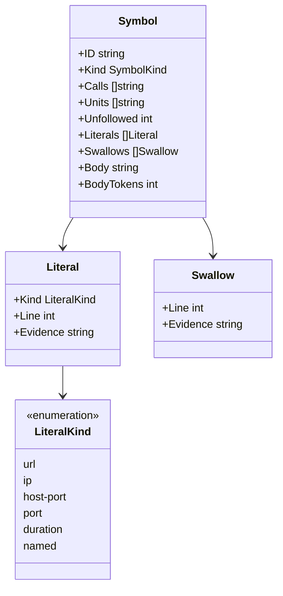

# Rules: `code/`

## Purpose

The `code/` rules stop a change that adds one of three things to product code. Each looks fine in the change's own diff and hurts later, somewhere else.

| What is written | What hurts later |
|---|---|
| A value that belongs in configuration, written into code | The next environment, or the next person who changes the value, has to find every copy |
| An error caught and dropped | The failure disappears without a trace, and the problem shows up somewhere else |
| A function with the same body as another, or a fix to only one of two copies | Every fix has to be made twice. A fix to one copy leaves the bug in the other |

Agents write these often: the value in front of them works, and they write what the feature in front of them needs.

Like every rule, these fail only what a change makes worse. What is already on base never fails.

## The rules

| Rule | Kind | Regression when |
|---|---|---|
| `code/config-literal` | finding | a function gains configuration values |
| `code/swallowed-error` | finding | a function gains places that drop an error |
| `code/duplicate` | finding against base | a group of functions with the same body grows larger than its group on base |
| `code/diverged-copy` | finding judged against base | of functions whose bodies were the same on base, some change and the rest keep the base body |

All are on by default. They measure the functions and methods of product code only, never test files or generated files.

The languages are the ones with functions: Go, TypeScript, JavaScript, Python, Rust, Java and Kotlin. Terraform, Ansible and SQL are left out. Terraform and Ansible files are configuration themselves. SQL has none of the function and error shapes these rules read.

### Only what is certain is a regression

All three rules judge by shape. What the shape does not settle is not reported. Example: when the type of a value a Go assignment drops into `_` is unknown, `code/swallowed-error` does not report it.

- What is not reported is not `unknown` (exit `3`) either. Calls of unknown type are everywhere, and reporting them as `unknown` would need a person's review on every change
- So these rules can miss things. A miss does less harm than failing a change wrongly

## `code/config-literal`

- **Finds**: a value that belongs in configuration, written inside a function in product code (see "Shapes it finds")
- **Why**: the value works where it is. The next environment, or the next person who changes the value, has to find every copy in the code
- **Fix**: read it from where the repository reads its configuration (a configuration file, an environment variable, a configuration type). If the value is the same in every environment and is not meant to change, make it a named constant

### Shapes it finds

Shapes differ in how certain they are. Only the certain ones are built in; the rest are found only when the repository names them.

| Shape | Example | Built in |
|---|---|---|
| A URL with a scheme and a host | `"https://api.shop.internal/v1"`, `"redis://cache:6379"` | yes |
| An IP address | `"10.0.0.12"`, `"fe80::1"` | yes |
| A host and port | `":8080"`, `"db.internal:5432"` | yes |
| A number passed to a call or a name that takes a port | `app.listen(8080)`, `new ServerSocket(8080)`, `port=8080` | yes |
| A duration built from a literal, or a number passed to a name for a time limit | `30 * time.Second`, `Duration.ofSeconds(30)`, `timedelta(seconds=30)`, `timeout: 5000` | yes |
| A literal passed to an argument or field the repository names | `pageSize: 50`, `max_retries=5`, `bucket = "uploads"` | only when configured |

- **String shapes** (URL, IP address, host and port) depend only on the string, in any language. One check serves every language (see "Facts")
  - The check looks at the whole string literal. A string with a URL in the middle of a sentence does not count. Example: an error message such as `"see https://docs.shop.internal/guide"`. A string with characters outside ASCII does not count either: it is an example with an explanation, such as an input's placeholder `"https://host/pull/123 (paste the URL)"` written in another language
  - A string with a value filled in (`` `https://${host}/v1` ``, `f"https://{host}"`) does not count: its host is decided at run time
  - A URL counts only with both a scheme (`http`, `https`, `ws`, `wss`, `grpc`, `redis`, `postgres` and so on) and a host. A path alone, such as `/v1/orders`, does not count
  - Hosts reserved for examples do not count: `example.com`, `example.org`, `example.net`, and hosts ending in `.example`, `.test` or `.invalid` (RFC 2606, RFC 6761). No environment connects to them
  - URLs used as namespaces do not count. Examples: `http://www.w3.org/2000/svg`, `http://json-schema.org/draft-07/schema#`. They are identifiers, not endpoints. The list of namespace hosts is built in
  - Addresses that mean the same on every machine do not count without a port: `localhost`, `127.0.0.1`, `0.0.0.0`, `::1`, `::` and `255.255.255.255`. Code compares with them, or parses a relative URL against one (`new URL(path, "http://localhost")`). With a port (`"127.0.0.1:3000"`, `"http://localhost:3000"`) they are somewhere to listen or connect, and count
- **Ports and durations** need to know, per language, which call it is. Each adapter keeps a table for its language, the same way it keeps the hazard table ([adapters.md](adapters.md), "Hazard categories")

  | Language | Durations, for example | Ports, for example |
  |---|---|---|
  | Go | `30 * time.Second`, `time.Duration(30) * time.Second` | (Go passes ports as a string such as `":8080"`, found by the string shapes) |
  | TypeScript | `AbortSignal.timeout(5000)` | `app.listen(8080)` |
  | Python | `timedelta(seconds=30)` | |
  | Java | `Duration.ofSeconds(30)`, `TimeUnit.SECONDS.toMillis(30)` | `new ServerSocket(8080)`, `new InetSocketAddress(8080)` |
  | Kotlin | `30.seconds`, `Duration.ofSeconds(30)` | `ServerSocket(8080)` |
  | Rust | `Duration::from_secs(30)` | (passed as a string such as `"0.0.0.0:8080"`, found by the string shapes) |

  The table shows examples; the full tables live in each adapter.

- **Names of time limits and ports**: a number passed to an argument, keyword argument or field whose name says it is a time limit or a port counts. The names are the same in every language
  - Time limits: names ending in `timeout` (`timeout`, `readTimeout`, `connect_timeout`), names ending in `timeoutMs` or `timeoutSeconds`, and `ttl`
  - Ports: the name `port`
  - Examples: TypeScript `{ timeout: 5000 }`, Python `requests.get(url, timeout=30)` and `app.run(port=8080)`, Kotlin `embeddedServer(Netty, port = 8080)`, the field of Go `http.Client{Timeout: …}`
- **Values compared, durations calculated with**: a value compared with something, or used to calculate a time, does not count. It is a mark to recognise or a part of a calculation, not somewhere to connect or a limit
  - A URL, IP address or host and port does not count on one side of a comparison operator (`==`, `!=`, `===`, `<` and so on), or given to a call that compares text (`startsWith`, `strings.HasPrefix`, `strip_prefix`, `includes` and so on). `replace` is not on the list: its second argument is the value put in, which may be an endpoint. Example: `u.startsWith("https://github.com/")`
  - A duration does not count on one side of a comparison operator, added to or subtracted from a time with `+` or `-` (added to another duration it builds a limit, and counts: `30 * time.Second + 5 * time.Second`), or given to a call that moves a time (`Add`, `Sub`, `plus`, `minus` and so on). Examples: `now - timedelta(days=6)`, `now.Add(-24 * time.Hour)`
  - A string joined with `+` counts. `"https://api.shop.internal" + path` is the endpoint itself
  - The names of the calls are one list for every language, kept in `facts`
- **Zero**: a duration or port of 0 does not count. `timedelta(0)`, `0.seconds`, `timeout: 0` and `port: 0` are choices ("no wait", "any port"), not values that differ by environment
- **Named arguments and fields**: limits and thresholds (a page size, a rate limit, a retry count) and names that differ by environment (a bucket, a queue, a table prefix, a feature flag) cannot be told apart by shape from values that belong in code. `limit = 10` may be a loop bound. Only when the repository lists names in `rules.code.config-literal.names` are literals passed to arguments, fields and keyword arguments of those names counted
  - Names are compared in lower case without `_` and `-`: `max_retries`, `maxRetries` and `MaxRetries` are the same name

### What does not count

| Does not count | Why |
|---|---|
| Code outside functions: declarations at the top of a file or package, initial values of class fields | The name is the one place to change the value |
| Constants named inside a function (Go `const`, Rust `const` and `static`) | The same: the name is the one place |
| A file that matches `rules.code.config-literal.paths` | The repository has said its configuration lives there. Examples: `config/**`, `internal/settings/**` |
| Strings in comments and docs | They are not run |
| Values compared, durations used to calculate a time | They are marks to recognise or parts of a calculation, not endpoints or limits (see "Shapes it finds" above) |

- Named constants do not count because a name already solves "find every copy". Whether the value should differ by environment is something hadome cannot know
- Making it a constant is enough to pass. Even so, the value is now in one place, which is no worse than before the change

### How it counts

- One entry per value. The entry's line is the value's line, and the message gives the value's source
- The entry's anchor is the ID of the function (symbol) the value is in. So the engine compares the number of entries per function, since it matches entries with the same fingerprint by count ([engine.md](engine.md), "Matching findings across versions"). A function with more values than on base is a regression
- Counting per function keeps a small edit to a line with a value from making an existing value look new. Example: changing `fetch("https://api.shop.internal/v1")` to `fetch("https://api.shop.internal/v1", opts)` is not a regression
- Entries are not merged into one per function so that an exception marker covers only its value. With one entry per function, a marker would cover the whole function, and a value added to it later would pass too

### Exceptions

A value whose endpoint is fixed and never changes (a well-known public API, for example), written inside a function, takes a reasoned exception.

```go
func fetchTime(ctx context.Context) (time.Time, error) {
	// gate:allow code/config-literal reason: the public time server every installation uses
	return get(ctx, "https://time.vendor.net/now")
}
```

## `code/swallowed-error`

- **Finds**: a place where an error is caught or returned and then neither returned, re-thrown, wrapped nor recorded
- **Why**: the failure disappears without a trace. The change passes its tests, and the problem shows up later somewhere else
- **Fix**: return the error, or wrap and re-throw it. When dropping it is the intent (a cleanup that may fail, for example), write a reasoned exception

### Shapes it finds

| Language | Shape | Example |
|---|---|---|
| TypeScript, JavaScript, Java, Kotlin | A `catch` whose block is empty or holds only comments | `try { await store.save(order) } catch (e) {}` |
| TypeScript, JavaScript | A `.catch` given a function with an empty body | `video.play().catch(() => {})` |
| Python | An `except` that catches every error, whose body is only `pass` or `...` | `except Exception: pass`, `except: pass` |
| Go | An assignment of an `error` to `_`, from a call whose last result is known to be `error` | `_ = store.Close()`, `n, _ := strconv.Atoi(s)` |
| Rust | An expression statement ending in `.ok()`, its value unused | `tx.send(msg).ok();` |

- **A `catch` with only comments**: a comment does not replace a reason. The reason goes in an exception marker, which sends it to a person's review as a new exception
- **A `catch` that only logs**: not reported. A block with any statement uses the error for something. Whether logging is enough cannot be told from the shape
- **An error named to say it is dropped**: a caught error named `_`, a name starting with `_`, `ignored`, `ignore`, `expected` or `unused` is not reported. Examples: Kotlin `catch (_: IOException) {}`, Java `catch (IOException ignored) {}`. As with Rust's `let _ =` (below), the name is the author's statement of intent
- **A narrow Python `except`**: not reported. Naming one error, as in `except KeyError: pass`, is how Python asks forgiveness rather than permission (EAFP): the author expected that error. Only a bare `except:` and an `except` naming `Exception` or `BaseException` (also inside a tuple) are reported
- **Telling an `error` in Go**: the adapter reads the result types from the callee's declaration, without type checking ([adapters.md](adapters.md), "How each language is read")
  - Functions and methods in the repository: from their declarations
  - Standard library functions and methods: from the adapter's table. Examples: `os.Remove`, `json.Unmarshal`, `strconv.Atoi`, `(*sql.Tx).Rollback`
  - fmt's writes such as `fmt.Fprintf` are left out of the table. `_, _ = fmt.Fprintf(w, …)` is how Go code says a write to a response or a terminal may fail unseen, and reporting each would bury everything else
  - When the callee's type is unknown, nothing is reported
- **Rust `let _ =`**: not reported. Rust warns about an unused `Result`, and `let _ =` is what one writes to silence that warning: a sign that dropping it is the intent. Nor can it be said for certain, without type checking, that the right-hand side is a `Result`

### How it counts

The same as `code/config-literal`: one entry per place that drops an error, anchored to the function's ID. A function with more such places than on base is a regression.

## `code/duplicate`

- **Finds**: a group of functions and methods in product code with the same body
- **Why**: every fix has to be made in two places. Forget one, and the bug stays in the copy
- **Fix**: delete one and call the other. How to share the code is the author's decision

### Comparing bodies

Bodies are compared as a sequence of tokens, the way `tests/duplicate` compares them ([adapters.md](adapters.md), "The body's fingerprint"), from the parameters to the end of the body.

| Left out of the fingerprint | Example |
|---|---|
| The function's name and receiver | `billing.roundTotal` and `invoice.roundTotal` |
| Comments and whitespace | |
| Names of parameters and local variables | `func(total float64)` and `func(sum float64)` |

- Parameters and local variables are replaced by numbers in the order they appear, so a copy with renamed variables is still found
- Names from outside the function are kept: package names, package variables, fields, the functions it calls. They decide what the body means. A field with the name of a local variable (`self.total`, `this.total`) is kept too
- Literals are kept with their values. One different value makes a different function
- Parameter and result types are kept. `func(a int) int` and `func(a float64) float64` are different functions, even with the same body. Type parameters (Go's `[T any]`) and a result type written before the parameters (Java's `int total(…)`) are kept too
- Statement boundaries are kept: Go's line ends (where it reads a `;`) and the ends of Python's indented blocks. Without them, different sequences of statements, such as `a; b(c)` and `a(b, c)`, can get the same fingerprint

### Which groups are copies

- **In the same file**: the same body is a copy. The same name means the same thing
- **In different files**: the same body is a copy only when all of these hold. Files of the same Go package are no exception: when each file imports differently, the same name points to a different package
  - the sets of callees (`Symbol.Calls`) are the same
  - the sets of units whose values they use (`Symbol.Units`) are the same
  - neither calls a value of unknown type (`Symbol.Unfollowed`)
- The reason is the one `tests/duplicate` gives: in different files, the same tokens can mean different things. Example: a `round` imported from a different module in each file
- **Go files never built together**: not copies. Functions in files whose build conditions ([adapters.md](adapters.md), "Build conditions") cannot hold at once, such as `cpu_freebsd.go` and `cpu_netbsd.go`, are versions for each operating system, not copies

### Small functions

Small functions are not compared. One-line getters and wrappers that only pass their arguments on are everyday code, even with the same body.

- A function whose fingerprint has fewer tokens than `rules.code.duplicate.min-tokens` (default 50) is not compared
- Tokens rather than lines, because line counts change with formatting (where the line breaks fall)

### How it counts

One entry per group of copies. The entry's position is the first function in file and line order.

Which group is new is decided by looking at base, so the rule is a `BaseFindingRule` and decides in `FindAgainst(base, head)` ([engine.md](engine.md), "Rules that find against base"). A group on head is reported when it is larger than both of these.

| Group on base | Why it is compared |
|---|---|
| The group with the head group's body | so that renaming or moving a copy does not make a new group |
| The group the head group's functions were in (the group the functions with the same IDs were in) | so that changing every copy the same way does not make a new group, even though the body changed |

- A group of copies already on base does not fail on its own
- Changing every copy in a group the same way does not fail. There are no more copies than before the fix
- Adding a third to a group on base fails
- Comparing bodies by fingerprint alone would make the new body's group look like a new violation when every copy is fixed the same way. Avoiding that is why the rule looks at base
- Groups and functions are matched with their Go build conditions. `round_linux.go` and `round_windows.go` hold functions with the same IDs, so matching by ID alone would take the Linux group for the Windows one

## `code/diverged-copy`

- **Finds**: of a group of functions whose bodies were the same on base, the ones left with the base body when the change edits only some of them
- **Why**: a fix to one may be needed in the copy too. The copy is not in the diff, so review does not see it either
- **Fix**: make the same fix in the copy left behind, or delete one and call the other. For copies that may change separately, write a reasoned exception

Example: on base, `billing.roundTotal` and `invoice.roundTotal` have the same body. The change fixes rounding in `billing.roundTotal` only, and `invoice.roundTotal` is reported.

```text
billing.roundTotal changed; invoice.roundTotal still has the body it had
```

### Judging

This cannot be judged without base, so the rule is a `BaseFindingRule` and judges with `FindAgainst(base, head)` ([engine.md](engine.md), "Rules that find against base").

1. On base, build the groups of copies by the same rules as `code/duplicate`
2. Match each function in a group with the function of the same ID on head (its unit and name). When base or head has several functions with that ID (versions under build conditions, overloads), take only the one in the same file. When none can be taken, leave the function out of the matching, since which one it became cannot be told
3. When at least one function's body changed on head and at least one still has the base body, report the functions that still have it. Only functions that are copies of a changed function directly are reported. A group can be joined through a third function, so two functions in it may not be copies of each other

| The group on head | Reported |
|---|---|
| None changed | no |
| All changed the same way | no (still copies; `code/duplicate` handles them) |
| All changed (differently) | no |
| Some changed, the rest kept the base body | yes, each function that kept the base body |
| Some deleted, the rest kept the base body | no (deleting a copy is the result of sharing the code) |

- Not just one is reported because hadome cannot tell which copy in the group needs the fix. Each function that did not change is reported
- Partway through replacing one copy with a shared function (one now calls the new function, the other keeps the base body) is reported too. The copy still has the old body
- The entry's anchor is the symbol ID of the function left behind. An exception marker goes on that function

## Configuration

```yaml
rules:
  code:
    config-literal:
      paths: ["config/**", "internal/settings/**"] # where configuration lives. Adding needs a person's review
      names: [pageSize, max_retries, bucket]       # arguments and fields whose literals count. Removing needs a person's review
    duplicate:
      min-tokens: 50                               # smallest function compared, in tokens. Raising needs a person's review
```

| Key | Loosening direction (needs a person's review) | Why |
|---|---|---|
| `config-literal.paths` | adding | more files go uncounted |
| `config-literal.names` | removing | fewer values are counted |
| `duplicate.min-tokens` | raising | fewer functions are compared |

A loosening change is `config/loosened` (exit `3`). No setting turns a rule off. As with every rule, a place where it truly does not apply takes a reasoned exception.

## Facts



| Fact | Filled by | Used by |
|---|---|---|
| `Symbol.Literals` | the adapter: configuration values inside a function. The string shapes and the names are judged by shared functions in `facts` | `code/config-literal` |
| `Symbol.Swallows` | the adapter: places in a function that drop an error | `code/swallowed-error` |
| `Symbol.Body`, `BodyTokens` | the adapter: the body fingerprint (a hash) of functions and methods in product code, and its number of tokens | `code/duplicate`, `code/diverged-copy` |
| `Symbol.Calls`, `Units`, `Unfollowed` | the adapter: facts that already exist | `code/duplicate`, `code/diverged-copy` |

- **Why the string shapes and the names are judged in `facts`**: URL, IP address, host and port, and the names of time limits and ports do not depend on the language. The same check written in each adapter would drift between languages ([.hadome.yml](../../.hadome.yml), `same-rules-every-language`). Every unit may import `facts`, so no new arrow is needed
- **Why the adapter judges before handing facts over**: making every string literal a fact would make the facts too large, since the facts of two versions are held at once ([analysis-reuse.md](analysis-reuse.md))
- **Why the fingerprint is a hash**: there are more functions than tests, and keeping the token sequence itself would make the facts large. `Test.Body` stays as it is
- `config-literal.names` is configuration the adapters read. It goes into the key for reusing analyses ([analysis-reuse.md](analysis-reuse.md), "The configuration adapters may read")

## Self-test cases

| Rule | Cases |
|---|---|
| `code/config-literal` | a URL added inside a function fails · a path with no scheme passes · a namespace URL passes · a URL in the middle of a sentence passes · a URL added to a constant at the top of the file passes · a URL added to a constant inside the function passes · a URL added in a file matching `paths` passes · a second URL added to the same function fails · editing the line with a URL passes when the number stays the same · moving a function with a URL passes · adding `30 * time.Second` fails · adding a host and port fails · a literal given to a field `names` lists fails · a literal given to a field `names` does not list passes · a URL in a test file passes · a reasoned exception needs a person's review · a marker covers only its own place, and a URL added further down fails · adding to `paths` needs a person's review · a URL added to a function fails in TypeScript, Python, Java, Kotlin and Rust alike |
| `code/swallowed-error` | dropping a repository function's `error` into `_` fails · dropping a second error in the same function fails · dropping a result that is not an `error` into `_` passes · dropping the value of a call through an interface passes · dropping a standard library function's `error` fails · `n, _ := strconv.Atoi(s)` fails · an existing dropped `error` that moved passes · a reasoned exception needs a person's review · an empty catch added fails in TypeScript, Python, Java, Kotlin and Rust alike |
| `code/duplicate` | fixing both copies in one operating system's file passes · a copy added in one operating system's file fails though another file has a pair · adding a copy of an existing function fails · a copy in another package with the same calls fails · a function with one literal changed passes · a function differing only in a parameter type passes · copies smaller than `min-tokens` pass · a group of copies on base passes · adding a third to a group fails · renaming a copy passes · changing every copy in a group the same way passes · a copy in a test file passes · raising `min-tokens` needs a person's review · a TypeScript copy with renamed variables fails · a TypeScript function with another literal passes |
| `code/diverged-copy` | deleting a copy whose name another operating system's file also declares passes · fixing one of a group reports the other · fixing both the same way passes · changing both differently passes · deleting one passes · functions that were not copies on base are not reported · a reasoned exception on the copy left behind needs a person's review · fixing one of two TypeScript copies reports the other |

## Invariants

1. Configuration values, places that drop an error and copies already on base never fail, wherever they move
2. The same change fails the same rule in every language these rules cover
3. What the shape does not settle is neither a regression nor sent to a person's review
4. Test files and generated files are never measured

## Deliberately left out

- **Every magic number**: loop bounds, indexes and small constants are everyday code. It would fail far more often than it would find a real problem
- **Reading environment files or deployment manifests to see which values are configured**: hadome reads only the repository, and those often live elsewhere
- **Values in code outside functions**: declarations at the top and class fields have a name, the one place to change the value. A top-level statement without one (a script's `app.run(port=8080)`) is missed
- **Error handling that differs from the rest of the repository** (wrapping in one place, not in another): a matter of style with no single right answer. Learning the repository's style would make the result depend on more than base and head
- **Go `if err != nil { return nil }`**: often written on purpose to mean "not found", and the shape cannot tell the two apart
- **A Go call statement that does not take its `error` result** (a line with only `store.Close()`): forms such as `defer f.Close()` are too common. A dedicated tool such as errcheck covers this
- **Reading a linter's silencing comment (`# noqa: BLE001` and the like) as an exception**: exceptions are written one way, `gate:allow`. Reading comments that carry no reason would let an exception without a reason take effect
- **Finding similar functions by a similarity score**: a threshold makes the result change with small edits, and a message can hardly explain why two functions counted as similar
- **Suggesting the shared function to extract**: hadome reports regressions. How to share the code is the author's decision
- **Letting off copies across units the dependency diagram keeps apart**: sharing the code would need a new arrow, which is a reason to keep a copy. Still, the copy keeps the same bug, so it is reported. The reason for keeping them apart goes in an exception marker. It also keeps the result independent of the dependency diagram's configuration
