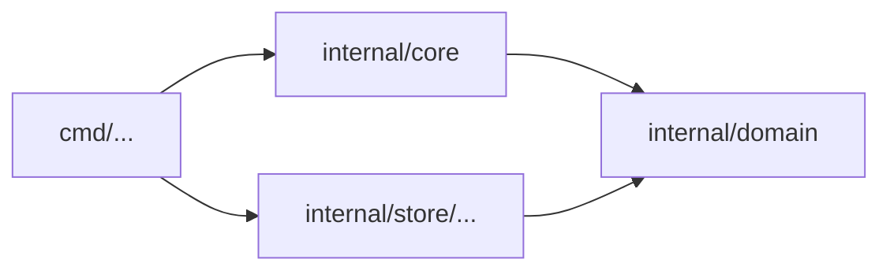

# ルール: `deps/`

## 目的

依存の図はいちばん手軽に書ける設計書だが、いちばん先に古くなる設計書でもある。手近な import が1つずつ入るたびに、コードは図と合わなくなる。`deps/` ルールは、図とコードが食い違ったときに図のほうを正とする。図に描かれていない import は落ち、何も指さない図の箱も落ちる。

## 依存の図

依存の図はリポジトリの Markdown ファイルにある Mermaid の flowchart で、設定でファイルを指す。

```yaml
rules:
  deps:
    diagram: docs/conventions/dependencies.md
```

````markdown

````

- ファイルの `mermaid` ブロックのうち、`flowchart` か `graph` のものをすべて読む
- **ノードのラベル**は、リポジトリのルートからのディレクトリを指す。`dir/...` はそのディレクトリと配下すべてを含む。ラベルの無いノードは ID で指す
- ラベルは改行（`<br/>`）のあとに説明を書ける。ディレクトリを指すのは1行目だけで、説明を直しても矢印が許すものは変わらない（`core["internal/core<br/>規則を持つ"]`）
- **矢印** `a --> b`（`-.->` と `==>` も。`|label|` の有無、連結や `&` も問わない）は、`a` のユニットが `b` のユニットを import することを許す。矢印の無い線（`---`）は何も許さない
- **予定の箱**: クラス `planned` を付けたノード（`api["internal/api"]:::planned`、または `class api planned`）は、まだ作っていないディレクトリを指してよい。設計を先に図に描き、パッケージをあとの変更で作る流れのためだ。見た目は利用者が `classDef planned` で決める（破線など）。描いた図でも予定だと分かるように、コメント（`%%`）ではなくクラスにする
- 予定の箱にも矢印を描ける。矢印を足すときは、ほかの箱と同じく人の確認が要る
- サブグラフ、スタイル、コメント（`%%`）は、`planned` のクラスを除いて無視する
- ユニットは、それを含むノードのうち最も具体的なものに属する。完全なディレクトリが `/...` より先、長い `/...` が短いものより先
- 1つのノードの中の import は常に許される

依存の図は設定だ。設定を読むときに読み、読めない図やパスでないラベルは設定の誤り（終了コード `2`）になる。ほかの設定と同じく head の矢印が両方の版を判定するので、矢印を消しても報告されるのは変更が足した import だけだ。箱が何かを指すかどうかは例外で、各版の箱はその版のツリーと照らすので、変更で足した何も指さない箱は後退になる。ただし予定の箱は除く。base の図にある箱に、head で `planned` を付けることは、緩めることとして数える（人の確認、終了コード `3`）。何も指さなくなった箱を、印1つで後退から外せてしまうからだ。新しい箱を `planned` 付きで足すこと、`planned` を外すことは、緩めることに数えない。矢印を足すこと — あるいはラベルを変えること。ラベルを変えると矢印が許すものが変わる — には人の確認が要る（終了コード `3`）。矢印を消すときは要らない。`rules.deps.diagram` そのものを外すときは要る。すべての import が通るようになるからだ。

## ルール

| ルール | 種類 | 後退になるとき |
|---|---|---|
| `deps/not-in-diagram` | 見つけるルール | リポジトリの2つのユニットの間の import が描かれていない。ノードの間に矢印が無いか、どのノードにも含まれないユニットがある |
| `deps/diagram-stale` | 見つけるルール | 図のノードが、ユニットを1つも持たないディレクトリを指している |

どちらも `rules.deps.diagram` を設定するまでは無効。数えるのは製品のコードの import だけ（テストファイルは製品の依存ではない）で、リポジトリ自身のユニットの間の import だけだ。外部のライブラリは描かない。

### `deps/not-in-diagram`

- **見つけるもの**: ユニット A からユニット B への import のうち、A のノードから B のノードへ矢印が無いもの、または A か B がどのノードにも無いもの
- **なぜ困るか**: 人やエージェントは、何が何に依存してよいかを図で知る。図に描かれていない import は図を誤りにし、次の変更はその誤った図をもとに書かれる
- **直し方**: 図が許すものに依存する（多くは import する側のユニットが宣言するインターフェースを通す）。設計が本当に変わったのなら矢印を描く — 人が確認する変更だ
- アンカーはディレクトリの組なので、import をファイル内で動かしても、同じユニットの別のファイルへ動かしても、同じ見つかったもののまま

### `deps/diagram-stale`

- **見つけるもの**: ラベルがユニットの無いディレクトリを指すノード（書き間違い、またはユニットが動いたか消えた）。予定の箱は除く。逆に、ユニットを指すようになった予定の箱も見つける（パッケージを作ったのに、図はまだ予定と言っている）
- **なぜ困るか**: 何も指さない箱があると、図が完全でないのに完全に見える
- **直し方**: ラベルを直すか、ノードを消す。ディレクトリをまだ作っていないなら、箱に `planned` を付ける。予定の箱がユニットを指すなら、`planned` を外す
- アンカーはラベル

## 事実

| 事実 | 使い道 |
|---|---|
| `Import`（どのユニットから、どのユニットへ、内部か） | どのユニットがどれに依存するか |
| `File.Unit`、`File.Path`、`File.Role` | 各ユニットのディレクトリと、どのファイルが製品のコードか |

## 自己テストの事例

| ルール | 事例 |
|---|---|
| `deps/not-in-diagram` | 矢印に沿った import は通る · 矢印の無い import は落ちる · 描かれていない既存の import は通る · 1つのノードの中の import は通る · どのノードにも無いユニットからの import は落ちる · `/...` のノードは配下を含む · テストファイルの import は通る |
| `deps/diagram-stale` | 無いディレクトリを指すノードは落ちる · 既存のユニットを指すノードは通る |
| `deps/not-in-diagram`（追加） | どのノードにも無い2つのユニットの間の import は落ちる · 矢印を描くと代わりに人の確認が要る |
| `deps/diagram-stale`（追加） | テストしか無いディレクトリを指すノードは落ちる · ユニットをノードから動かすと落ちる |
| `deps/diagram-stale`（予定の箱） | 無いディレクトリを指す予定の箱は通る · `class` の文で付けた予定の箱も通る · ユニットを指す予定の箱は落ちる · base の図にある箱に `planned` を付けると人の確認が要る |

## 不変条件

1. `rules.deps.diagram` が無ければ、ルールは何も見つけない
2. 変更を判定する矢印は、両方の版について head のもの。矢印を描くことは決して黙って通らない

## 意図して入れなかったもの

- ノードの間の循環。何が許されるかは図が決める。図が循環を描けば、その循環は許される
- 推移的な矢印。`a --> b --> c` は `a` が `c` を import することを許さない
- 図の中の外部ライブラリ
- Mermaid の flowchart 以外の図の形式
- 予定の箱の期限。予定のまま長く残っても後退にはしない。予定を取りやめたら箱を消す
