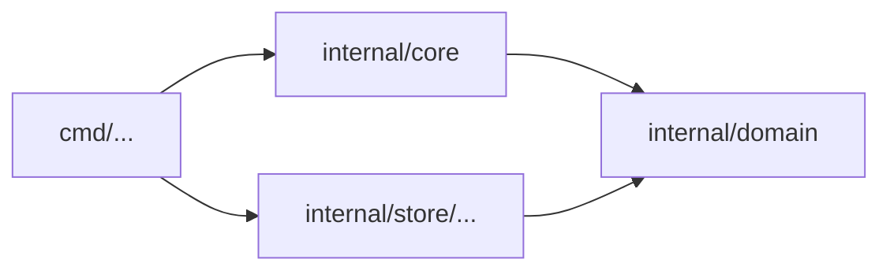

# ルール: `deps/`

## 目的

`deps/` ルールは、依存の図とコードが食い違ったとき、図のほうを正とします。

- 図に描かれていない import は落ちます
- 何も指さない図のノードも落ちます

依存の図はいちばん手軽に書ける設計書です。同時に、いちばん先に古くなる設計書でもあります。手近な import が1つずつ入るたびに、コードは図と合わなくなります。

## 依存の図

依存の図はリポジトリの Markdown ファイルにある Mermaid の flowchart です。設定でそのファイルを指します。

```yaml
rules:
  deps:
    diagram: docs/conventions/dependencies.md
```

````markdown

````

- **読むブロック**: ファイルの `mermaid` ブロックのうち、`flowchart` か `graph` のものをすべて読みます
- **ノードのラベル**: リポジトリのルートからのディレクトリを指します。`dir/...` は、そのディレクトリと配下すべてを含みます。ラベルの無いノードは ID で指します
- **ラベルの説明**: ラベルには改行（`<br/>`）のあとに説明を書けます。ディレクトリを指すのは1行目だけです。そのため、説明を直しても矢印が許すものは変わりません。例: `core["internal/core<br/>規則を持つ"]`
- **矢印**: `a --> b` は、`a` のユニットが `b` のユニットを import することを許します。`-.->` と `==>` も矢印です。`|label|` の有無、連結や `&` も問いません。矢印の無い線（`---`）は何も許しません
- **予定のノード**: クラス `planned` を付けたノードは、まだ作っていないディレクトリを指してかまいません。例: `api["internal/api"]:::planned`、または `class api planned`
  - 設計を先に図に描き、パッケージをあとの変更で作る流れのためのものです
  - 見た目は、利用者が `classDef planned` で決めます（破線など）
  - 描いた図でも予定だと分かるように、コメント（`%%`）ではなくクラスにしています
- 予定のノードにも矢印を描けます。矢印を足すときは、ほかのノードと同じく人の確認が要ります
- サブグラフ、スタイル、コメント（`%%`）は無視します。`planned` のクラスだけは読みます
- **ユニットの属し先**: ユニットはそれを含むノードのうち最も具体的なものに属します。完全なディレクトリが `/...` より先で、長い `/...` が短いものより先です
- 1つのノードの中の import は常に許されます

**依存の図は設定です。**

- 設定を読むときに、図も読みます。読めない図や、パスでないラベルは、設定の誤りです（終了コード `2`）
- ほかの設定と同じく、head の矢印が両方の版を判定します。そのため、矢印を消しても、報告されるのは変更が足した import だけです
- 例外は、ノードが何かを指すかどうかです。各版のノードはその版のツリーと照らします。そのため、変更で足した何も指さないノードは後退になります。ただし予定のノードは除きます

人の確認が要るかどうかは、変更の種類で決まります。

| 変更 | 人の確認（終了コード `3`） | 理由 |
|---|---|---|
| base の図にあるノードに、head で `planned` を付ける | 要る。緩めることとして数える | 何も指さなくなったノードを、印1つで後退から外せてしまう |
| 新しいノードを `planned` 付きで足す | 要らない | |
| `planned` を外す | 要らない | |
| 矢印を足す | 要る | |
| ラベルを変える | 要る | ラベルを変えると、矢印が許すものが変わる |
| 矢印を消す | 要らない | |
| `rules.deps.diagram` そのものを外す | 要る | すべての import が通るようになる |

## ルール

「種類」の見つけるルールと測るルールは、[engine.ja.md](engine.ja.md#2種類のルール) で決めています。

「種類」の見つけるルールと測るルールは、[engine.ja.md](engine.ja.md#2種類のルール) で決めています。

| ルール | 種類 | 後退になるとき |
|---|---|---|
| `deps/not-in-diagram` | 見つけるルール | リポジトリの2つのユニットの間の import が描かれていない。ノードの間に矢印が無いか、どのノードにも含まれないユニットがある |
| `deps/diagram-stale` | 見つけるルール | 図のノードが、ユニットを1つも持たないディレクトリを指している |

- どちらも、`rules.deps.diagram` を設定するまでは無効です
- 数えるのは製品のコードの import だけです。テストファイルは製品の依存ではありません
- 数えるのは、リポジトリ自身のユニットの間の import だけです。外部のライブラリは描きません

### `deps/not-in-diagram`

- **見つけるもの**: ユニット A からユニット B への import のうち、次のどちらかにあたるもの
  - A のノードから B のノードへ矢印が無い
  - A か B が、どのノードにも無い
- **なぜ困るか**: 人やエージェントは、何が何に依存してよいかを図で知ります。図に描かれていない import は図を誤りにし、次の変更はその誤った図をもとに書かれます
- **直し方**: 図が許すものに依存します。多くの場合、import する側のユニットが宣言するインターフェースを通します。設計が本当に変わったのなら、矢印を描きます。これは人が確認する変更です
- アンカーはディレクトリの組です。そのため、import をファイル内で動かしても、同じユニットの別のファイルへ動かしても、同じ違反のままです

### `deps/diagram-stale`

- **見つけるもの**:
  - ラベルが、ユニットの無いディレクトリを指すノード。書き間違いのほか、ユニットが動いたか消えた場合です。予定のノードは除きます
  - ユニットを指すようになった予定のノード。パッケージを作ったのに、図はまだ予定のままになっている状態です
- **なぜ困るか**: 何も指さないノードがあると、図が完全でないのに完全に見えます
- **直し方**: ラベルを直すか、ノードを消します。ディレクトリをまだ作っていないなら、ノードに `planned` を付けます。予定のノードがユニットを指すなら、`planned` を外します
- アンカーはラベルです

## 事実

| 事実 | 使い道 |
|---|---|
| `Import`（どのユニットから、どのユニットへ、内部か） | どのユニットがどれに依存するか |
| `File.Unit`、`File.Path`、`File.Role` | 各ユニットのディレクトリと、どのファイルが製品のコードか |

## 自己テストの事例

| ルール | 事例 |
|---|---|
| `deps/not-in-diagram` | 矢印に沿った import は通る · 矢印の無い import は落ちる · 描かれていない既存の import は通る · 1つのノードの中の import は通る · どのノードにも無いユニットからの import は落ちる · `/...` のノードは配下を含む · テストファイルの import は通る · どのノードにも無い2つのユニットの間の import は落ちる · 矢印を描くと代わりに人の確認が要る |
| `deps/diagram-stale` | 無いディレクトリを指すノードは落ちる · 既存のユニットを指すノードは通る · テストしか無いディレクトリを指すノードは落ちる · ユニットをノードから動かすと落ちる · 無いディレクトリを指す予定のノードは通る · `class` の文で付けた予定のノードも通る · ユニットを指す予定のノードは落ちる · base の図にあるノードに `planned` を付けると人の確認が要る |

## 不変条件

1. `rules.deps.diagram` が無ければ、ルールは何も見つけない
2. 変更を判定する矢印は、両方の版について head のもの。矢印を描くことは決して黙って通らない

## 意図して入れなかったもの

- **ノードの間の循環**: 何が許されるかは図が決めます。図が循環を描けば、その循環は許されます
- **推移的な矢印**: `a --> b --> c` は、`a` が `c` を import することを許しません
- **図の中の外部ライブラリ**
- **Mermaid の flowchart 以外の図の形式**
- **予定のノードの期限**: 予定のまま長く残っても、後退にはしません。予定を取りやめたら、ノードを消します
