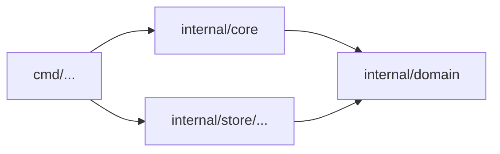
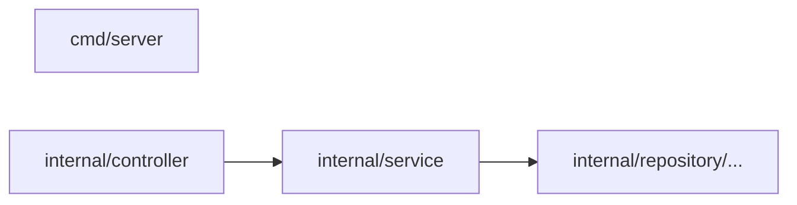
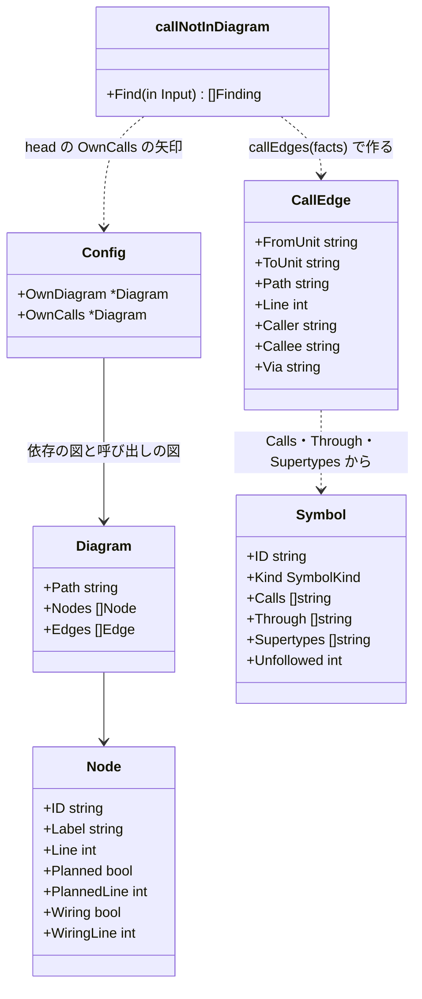

# ルール: `deps/`

## 目的

`deps/` ルールは、依存の図とコードが食い違ったとき、図のほうを正とします。

- 図に描かれていない import は落ちます
- 何も指さない図のノードも落ちます
- 呼び出しの図を描けば、図に描かれていない呼び出しも落ちます（「[呼び出しの図](#呼び出しの図)」）

依存の図はいちばん手軽に書ける設計書です。同時に、いちばん先に古くなる設計書でもあります。手近な import が1つずつ入るたびに、コードは図と合わなくなります。

## 依存の図

依存の図はリポジトリの Markdown ファイルにある Mermaid の flowchart です。設定でそのファイルを指します。

```yaml
rules:
  deps:
    diagram: docs/conventions/dependencies.md
```

````markdown

````

- **読むブロック**: ファイルの `mermaid` ブロックのうち、`flowchart` か `graph` のものをすべて読みます
- **ノードのラベル**: リポジトリのルートからのディレクトリを指します。`dir/...` は、そのディレクトリと配下すべてを含みます。ラベルの無いノードは ID で指します
- **ラベルの説明**: ラベルには改行（`<br/>`）のあとに説明を書けます。ディレクトリを指すのは1行目だけです。そのため、説明を直しても矢印が許すものは変わりません。例: `core["internal/core<br/>規則を持つ"]`
- **矢印**: `a --> b` は、`a` のユニットが `b` のユニットを import することを許します。`-.->` と `==>` も矢印です。`|label|` の有無、連結や `&` も問いません。矢印の無い線（`---`）は何も許しません
- **予定のノード**: クラス `planned` を付けたノードは、まだ作っていないディレクトリを指してかまいません。例: `api["internal/api"]:::planned`、または `class api planned`
  - 設計を先に図に描き、パッケージをあとの変更で作る流れのためのものです
  - 見た目は、利用者が `classDef planned` で決めます（破線など）
  - 描いた図でも予定だと分かるように、コメント（`%%`）ではなくクラスにしています
- 予定のノードにも矢印を描けます。矢印を足すときは、ほかのノードと同じく人の確認が要ります
- サブグラフ、スタイル、コメント（`%%`）は無視します。`planned` のクラスだけは読みます
- **ユニットの属し先**: ユニットはそれを含むノードのうち最も具体的なものに属します。完全なディレクトリが `/...` より先で、長い `/...` が短いものより先です
- 1つのノードの中の import は常に許されます

**依存の図は設定です。**

- 設定を読むときに、図も読みます。読めない図や、パスでないラベルは、設定の誤りです（終了コード `2`）
- ほかの設定と同じく、head の矢印が両方の版を判定します。そのため、矢印を消しても、報告されるのは変更が足した import だけです
- 例外は、ノードが何かを指すかどうかです。各版のノードはその版のツリーと照らします。そのため、変更で足した何も指さないノードは後退になります。ただし予定のノードは除きます

人の確認が要るかどうかは、変更の種類で決まります。

| 変更 | 人の確認（終了コード `3`） | 理由 |
|---|---|---|
| base の図にあるノードに、head で `planned` を付ける | 要る。緩めることとして数える | 何も指さなくなったノードを、印1つで後退から外せてしまう |
| 新しいノードを `planned` 付きで足す | 要らない | |
| `planned` を外す | 要らない | |
| 矢印を足す | 要る | |
| ラベルを変える | 要る | ラベルを変えると、矢印が許すものが変わる |
| 矢印を消す | 要らない | |
| `rules.deps.diagram` そのものを外す | 要る | すべての import が通るようになる |

## 呼び出しの図

呼び出しの図は、どのユニットのコードが、どのユニットのコードを呼んでよいかを描く図です。依存の図とは別のファイルに描きます。

依存の図だけでは、呼び出しの流れが見えないことがあります。DI でつなぐと、import と呼び出しの向きが分かれるからです。

```go
// controller: 自分でインターフェースを宣言し、それを呼ぶ
type Finder interface{ Find(id string) (User, error) }

// service: Finder を実装するが、controller を import しない

// container: すべてを import して、つなぐ
c := controller.New(service.New(repository.New(db)))
```

この形の依存の図は、container から全部へ矢印が出て、controller・service・repository が横に並びます。呼び出しの図には、実際の流れを描きます。

````markdown

````

```yaml
rules:
  deps:
    diagram: docs/conventions/dependencies.md
    calls: docs/conventions/calls.md
```

- **書き方**: 依存の図と同じです。ノードのラベル、`dir/...`、ラベルの説明、矢印の書き方、予定のノード（`planned`）、ユニットの属し先、無視するもの、すべて同じ読み方をします
- **矢印の意味**: `a --> b` は、`a` のコードが `b` のコードを呼ぶことを許します。呼び出しの届き方は「[呼び出しの届き先](#呼び出しの届き先)」で決めています
- **つなぎ込みのノード**: クラス `wiring` を付けたノードのユニットからの呼び出しは、照らし合わせません。すべてを作ってつなぐ場所（DI のコンテナ、`main`）のためのものです。つなぎ込みの場所は全部を呼ぶので、照らし合わせると、呼び出しの図も星形に戻ってしまいます
  - `wiring` のノードへの呼び出しは、ほかのノードと同じく照らし合わせます
  - 書き方は `planned` と同じです。例: `container["cmd/server"]:::wiring`、または `class container wiring`
- **別のファイルにする理由**: 依存の図のファイルは、すべての flowchart を依存の図として読みます。いまの矢印の書き方（`-.->`、`|label|`）は、どれも import の矢印として読んでいます。同じファイルに呼び出しの矢印を混ぜると、いま描かれている図の意味が変わります
- `calls` と `diagram` に同じファイルは指せません。指すと設定の誤り（終了コード `2`）です
- `calls` だけを設定してもかまいません。依存の図とは独立に読みます

**呼び出しの図も設定です。** 読み方と人の確認は、依存の図と同じです。

- 読めない図や、パスでないラベルは、設定の誤り（終了コード `2`）です
- head の矢印が両方の版を判定します。ノードが何かを指すかどうかだけは、各版のノードをその版のツリーと照らします
- `wiring` は照らし合わせを外す印なので、緩めることとして数えます

| 変更 | 人の確認（終了コード `3`） | 理由 |
|---|---|---|
| 矢印を足す | 要る | |
| ラベルを変える | 要る | 矢印が許すものが変わる |
| `wiring` を付ける（新しいノードでも、base の図にあるノードでも） | 要る。緩めることとして数える | 印1つで、ユニットの呼び出しをすべて照らし合わせから外せてしまう |
| base の図にあるノードに `planned` を付ける | 要る。緩めることとして数える | 依存の図と同じ |
| 矢印を消す、`wiring` や `planned` を外す、新しいノードを `planned` 付きで足す | 要らない | |
| `rules.deps.calls` そのものを外す | 要る | すべての呼び出しが通るようになる |

## ルール

「種類」の見つけるルールと測るルールは、[engine.ja.md](engine.ja.md#2種類のルール) で決めています。

| ルール | 種類 | 後退になるとき |
|---|---|---|
| `deps/not-in-diagram` | 見つけるルール | リポジトリの2つのユニットの間の import が描かれていない。ノードの間に矢印が無いか、どのノードにも含まれないユニットがある |
| `deps/diagram-stale` | 見つけるルール | 依存の図か呼び出しの図のノードが、ユニットを1つも持たないディレクトリを指している |
| `deps/call-not-in-diagram` | 見つけるルール | リポジトリの2つのユニットの間の呼び出しが、呼び出しの図に描かれていない |

- `deps/not-in-diagram` は `rules.deps.diagram` を、`deps/call-not-in-diagram` は `rules.deps.calls` を設定するまでは無効です。`deps/diagram-stale` は、設定した図だけを見ます
- 数えるのは製品のコードの import だけです。テストファイルは製品の依存ではありません
- 数えるのは、リポジトリ自身のユニットの間の import だけです。外部のライブラリは描きません
- 型だけを持ち込む import は数えません。例: TypeScript の `import type`。コンパイルすると消え、実行するコードの依存ではないからです
- TypeScript の宣言ファイル（`.d.ts` など）の import も数えません。宣言ファイルは実行されないからです

### `deps/not-in-diagram`

- **見つけるもの**: ユニット A からユニット B への import のうち、次のどちらかにあたるもの
  - A のノードから B のノードへ矢印が無い
  - A か B が、どのノードにも無い
- **なぜ困るか**: 人やエージェントは、何が何に依存してよいかを図で知ります。図に描かれていない import は図を誤りにし、次の変更はその誤った図をもとに書かれます
- **直し方**: 図が許すものに依存します。多くの場合、import する側のユニットが宣言するインターフェースを通します。設計が本当に変わったのなら、矢印を描きます。これは人が確認する変更です
- アンカーはディレクトリの組です。そのため、import をファイル内で動かしても、同じユニットの別のファイルへ動かしても、同じ違反のままです

### `deps/diagram-stale`

- **見つけるもの**: 依存の図と呼び出しの図の、次のノード
  - ラベルが、ユニットの無いディレクトリを指すノード。書き間違いのほか、ユニットが動いたか消えた場合です。予定のノードは除きます
  - ユニットを指すようになった予定のノード。パッケージを作ったのに、図はまだ予定のままになっている状態です
- **なぜ困るか**: 何も指さないノードがあると、図が完全でないのに完全に見えます
- **直し方**: ラベルを直すか、ノードを消します。ラベルのディレクトリの下にユニットがあるなら、`tools/...` のように `/...` を付けると1つの箱にまとめられることも伝えます。ディレクトリをまだ作っていないなら、ノードに `planned` を付けます。予定のノードがユニットを指すなら、`planned` を外します
- アンカーはラベルです。呼び出しの図のノードは、ラベルの前に図のファイルを付けます。そのため、同じラベルが2つの図にあっても、別の違反です

### `deps/call-not-in-diagram`

- **見つけるもの**: ユニット A のコードからユニット B のコードへの呼び出しのうち、次のどちらかにあたるもの。A が `wiring` のノードに属するときは除きます
  - 呼び出しの図に、A のノードから B のノードへの矢印が無い
  - A か B が、呼び出しの図のどのノードにも無い
- **なぜ困るか**: 呼び出しの図は、処理がどの層をどの順に通るかを伝えます。描かれていない呼び出しは、層を飛ばしたり逆に辿ったりしていても、図からは見えません。例: controller が service を飛ばして repository を呼ぶ
- **直し方**: 図が許す層を通して呼びます。設計が本当に変わったのなら、矢印を描きます。これは人が確認する変更です
- **報告の場所**: その組の呼び出しをする関数のうち、パスと行が最も前のものの宣言です。入口のコードなら、その入口です。事実は呼び出しの行を持たないためです。メッセージには、呼ぶ側の関数と、届く先のメソッドを書きます。インターフェースを通した呼び出しなら、インターフェースのメソッドと、届く先の実装の両方を書きます
- アンカーはディレクトリの組です。`deps/not-in-diagram` と同じく、呼び出しを動かしても同じ違反のままです
- 照らし合わせるのは、hadome がたどれる呼び出しだけです（「[たどれない呼び出し](#たどれない呼び出し)」）

## 型



- **`Config.OwnCalls`**: `rules.deps.calls` の図です。`OwnDiagram` と同じく、各版が自分の図を持ち、矢印は head のものを使います
- **`Node.Wiring`**: クラス `wiring` を付けたノードです。`WiringLine` は、クラスを付けた行です
- **`CallEdge`**: ユニットの間の呼び出しの1つです。`callEdges` が事実から作ります。`Via` は、インターフェースを通した呼び出しのとき、そのインターフェースのメソッドの ID です。直接の呼び出しでは空です
- **`Symbol` に足す3つの事実**は「[呼び出しの事実](#呼び出しの事実)」で決めています

## 事実

| 事実 | 使い道 |
|---|---|
| `Import`（どのユニットから、どのユニットへ、内部か） | どのユニットがどれに依存するか |
| `File.Unit`、`File.Path`、`File.Role` | 各ユニットのディレクトリと、どのファイルが製品のコードか |
| `Symbol.Calls`、`Entry.Calls` | 直接の呼び出し（呼び出しの図） |
| `Symbol.Through`、`Symbol.Supertypes` | インターフェースを通した呼び出しと、その届き先（呼び出しの図） |
| `Symbol.Unfollowed` | たどれない呼び出しの数（呼び出しの図） |

### 呼び出しの事実

`Symbol.Calls` は、構文から呼び先を1つに決められる呼び出しだけを持ちます（[suggest.ja.md](suggest.ja.md) の「たどれる呼び出し」）。インターフェースの値の呼び出しが入るかどうかは、言語で違います。Java と Kotlin は宣言した型を持つ値の呼び出しを入れ、Go はフィールドを通した呼び出しだけを入れ、TypeScript と Python は入れません。呼び出しの図には、どの言語でもそれが要ります。そこで、`Calls` は変えずに、次の3つを `Symbol` に足します。

| 事実 | 持つシンボル | 中身 |
|---|---|---|
| `Through` | 関数とメソッド | 値の宣言した型を通して呼ぶ、リポジトリのメソッドの ID のうち、`Calls` に入らないもの。インターフェース・抽象型・トレイトのメソッドの呼び出しです。TypeScript と Python では、具体的なクラスのメソッドの呼び出しも入ります（下の表） |
| `Supertypes` | 型 | その型が実装する、または継承する、リポジトリの型の ID。推移的にたどった結果ではなく、直接のものだけです |
| `Unfollowed` | 関数とメソッド | 値の型が分からず、リポジトリのコードに届くかもしれないメソッドの呼び出しの数 |

- `Calls` を変えないのは、`Calls` を読むほかの仕組み（`idempotent` の候補）の結果を変えないためです
- 事実の ID の形は、`Calls` と同じです。例: `<ユニット>.<型>.<メソッド>`

### 呼び出しの届き先

ユニット A のシンボルが持つ事実から、A から届くユニットを次のように決めます。

| 呼び出し | 届くユニット |
|---|---|
| 関数の ID | その関数を宣言したユニット |
| 型 T のメソッド M の ID | T を `Supertypes` で推移的にたどれる型（T の実装と子孫）のうち、M を自分で宣言した型を持つユニット。T がインターフェースでなければ、T のユニットも含む |

- `Calls`・`Through`・`Entry.Calls` のどれにある ID も、この表で決めます。`Entry.Calls`（シンボルでない入口のコード）の ID は、入口のコードがあるユニットからの呼び出しとして数えます
- インターフェースのメソッドは本体を持たないので、インターフェースを宣言したユニットには届きません

- 同じユニットへの呼び出しは数えません
- 実装が複数のユニットにあれば、そのすべてに届くとします。例: `Repository` の実装が `repository/pg` と `repository/memory` にあれば、両方への矢印が要ります。実際にどちらへも届きうるからです
- テストのファイルの型は、実装として数えません。テストのための偽物（モック）への矢印を、図に求めないためです
- 製品のコードに置いた偽物も実装として数えます。テストのファイルかどうかは、[adapters.ja.md](adapters.ja.md) の「ファイルと役割」で決めます

### 言語ごとの読み方

難しさは2つに分かれます。呼んでいる値の型が分かるか（`Through`）と、どの型がそれを実装しているか分かるか（`Supertypes`）です。

| 言語 | `Through` に入る呼び出し | `Supertypes` の決め方 |
|---|---|---|
| Java | 入らない。宣言した型を持つフィールド・引数・ローカル変数のメソッドの呼び出しは、インターフェースでも `Calls` に入っている | `implements`・`extends` |
| Kotlin | 同上（コンストラクタの引数のプロパティも含む） | クラスの宣言の `:` のあとの型。コンストラクタを呼んでいてもいなくても、`by` で委ねていても数える |
| TypeScript | 型の注釈を持つフィールド・引数（コンストラクタの引数のプロパティも含む）・ローカル変数のメソッド。インターフェースでも具体的なクラスでも入る | `implements`・`extends` |
| Go | インターフェースの型で宣言した引数のメソッド。フィールドとローカル変数のものは、もう `Calls` に入っている | メソッドの突き合わせ（下記）。インターフェースは、埋め込んだリポジトリのインターフェース |
| Rust | `dyn Trait`・`impl Trait`・トレイトの境界を持つ型の引数とフィールドのメソッド | `impl Trait for Type` |
| Python | 型の注釈を持つ属性・引数のメソッド。具体的なクラスでも入る | 基底クラス（`ABC` の子も含む）。`Protocol` はメソッドの突き合わせ |

- **TypeScript と Python で具体的なクラスも入る理由**: この2言語の `Calls` は、import した名前とファイルの直下の名前しか持ちません。DI で注入したクラスの値（`this.service.find()`）の呼び出しは、具体的なクラスでも `Calls` に入っていません
- **Go のメソッドの突き合わせ**: リポジトリの型ごとにメソッドの集まりを作り、リポジトリのインターフェースのメソッドがすべてそろう型を、そのインターフェースの実装とします
  - メソッドは、名前と、引数と戻り値の型を書いたとおりに比べます。型の名前はパッケージを解いてから比べます
  - 埋め込んだリポジトリの型のメソッドも、その型のメソッドとして数えます
  - ポインタのレシーバのメソッドは、ポインタの型のメソッドとして数えます。`*T` だけがインターフェースを満たすときも、`T` の実装とします
  - ほかのモジュールの型を埋め込んだ型は、そのメソッドが分からないので、そろわない限り実装としません
- **Python の `Protocol`**: Go と同じく、メソッドの名前と引数の数で突き合わせます。型の注釈は比べません。注釈の無い引数があるためです

### たどれない呼び出し

型が分からない値のメソッドの呼び出しは、`Unfollowed` として数えるだけです。照らし合わせず、チェックを落としもせず、人の確認にも回しません。

| 数えるもの | 例 |
|---|---|
| 型の注釈の無い Python の属性・引数のメソッド | `self.repo.save(…)`（`repo` に注釈が無い） |
| 型の注釈の無い TypeScript の値、`any` の値のメソッド | `constructor(private repo)` |
| 型を決められないローカル変数のメソッド | Java の `var r = factory.make()` で、`make` の戻り値の型をたどれないとき |

- `hadome check` は、呼び出しの図にあるユニットで `Unfollowed` が増えたとき、その数を知らせます。終了コードは変えません。不変条件の候補と同じ「知らせるだけ」の扱いです
- 知らせるときは、型の注釈を書けばたどれることも添えます
- **人の確認に回さない理由**: `unknown/import` は、行き先の分からない import を人の確認に回します。行き先の分からない import はまれで、書いた人が意図して書くものだからです。型の注釈の無い値の呼び出しは、注釈を書かない Python のリポジトリでは、ほぼすべてのメソッドの呼び出しです。人の確認に回すと、そうしたリポジトリでは呼び出しの図が使えなくなります
- ほかのモジュールのインターフェースの値のメソッド（Go の `w.Write(…)` で `w` が `io.Writer`）は、`Unfollowed` にも数えません。届き先の実装は、ふつうほかのモジュールにあるからです（「[意図して入れなかったもの](#意図して入れなかったもの)」）

## 自己テストの事例

| ルール | 事例 |
|---|---|
| `deps/not-in-diagram` | 矢印に沿った import は通る · 矢印の無い import は落ちる · 描かれていない既存の import は通る · 1つのノードの中の import は通る · どのノードにも無いユニットからの import は落ちる · `/...` のノードは配下を含む · テストファイルの import は通る · どのノードにも無い2つのユニットの間の import は落ちる · 矢印を描くと代わりに人の確認が要る |
| `deps/diagram-stale` | 無いディレクトリを指すノードは落ちる · 既存のユニットを指すノードは通る · テストしか無いディレクトリを指すノードは落ちる · ユニットをノードから動かすと落ちる · 無いディレクトリを指す予定のノードは通る · `class` の文で付けた予定のノードも通る · ユニットを指す予定のノードは落ちる · base の図にあるノードに `planned` を付けると人の確認が要る · 呼び出しの図の、無いディレクトリを指すノードは落ちる |
| `deps/call-not-in-diagram` | 矢印に沿った直接の呼び出しは通る · 矢印の無い直接の呼び出しは落ちる · 描かれていない既存の呼び出しは通る · 1つのノードの中の呼び出しは通る · `wiring` のノードからの呼び出しは通る · `wiring` のノードへの描かれていない呼び出しは落ちる · インターフェースを通した呼び出しは実装のユニットへの矢印を求める · 実装が2つのユニットにあれば、片方への矢印だけでは落ちる · テストのファイルの実装は数えない · import の矢印はあるが呼び出しの矢印が無い呼び出しは落ちる · 型の分からない値の呼び出しは通る · 矢印を描くと代わりに人の確認が要る · `wiring` を付けると人の確認が要る |

## 不変条件

1. `rules.deps.diagram` が無ければ、`deps/not-in-diagram` は何も見つけない。`rules.deps.calls` が無ければ、`deps/call-not-in-diagram` は何も見つけない
2. 変更を判定する矢印は、両方の版について head のもの。矢印を描くことは決して黙って通らない
3. `wiring` を付けることは決して黙って通らない
4. 呼び出しの図は、依存の図の判定を変えない。逆も同じ
5. `Through`・`Supertypes`・`Unfollowed` を足しても、ほかの事実は変わらない。`Calls` を読むルールと候補の結果も変わらない
6. たどれない呼び出しは、チェックを落とさず、人の確認にも回さない。終了コードを変えるのは、たどれた呼び出しだけ
7. 同じユニットの中の呼び出しは、常に通る

## 意図して入れなかったもの

- **ノードの間の循環**: 何が許されるかは図が決めます。図が循環を描けば、その循環は許されます
- **推移的な矢印**: `a --> b --> c` は、`a` が `c` を import することを許しません
- **図の中の外部ライブラリ**
- **Mermaid の flowchart 以外の図の形式**
- **予定のノードの期限**: 予定のまま長く残っても、後退にはしません。予定を取りやめたら、ノードを消します
- **依存の図と同じファイルに呼び出しの矢印を描くこと**: いまの矢印の書き方は、どれも import の矢印として読んでいます。ラベル（`|calls|`）や線の形で呼び出しの矢印を見分けると、いま描かれている図の意味が変わります
- **つなぎ込みの場所から呼び出しを推すこと**: `controller.New(service.New(…))` から「service の値が controller に渡る」ことは分かります。ただ、渡したことは呼ぶことを意味しません。推した呼び出しで落とすと、誤って落とすことになります
- **ほかのモジュールのインターフェースを通した呼び出し**: `io.Writer` や `http.Handler` の値のメソッドです。実装はふつうほかのモジュールにあり、hadome はほかのモジュールを読みません
- **引数で受け取った関数の呼び出し**: どの関数が渡るかは、呼ぶ側を見ないと決まりません
- **リフレクションとフレームワークの自動の呼び出し**: Spring の `@EventListener` やプロキシ、`getattr` での呼び出しです。構文に呼び先が無いからです
- **呼び出しの順序と回数**: 図が決めるのは、どのユニットからどのユニットへ届いてよいかだけです
- **推移的な矢印**: `a --> b --> c` は、`a` が `c` を直接呼ぶことを許しません。依存の図と同じです
- **描かれているのに呼ばれていない矢印**: 依存の図と同じく、後退にしません
- **生成されたコードの実装**: `Symbol` は生成されたコードを持たないので、生成されたコードの型（sqlc の `Queries` など）は実装として数えません。そうした実装への呼び出しは、図に求めません。誤って落とすことはなく、届き先が少なく見えるだけです
