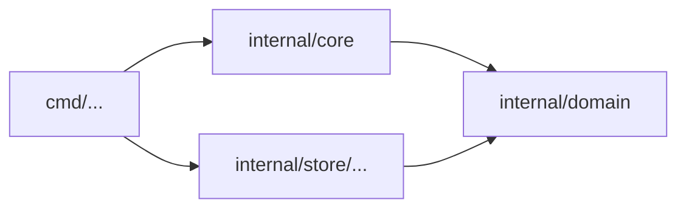

# Rules: `deps/`

## Purpose

A dependency diagram is the cheapest architecture document there is, and the first to go stale: one convenient import at a time, the code stops matching it. The `deps/` rules make the diagram the source of truth. An import the diagram does not draw fails, and so does a diagram box that names nothing.

## The diagram

The diagram is a Mermaid flowchart in a Markdown file of the repository, named by configuration:

```yaml
rules:
  deps:
    diagram: docs/conventions/dependencies.md
```

````markdown

````

- Every `mermaid` block of the file that is a `flowchart` or `graph` is read
- A **node's label** names a directory of the repository, from its root. `dir/...` covers the directory and everything under it. A node without a label is named by its ID
- An **arrow** `a --> b` (also `-.->` and `==>`, with or without a `|label|`, in chains and with `&`) allows the units of `a` to import the units of `b`. Lines without arrows (`---`) allow nothing
- Subgraphs, styles and comments (`%%`) are ignored
- A unit belongs to the most specific node that covers it: an exact directory before a `/...`, a longer `/...` before a shorter one
- Imports within one node are always allowed

The diagram is configuration: it is read when configuration is loaded, an unreadable diagram or a label that is not a path is a configuration error (exit code `2`), and **head's arrows judge both versions**, like every other setting, so removing an arrow reports only imports the change adds. Whether a box names something is the exception: each version's boxes are checked against that version's tree, so a box added in the change that names nothing is a regression. Adding an arrow — or changing a label, which changes what an arrow allows — needs a person's review (exit code `3`). Removing one never does.

## The rules

| Rule | Kind | Regression when |
|---|---|---|
| `deps/not-in-diagram` | finding | An import between two of the repository's units is not drawn: no arrow between their nodes, or a unit no node covers |
| `deps/diagram-stale` | finding | A node of the diagram names a directory that holds no unit |

Both are off until `rules.deps.diagram` is set. Only imports of product code count (test files are not dependencies of the product), and only imports between the repository's own units: external libraries are not drawn.

### `deps/not-in-diagram`

- **Finds**: an import from unit A to unit B where the node of A has no arrow to the node of B, or where A or B is in no node
- **Why**: the diagram is how people and agents know what may depend on what; an import it does not draw makes it wrong, and the next change builds on the wrong picture
- **Fix**: depend on what the diagram allows (often through an interface the importing unit declares), or, if the design really changed, draw the arrow — a change a person reviews
- The anchor is the pair of directories, so moving the import within a file, or to another file of the same unit, keeps it the same finding

### `deps/diagram-stale`

- **Finds**: a node whose label names a directory with no unit (a typo, or a unit that was moved or deleted)
- **Why**: a box that names nothing makes the diagram look complete when it is not
- **Fix**: correct the label, or remove the node
- The anchor is the label

## Facts

| Fact | Used for |
|---|---|
| `Import` (from unit, to unit, internal) | which units depend on which |
| `File.Unit`, `File.Path`, `File.Role` | the directory of each unit, and which files are product code |

## Self-test cases

| Rule | Cases |
|---|---|
| `deps/not-in-diagram` | an import along an arrow passes · an import with no arrow fails · an existing undrawn import passes · an import within one node passes · an import from a unit in no node fails · a `/...` node covers what is under it · an import in a test file passes |
| `deps/diagram-stale` | a node naming a missing directory fails · a node naming an existing unit passes |
| `deps/not-in-diagram` (more) | an import between two units in no node fails · drawing the arrow needs review instead |
| `deps/diagram-stale` (more) | a node naming a directory of tests only fails · moving a unit away from its node fails |
| (configuration) | adding an arrow, or widening a label, needs review · removing one does not |

## Invariants

1. Without `rules.deps.diagram`, the rules find nothing
2. The arrows that judge a change are head's, for both versions; drawing an arrow is never silent

## Deliberately left out

- Cycles between nodes. The diagram decides what is allowed; if it draws a cycle, the cycle is allowed
- Transitive arrows. `a --> b --> c` does not allow `a` to import `c`
- External libraries in the diagram
- Diagram formats other than Mermaid flowcharts
