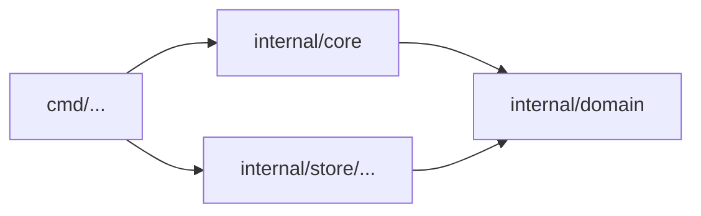
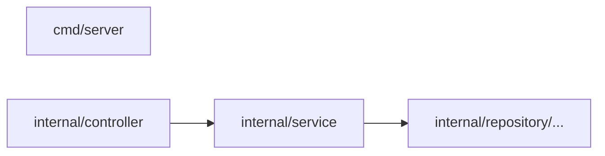
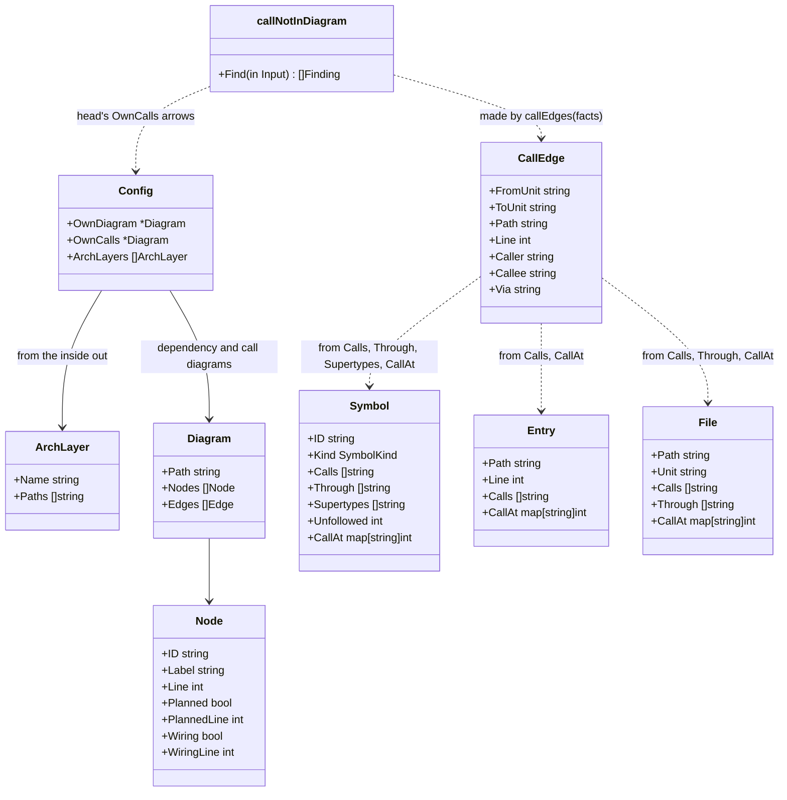

# Rules: `deps/`

## Purpose

Examples of writing each design pattern as a diagram, layers or allowed pairs are in [patterns.md](../patterns.md), for users.

A dependency diagram is the easiest design document to write, and also the first to go out of date: with each import added because it was close at hand, the code stops matching it. When the diagram and the code disagree, the `deps/` rules treat the diagram as correct. An import the diagram does not draw fails, and so does a diagram box that names nothing. With a call diagram drawn, a call it does not draw fails too ([The call diagram](#the-call-diagram)). Even without a diagram, an import that makes a new cycle between units fails ([`deps/cycle`](#depscycle)). With the order of layers written, an import from an inner layer to an outer one fails ([`deps/layer`](#depslayer)).

## The diagram

The diagram is a Mermaid flowchart in a Markdown file of the repository, named by configuration:

```yaml
rules:
  deps:
    diagram: docs/conventions/dependencies.md
```

````markdown

````

- Every `mermaid` block of the file that is a `flowchart` or `graph` is read
- A **node's label** names a directory of the repository, from its root. `dir/...` covers the directory and everything under it. A node without a label is named by its ID
- A label may describe its directory after a line break (`<br/>`). Only the first line names the directory, so rewording the description changes nothing the arrows allow (`core["internal/core<br/>holds the rules"]`)
- An **arrow** `a --> b` (also `-.->` and `==>`, with or without a `|label|`, in chains and with `&`) allows the units of `a` to import the units of `b`. Lines without arrows (`---`) allow nothing
- **Planned boxes**: a node with the class `planned` (`api["internal/api"]:::planned`, or `class api planned`) may name a directory that does not exist yet. This is for drawing the design first and creating the package in a later change. How it looks is the user's choice with `classDef planned` (a dashed border, for example). It is a class, not a comment (`%%`), so that the rendered diagram also shows it is planned
- Arrows may be drawn to and from planned boxes. Adding one needs review, as for any box
- Subgraphs, styles and comments (`%%`) are ignored, apart from the class `planned`
- A unit belongs to the most specific node that covers it: an exact directory before a `/...`, a longer `/...` before a shorter one
- Imports within one node are always allowed

The diagram is configuration: it is read when configuration is loaded, an unreadable diagram or a label that is not a path is a configuration error (exit code `2`), and head's arrows judge both versions, like every other setting, so removing an arrow reports only imports the change adds. Whether a box names something is the exception: each version's boxes are checked against that version's tree, so a box added in the change that names nothing is a regression, unless it is planned. Marking `planned`, in head, a box base's diagram draws counts as loosening (review, exit code `3`): one mark would take a box that stopped naming anything out of the regressions. Adding a new box already `planned`, or removing `planned`, is not loosening. Adding an arrow — or changing a label, which changes what an arrow allows — needs a person's review (exit code `3`). Removing an arrow never does. Removing `rules.deps.diagram` itself does, because every import then passes.

## The call diagram

The call diagram draws which units' code may call which units' code. It is drawn in a file of its own, apart from the dependency diagram.

The dependency diagram alone can hide the flow of calls, because wiring with dependency injection splits the direction of imports from the direction of calls:

```go
// controller: declares its own interface and calls it
type Finder interface{ Find(id string) (User, error) }

// service: implements Finder, without importing controller

// container: imports everything and wires it
c := controller.New(service.New(repository.New(db)))
```

The dependency diagram of this shape has arrows from the container to everything, with controller, service and repository side by side. The call diagram draws the actual flow:

````markdown

````

```yaml
rules:
  deps:
    diagram: docs/conventions/dependencies.md
    calls: docs/conventions/calls.md
```

- **Syntax**: the same as the dependency diagram. Node labels, `dir/...`, label descriptions, the ways to write an arrow, planned boxes (`planned`), which node a unit belongs to, and what is ignored are all read the same way
- **What an arrow means**: `a --> b` lets the code of `a` call the code of `b`. How a call reaches a unit is defined in [Where a call reaches](#where-a-call-reaches)
- **Wiring boxes**: calls from the units of a node with the class `wiring` are not checked. They are for the place that makes and wires everything (a DI container, `main`): it calls everything, so checking it would turn the call diagram back into a star
  - Calls *to* a `wiring` node are checked like any other
  - It is written like `planned`: `container["cmd/server"]:::wiring`, or `class container wiring`
- **Why a file of its own**: every flowchart in the dependency diagram's file is read as the dependency diagram, and every way of writing an arrow today (`-.->`, `|label|`) is read as an import arrow. Mixing call arrows into that file would change the meaning of diagrams already drawn
- `calls` and `diagram` cannot name the same file; doing so is a configuration error (exit code `2`)
- `calls` can be set alone; it is read independently of the dependency diagram

**The call diagram is configuration too.** It is read, and reviewed, like the dependency diagram:

- An unreadable diagram or a label that is not a path is a configuration error (exit code `2`)
- Head's arrows judge both versions. Only whether a box names something is checked against each version's own tree
- `wiring` takes calls out of the check, so it counts as loosening

| Change | A person's review (exit code `3`) | Why |
|---|---|---|
| Adding an arrow | Needed | |
| Changing a label | Needed | It changes what an arrow allows |
| Marking `wiring` (a new box or one base's diagram draws) | Needed; counts as loosening | One mark would take every call of a unit out of the check |
| Marking `planned` a box base's diagram draws | Needed; counts as loosening | As in the dependency diagram |
| Removing an arrow, removing `wiring` or `planned`, adding a new box already `planned` | Not needed | |
| Removing `rules.deps.calls` itself | Needed | Every call then passes |

## The rules

The kinds, finding and measure, are defined in [engine.md](engine.md#two-kinds-of-rules).

| Rule | Kind | Regression when |
|---|---|---|
| `deps/not-in-diagram` | finding | An import between two of the repository's units is not drawn: no arrow between their nodes, or a unit no node covers |
| `deps/diagram-stale` | finding | A node of the dependency diagram or the call diagram names a directory that holds no unit |
| `deps/call-not-in-diagram` | finding | A call between two of the repository's units is not drawn in the call diagram |
| `deps/cycle` | finding | An import the change added closes a cycle between units |
| `deps/layer` | finding | A unit of an inner layer imports a unit of an outer layer |

`deps/not-in-diagram` is off until `rules.deps.diagram` is set, and `deps/call-not-in-diagram` until `rules.deps.calls` is; `deps/diagram-stale` looks only at the diagrams that are set. `deps/cycle` works without a diagram. `deps/layer` is off until `rules.deps.layers` is set. Only imports of product code count (test files are not dependencies of the product), and only imports between the repository's own units: external libraries are not drawn. Imports that bring in types only, such as TypeScript's `import type`, do not count: they disappear when compiled, so they are no dependency of the running code. Nor do imports in TypeScript declaration files (`.d.ts` and the like), which are never run.

### `deps/not-in-diagram`

- **Finds**: an import from unit A to unit B where the node of A has no arrow to the node of B, or where A or B is in no node
- **Why**: the diagram is how people and agents know what may depend on what; an import it does not draw makes it wrong, and the next change is written from the wrong diagram
- **Fix**: depend on what the diagram allows (often through an interface the importing unit declares), or, if the design really changed, draw the arrow — a change a person reviews
- The anchor is the pair of directories, so moving the import within a file, or to another file of the same unit, keeps it the same finding

### `deps/diagram-stale`

- **Finds**: in the dependency diagram and the call diagram, a node whose label names a directory with no unit (a typo, or a unit that was moved or deleted), planned boxes aside. Conversely, a planned box that now names a unit (the package exists, but the diagram still says it is planned)
- **Why**: when a box names nothing, the diagram looks complete when it is not
- **Fix**: correct the label, or remove the node. When units lie under the label's directory, the fix also says that adding `/...`, as in `tools/...`, takes them in as one box. If the directory is not created yet, mark the box `planned`. If a planned box names a unit, remove `planned`
- The anchor is the label. For a node of the call diagram it is prefixed with the diagram's file, so the same label in both diagrams makes two findings

### `deps/call-not-in-diagram`

- **Finds**: a call from the code of unit A to the code of unit B, unless A belongs to a `wiring` node, where
  - the call diagram has no arrow from the node of A to the node of B, or
  - A or B is in no node of the call diagram
- **Why**: the call diagram tells which layers a request goes through, in which order. An undrawn call does not show in the diagram even when it skips a layer or goes backwards — a controller calling the repository past the service, for one
- **Fix**: call through the layers the diagram allows, or, if the design really changed, draw the arrow — a change a person reviews
- **Where it is reported**: the line of the call of that pair with the earliest path and line. The line comes from `CallAt` (see [Call lines](#call-lines)). A call whose line is unknown counts at the declaration of the calling function, or at the entry point. The message names the calling function and the method reached; for a call through an interface, both the interface's method and the implementation it reaches
- The anchor is the pair of directories, as for `deps/not-in-diagram`, so moving the call keeps it the same finding
- Only calls hadome can follow are checked ([Calls hadome cannot follow](#calls-hadome-cannot-follow))

### `deps/cycle`

- **What it finds**: an import from unit A to unit B that is both
  - of a pair of directories no import of base has
  - one from which head's imports lead from B back to A
- **Why it matters**: units in a cycle can no longer be changed, tested or split out one at a time. It is the plainest form of a broken dependency direction. Example: `domain` imports `infra`, and `infra` imports `domain`
- **Fix**: decide which way is right and remove the import going the other way. Usually the inner unit declares an interface and the outer one implements it
- **Where it is reported**: at the added import. With two or more imports of the pair of directories, at the first by path and line. The message gives one way back, such as `store → domain → store`: the one through the fewest units, and among those, the first by directory names
- The anchor is the pair of directories. As with `deps/not-in-diagram`, moving the import keeps the same violation
- **Imports counted**: as for `deps/not-in-diagram`: only imports of product code between the repository's own units. Imports bringing in types only and imports of test files do not count
  - Imports inside Python's `if TYPE_CHECKING:` bring in types only too, and do not count: they are how cycles are avoided. `deps/not-in-diagram` counts them the same way
- **Imports between a parent and a child**: when the importing file is Rust, Java or Kotlin, an import between a directory and one of its ancestors does not count when cycles are followed. In TypeScript and Python it does

| Language | What a cycle between a parent and a child does | Counted |
|---|---|---|
| TypeScript, Python | Values come out `undefined`, or `ImportError` is raised, depending on load order, also when a parent's `index.ts` or `__init__.py` re-exports a child | Yes |
| Rust | Nothing. A crate compiles as one. A crate root declaring a child with `mod` and the child coming back with `use crate::…` is the usual way to write | No |
| Java, Kotlin | Next to nothing at run time. A parent and a child package are close to containment; what matters to design is between siblings | No |
| Go | The compiler allows no cycle | (none) |

  - Why: over the last 50 commits of 14 public repositories, counting every import, Rust's nushell had 7 commits closing a new cycle; without imports between parents and children, 1. Each of the 7 Rust, Java and Kotlin repositories had 0 or 1. The cycles left without them had broken directions, such as `editor` ⇄ `view` and `error` ⇄ `util`
- **Allowed pairs**: imports between a pair written in `rules.deps.cycles.allow` do not count when cycles are followed. They are for pairs whose cycle the design accepts. Examples: MVP with the View and the Presenter in separate packages, screens and a Coordinator, a Visitor and its elements
- **The diagrams**: it looks apart from them. A new cycle between units fails even when the diagram draws arrows both ways, and so does a cycle between units within one box. A one-off intended cycle takes an exception with a reason (`gate:allow deps/cycle reason: …`) on the import's line. When the same shape repeats feature after feature, an allowed pair is written instead

```yaml
rules:
  deps:
    cycles:
      allow:
        - app/ui/** <-> app/presenter/**
```

- **Writing an allowed pair**: a string `<pattern> <-> <pattern>`. A pattern is a glob of directories from the repository root (`*` one level, `**` any number). Imports between a directory matching one pattern and a directory matching the other do not count, either way
  - Adding a pair loosens the configuration, so it goes to review (exit code `3`). Removing one needs none
  - An entry that is no pair (no `<->`, or an empty pattern) is a configuration error (exit code `2`)
- **Cycles already there**: an import of a pair base has does not fail, even in a cycle. Only changes that make things worse are stopped
  - Because it looks at base, it is a `BaseFindingRule` of the engine ("[Rules that find against base](engine.md#rules-that-find-against-base)"). An exception marker suppresses nothing once the change is in base. It can stay or be removed

### `deps/layer`

- **Finds**: an import from unit A to unit B where A's layer lies inside B's layer. Units in no layer are not looked at
- **Why it matters**: in clean or hexagonal architecture, dependencies point from the outside in. When the inside imports the outside, the domain code gets tied to the database or the web framework, and becomes hard to replace and hard to test. Example: `domain` imports `infra`
- **Fix**: the inner layer declares an interface and the outer layer implements it. If the design changed, rewrite the layers, which a person reviews
- **Where it is reported**: the import's line. The anchor is the pair of directories, so, as with `deps/not-in-diagram`, moving the import leaves the same violation. The message names both layers. Example: `domain/user → infra/db (layer domain imports the outer layer adapters)`
- **Imports that count**: those of `deps/not-in-diagram`
- **The diagrams**: it looks apart from them. A diagram draws arrows from box to box one by one, while layers give only an order. For a design of a few layers, they are shorter to write than a diagram. With both set, both judge
- **Writing layers**: `rules.deps.layers` lists the layers from the inside out. A layer is a name and a list of directory globs

```yaml
rules:
  deps:
    layers:
      - name: domain
        paths: [domain/**]
      - name: usecase
        paths: [usecase/**]
      - name: adapters
        paths: [infra/**, web/**]
```

- **Why imports**: the dependency rule of clean architecture is about the direction of source code dependencies. Calls rightly go the other way. Example: usecase calls infra's implementation through `UserRepository`, which domain declares. The imports, `usecase → domain` and `infra → domain`, point inward, while the call reaches `usecase → infra`, outward. Layers applied to calls would fail every correctly inverted dependency. Calls are drawn as arrows of the call diagram
- **DI containers**: the place that wires everything (a DI container, `main`) imports every layer. In the outermost layer, its imports all point inward and pass. It can also be left in no layer. Example: `name: main`, `paths: [cmd/**, di/**]`
- **Which layer**: a unit whose directory matches the globs of two layers is in the one written first, the inner one. Example: writing both `app/**` and `app/domain/**`, write `app/domain/**` first
- **Imports that pass**: those within one layer, and those from the outside in. Importing an inner layer past the layers between passes too
- **Changing the configuration**: writing layers for the first time needs no review. Once written, changing a layer or its `paths` is hard to tell as stricter or looser, so every such change goes to review (exit code `3`)
  - An empty name, two layers of one name, empty `paths`, or a glob that cannot be read is a configuration error (exit code `2`)
- **Violations already there**: a violation base has does not fail. Base is judged by head's layers too, so every violation there when the layers are first written is one already there

## Types



- **`Config.OwnCalls`**: the diagram of `rules.deps.calls`. Like `OwnDiagram`, each version holds its own, and head's arrows are used
- **`Config.ArchLayers`**: the layers of `rules.deps.layers`, from the inside out. `Paths` are directory globs
- **`Node.Wiring`**: a node with the class `wiring`; `WiringLine` is the line that gives the class
- **`CallEdge`**: one call between units, made from the facts by `callEdges`. `Line` is the line of the call, or, when `CallAt` lacks it, of the calling function's declaration or the entry point. For a call through an interface, `Via` is the ID of the interface's method; for a direct call it is empty
- **The four facts added to `Symbol`** are defined in [Call facts](#call-facts), and `CallAt` in [Call lines](#call-lines)

## Facts

| Fact | Used for |
|---|---|
| `Import` (from unit, to unit, internal) | which units depend on which |
| `File.Unit`, `File.Path`, `File.Role` | the directory of each unit, and which files are product code |
| `Symbol.Calls`, `Entry.Calls` | direct calls (call diagram) |
| `Symbol.Through`, `Symbol.Supertypes` | calls through an interface, and where they reach (call diagram) |
| `Symbol.Unfollowed` | the number of calls hadome cannot follow (call diagram) |
| `Symbol.Asserted`, `Entry.Asserted`, `File.Asserted` | calls on values taken out by asking for a type (call diagram) |
| `Symbol.CallAt`, `Entry.CallAt` | the lines of calls (where the call diagram reports) |
| `File.Calls`, `File.Through`, `File.Asserted`, `File.CallAt` | calls of the code outside functions (call diagram) |

### Call facts

`Symbol.Calls` holds only calls whose callee the syntax settles on one function ([suggest.md](suggest.md), "Calls hadome can follow"); whether calls on an interface value are in it differs by language: Java and Kotlin put in calls on values of a declared type, Go only calls through a field, and TypeScript and Python none. The call diagram needs them in every language, so four facts are added to `Symbol`, leaving `Calls` as it is:

| Fact | On | Content |
|---|---|---|
| `Through` | functions and methods | IDs of the repository's methods called through a value's declared type that are not in `Calls`: methods of interfaces, abstract types and traits. In TypeScript and Python, methods of concrete classes too (see the table below). Also the IDs of classes made in place, and their methods ([Objects made in place](#objects-made-in-place)) |
| `Supertypes` | types | IDs of the repository's types the type implements or extends; direct ones only, not the transitive closure |
| `Unfollowed` | functions and methods | the number of method calls on parameters and attributes whose type is not written ([Calls hadome cannot follow](#calls-hadome-cannot-follow)) |
| `Asserted` | functions and methods | the IDs in `Calls` and `Through` the function calls only on values taken out by asking for a type ([Values taken out by asking for a type](#values-taken-out-by-asking-for-a-type)). `Entry` and `File` have the same |

- `Calls` is left as it is so that what else reads it (the `idempotent` candidates) gives the same results
- The IDs have the form of `Calls`, for example `<unit>.<Type>.<Method>`

### Call lines

`Calls` and `Through` hold the IDs of what is called, not the lines of the calls. The lines are kept apart, in `CallAt`.

| Fact | Held by | Content |
|---|---|---|
| `Symbol.CallAt` | functions and methods | for each ID in `Calls` and `Through`, the line where the body first calls it |
| `Entry.CallAt` | entry-point code that is no symbol | for each ID in `Entry.Calls`, the line where it is first called |

- **Keys**: `Calls` and `Through` never hold the same ID, so one map serves both. Example: `{"app/repo.Repo.find": 42}`
- **Why the first line only**: a finding is reported once per pair of units, so later calls of the same ID are never used
- **Why `Calls` stays as it is**: `Calls` stays `[]string`, so the other things that read it (the `idempotent` candidates) do not change
- **When a line is missing**: an ID missing from `CallAt` has no known line, and is reported at the declaration of the calling function or at the entry point. An adapter that does not fill the lines only makes the place coarser; the findings stay the same
- **Adapters that fill it**: every adapter that fills `Calls` or `Through` fills `CallAt` too: the Go adapter and the tree-sitter adapters of five languages
- **How it is checked**: a self-test case cannot check a finding's line, so the reported line is checked by unit tests of `deps`, and each language's lines by unit tests of its adapter

### Code outside functions

Calls can also be written outside the bodies of functions and methods. Example: code that runs when a module is loaded.

```python
# app/state.py
queue = Queue(DATA_DIR)  # makes the Queue of app/store/queue
```

`Calls` and `Through` are held by symbols. Of code that is no symbol, only an entry point (`Entry.Calls`) holds its calls. So in a file not read as an entry point, calls outside functions are not counted by the call diagram. Three facts are added to the file.

| Fact | Content |
|---|---|
| `File.Calls` | the IDs of the repository's functions and methods called outside the bodies of functions and methods, by the rules of `Symbol.Calls` |
| `File.Through` | objects made in the same places, and methods called on what was made, by the rules of [Objects made in place](#objects-made-in-place) |
| `File.CallAt` | for each ID in `File.Calls` and `File.Through`, the line where it is first called |

- **The caller**: the file's unit. The message names the caller as "the code outside functions in `app/state.py`"
- **What is outside functions**: every place not in the body of a function or method symbol. Inside a type's declaration, a place outside its methods is included. So is the inside of a function expression that is no function symbol (`items.map(i => make(i))`)
- **Why when it runs is not told apart**: code that runs on loading and code called later are treated the same. The call diagram says which unit's code may call which unit, not when
- **Overlap with entry-point code**: entry-point code (`Entry.Calls`) is outside functions too, so it is also in `File.Calls`. A finding is made once per pair of units, so the overlap adds none. `Entry.Calls` stays as it is, for the `idempotent` candidates
- **Calls through a value's declared type**: not read outside functions. The values `Symbol.Through` reads (parameters, fields, attributes) hardly occur outside functions
- **What is not read**: imports, the names of declarations, and Rust's test modules. Imports and declarations bring in or declare a name and call nothing; test modules are test code
- **Files that hold them**: product code files only, not test files or generated files, as with symbols
- **Why on `File`**: making the code outside functions a symbol would change the results of other rules that read symbols (`size/`, `comments/`)

Calls outside functions are written in these places in each language.

| Language | Places |
|---|---|
| Python | statements of the module, a class body outside its methods, decorators, default values of parameters |
| TypeScript | statements of the module, initial values of class fields, `static` blocks |
| Java | initial values of fields, initializer blocks |
| Kotlin | top-level properties, initial values of properties of classes and `object`s, `init` blocks |
| Go | initial values of package-level `var`s. An `init` function is a function symbol, so `Symbol.Calls` already counts its calls |
| Rust | initial values of `static` and `const` |

### Where a call reaches

From the facts of a symbol of unit A, the units A reaches are:

| Call | Units reached |
|---|---|
| The ID of a function | the unit that declares the function |
| The ID of type T (a call making a T) | the unit that declares T |
| The ID of method M of type T | the units of the types that reach T through `Supertypes`, transitively (T's implementations and descendants), that declare M themselves; when T is no interface, the unit of the code a value of T itself runs as well: T's M, or else the first types up T's `Supertypes` that declare M, classes over interfaces (whose method then runs as a default) |

- An ID in `Calls`, `Through`, `Entry.Calls`, `File.Calls` or `File.Through` is decided by this table alike. An ID in `Entry.Calls` (entry-point code that is no symbol) counts as a call from the unit holding the entry-point code. An ID in `File.Calls` or `File.Through` counts as a call from the file's unit
- An interface's method has no body, so a call does not reach the unit declaring the interface
- A method no type of the repository declares reaches nowhere. Examples: `db.update()` through an alias of a library's type (`type Db = PostgresJsDatabase`), Kotlin's `.apply {}`, Rust's derived `.clone()`. What runs is the library's code or code the compiler writes, not code of T's unit. That the code uses T shows in the calls making a T and in the import diagram

- A call into the same unit does not count
- When implementations lie in several units, the call reaches all of them. With implementations of `Repository` in `repository/pg` and `repository/memory`, arrows to both are needed, since a call can reach either
- Types in test files are not counted as implementations, so the diagram is never asked for arrows to test fakes (mocks)
- A fake placed in product code counts. Which files are test files is decided in [adapters.md](adapters.md), "Files and roles"

### Values taken out by asking for a type

A value taken out as a type after asking whether a value holds that type is called here a value taken out by asking for a type. A call of an interface's method on such a value reaches nowhere.

```go
// workspace: ask whether the error holds MissingHashes, and take it out
var mh missingHashes
if errors.As(err, &mh) {
	missing = mh.MissingHashes() // reaches nowhere
}
```

- **Why it reaches nowhere**: which implementation the value holds is decided by the call that returned it. In the example that is `Sender.Submit`, which returned `err`, and the arrows to where it lands are already asked for. Asking for arrows from the call on the value taken out too would reach every type with the same method, whether or not it can be returned. For one: even when only `client.MissingError` ever reaches `err` in production, an arrow to `core.MissingError` would be asked for
- **How it differs from a value handed in**: for a value received as a parameter or a field, the calling code does not say which implementation it holds. The wiring decides, so the arrows can only be asked for from the call through the interface ([Where a call reaches](#where-a-call-reaches)). For a value taken out by asking for a type, the call in the calling code that returned the value decides which implementation it holds
- A value taken out by asking for a concrete type (`errors.As(err, &target)` with `target` a `*client.MissingError`) reaches that type, like any other value: the code names the type
- When one function calls the same method both on a value taken out by asking and on another value, it is a call on the other value, and its arrows are asked for
- The call stays in `Calls` and `Through`, marked in `Asserted`, so what else reads `Calls` gives the same results ([Call facts](#call-facts))

The ways of asking for a type that are read, by language:

| Language | Written as |
|---|---|
| Go | `v.(I)`; the `v` of `errors.As(err, &v)` (and of `golang.org/x/xerrors`); the variable of a type switch in a `case` that names one type |
| Java | a local set to a cast (`Finder f = (Finder) found;`, in parentheses or not) |
| Kotlin | a local set to a value taken out with `as` or `as?` (`val f: Finder = found as Finder`) |
| TypeScript | a local set to a value taken out with `as` or `<T>` (`const f: Finder = found as Finder`) |

- Other forms were never read as the type asked for. For example: Kotlin's smart cast after `is`, TypeScript's type guards, Python's `isinstance`, a Java `instanceof` pattern variable, and a cast called without a variable (`((Finder) found).find()`). The first four are read with the value's declared type, the last as a value of unknown type. None of them asks for arrows to the implementations of the type asked for
- Rust has no way of taking a value out as a trait: `downcast_ref` takes out a concrete type

### Objects made in place

Making another unit's class in place and using it is followed too: a controller making a repository is the most common way to skip a layer.

```python
def show(id):
    repo = UserRepo(db)   # making one: a call to UserRepo's unit
    return repo.find(id)  # calling what was made: a call to UserRepo.find
```

| Written | What goes into `Through` | Languages |
|---|---|---|
| Making one of the repository's classes (`UserRepo(db)`, `new Service()`) | the class's ID | Java, Kotlin, TypeScript, Python |
| Calling a method on what was just made, or on a local variable holding it (`repo.find()` after `repo = UserRepo(db)`, `var s = new Service()`, `const s = new Service()`, `new repo.Repo().find()`) | the ID of the class's method | Java, Kotlin, TypeScript, Python |
| Calling a method on an attribute or field set to what was made (`self.repo = UserRepo(db)` in `__init__`, `private repo = new Repo()`) | the ID of the class's method | TypeScript, Python |
| Importing a value made, or written with its type, at the top of another module and calling its method (`manager.switch()` after `from app.state import manager`, with `manager = Manager()` in `app/state.py`; `api.get()` after importing `export const api = new Api()`) | the ID of the class's method | TypeScript, Python |
| Taking an element out of a container whose written type has one of the repository's types as its elements, and calling its method (`for (const p of ports) p.find()` with `ports: Port[]`; `p.find()` after `p = ports[0]` with `ports: list[Port]`) | the ID of the type's method | TypeScript, Python |

- Making one counts as a call because it runs the constructor
- Go's and Rust's struct literals (`store.Repo{}`, `Store { … }`) run no code, so they are not counted. In both languages a call of the function that makes one (`store.New()`, `Store::new()`) is already in `Calls`, and local variables already have a type
- A local variable without a type annotation is followed only when its value is an expression making one of the repository's classes. Other local variables are not counted ([Calls hadome cannot follow](#calls-hadome-cannot-follow))
- An attribute or field set to what was made has a type plain from its value, so it is not counted among calls hadome cannot follow, though it has no annotation
- The type of an element taken out of a container is decided the way tests decide it ([adapters-treesitter.md](adapters-treesitter.md), "Kinds of values in tests"). The container may be a parameter, a local variable, a field or attribute, a value at the top of the file, or an imported value
- Go has no constructors, so these cannot be self-test cases, which are written in Go so that every build runs them; each language's adapter tests check them

### Reading each language

The difficulty splits in two: whether the type of the value called is known (`Through`), and whether the types implementing it are known (`Supertypes`).

| Language | Calls that go into `Through` | How `Supertypes` is decided |
|---|---|---|
| Java | none: calls of methods on fields, parameters and local variables with a declared type are already in `Calls`, interfaces included | `implements`, `extends` |
| Kotlin | the same, constructor-parameter properties included | the types after `:` in the class declaration, whether a constructor is called or not, and delegated with `by` or not |
| TypeScript | methods on fields, parameters (constructor-parameter properties included) and local variables with a type annotation, whether the type is an interface or a concrete class | `implements`, `extends` |
| Go | methods on parameters declared with an interface type; those on fields and local variables are already in `Calls` | matching methods (below); for an interface, the repository's interfaces it embeds |
| Rust | methods on fields of `dyn Trait` in `Box`, `Arc` or `Rc`, and on parameters of a type parameter with a trait bound (`T: Trait`, `where T: Trait`); those on `&dyn Trait` and `impl Trait` parameters are already in `Calls` | `impl Trait for Type`; for a trait, the `B` of `trait A: B` |
| Python | methods on attributes and parameters with a type annotation, attributes `__init__` sets from an annotated parameter (`self.repo = repo`) included, concrete classes too | base classes (subclasses of `ABC` included); `Protocol` by matching methods |

- **Why concrete classes count in TypeScript and Python**: in these two languages `Calls` holds only imported names and names declared at the top of the file. A call on an injected class value (`this.service.find()`) is not in `Calls`, even for a concrete class
- **Matching methods in Go**: for each of the repository's types, gather its method set; a type that has every method of one of the repository's interfaces implements it
  - Methods are compared by name and by their parameter and result types as written, with type names resolved to their packages
  - Methods of embedded repository types count as methods of the embedding type
  - Methods with a pointer receiver count for the pointer type; when only `*T` satisfies the interface, `T` is still taken as the implementation
  - A type embedding a type of another module is not an implementation unless its methods match without that type, since the embedded type's methods are unknown
- **Python's `Protocol`**: matched like Go, by method names and parameter counts. Annotations are not compared, since parameters may have none
- **Python's `Protocol` and `ABC`**: their symbols stay classes, not interfaces, so a call reaches the unit declaring the `Protocol` or `ABC` as well as the implementations. It usually lies in the caller's own unit, so no arrow is added
- **Names a Python package imports**: a name a package's `__init__.py` imports from another module is read as the name it imports. With `from app.models.account import Account` in `app/models/__init__.py`, both `Account()` after `from app.models import Account` and `models.Account()` after `from app import models` make the `Account` of `app/models/account.py`

### Calls hadome cannot follow

A method call on a value whose type is unknown is only counted in `Unfollowed`. It is not checked, does not fail the check, and is not sent to review.

Only the places that take a value from outside are counted: parameters, attributes and variables at the top of a module. A value injected with dependency injection, or one made once at the top of a module and shared, lands there.

| Counted | Example |
|---|---|
| Methods on Python parameters without a type annotation, and on attributes `__init__` sets from one | `def run(repo): repo.save(…)`, `self.repo.save(…)` after `self.repo = repo` in `__init__(self, repo)` |
| Methods on TypeScript parameters and constructor parameter properties without a type annotation, and on parameters and fields typed `any` | `this.repo.save(…)` after `constructor(private repo)` |
| Methods on variables at the top of a module holding the result of one of the repository's functions or typed `any`, and on values imported from the repository that are no function, class or module and were neither made from a class nor written with a type where they come from (Python, TypeScript) | `repo.find(…)` after `repo = make_repo()` at the top |

| Not counted | Why |
|---|---|
| Methods on local variables (Java's `var` and Kotlin's `val` without a type too); one holding a class of the repository made in place is followed | Most are values made in place (`list.append(…)`) that reach no code of the repository; counting them would bury the report in calls that reach nothing |
| Methods on what a call returns (`make_repo().find(…)`) | As above. The call of `make_repo()` itself is in `Calls`, so the pair of units is seen |
| Methods on values of a declared type (parameters and fields in Java, Kotlin, Go and Rust) | The type is known, so the call is followed, or known to be another module's |
| Methods on imported names, `self` and `this` | `Calls` follows them |

- It is reported only when `rules.deps.calls` is set and the sum of `Unfollowed` grows in a unit of the call diagram. The exit code does not change: it is information only, like invariant candidates
- The report adds that a type annotation makes the calls followable
- **Why not review**: `unknown/import` sends an import whose destination is unknown to review, because such imports are rare and written on purpose. A call on an unannotated value is almost every method call in a Python repository that writes no annotations; sending those to review would make the call diagram unusable there
- Methods on values of another module's interface (Go's `w.Write(…)` with `w` an `io.Writer`) are not counted in `Unfollowed` either: the implementation they reach is usually in another module ([Deliberately left out](#deliberately-left-out))

### How it is reported

| Output | Content |
|---|---|
| `json` | `unfollowed` lists each unit where it grew, with `unit` (the directory, as the call diagram's labels name it), `base` and `head` (the sum in each version). An empty array when none grew |
| `text` | After the invariant candidates, "Calls on values of unknown type grew (information only; a type annotation makes them followable):", then one line per unit, as `app/controller: 3 → 5` |

- Only the difference of the sums is reported, not which calls were added, since `Unfollowed` holds a count only, with no IDs or lines of calls
- The engine is given a function that makes the list from both versions' input, as for invariant candidates; the `deps` package holds it

## Self-test cases

| Rule | Cases |
|---|---|
| `deps/not-in-diagram` | an import along an arrow passes · an import with no arrow fails · an existing undrawn import passes · an import within one node passes · an import from a unit in no node fails · a `/...` node covers what is under it · an import in a test file passes · an import between two units in no node fails · drawing the arrow needs review instead |
| `deps/diagram-stale` | a node naming a missing directory fails · a node naming an existing unit passes · a node naming a directory of tests only fails · moving a unit away from its node fails · a planned box naming a missing directory passes · a box made planned by a `class` statement passes too · a planned box naming a unit fails · marking `planned` a box base's diagram draws needs review · a node of the call diagram naming a missing directory fails |
| `deps/cycle` | a new import closing a cycle fails · an import closing a cycle through three or more units fails too · an import of a cycle already there passes · a new import making no cycle passes · an import of types only passes even when it closes a cycle · an import inside Python's `TYPE_CHECKING` passes even when it closes a cycle · an import of a test file passes even when it closes a cycle · a cycle between units within one box fails too · a cycle between a parent and a child in TypeScript fails · a cycle between a parent and a child in Rust and Kotlin passes · a cycle between an allowed pair passes · adding an allowed pair needs review · a Terraform module call closing a cycle fails · an Ansible role dependency closing a cycle fails |
| `deps/layer` | an import from the outside in passes · a new import from the inside out fails · an existing import from the inside out passes · an import within one layer passes · an import with a unit in no layer passes · a unit matching two layers is in the one written first · an import in a test file passes · writing layers for the first time needs no review · changing layers needs review |
| `deps/call-not-in-diagram` | a direct call along an arrow passes · a direct call with no arrow fails · an existing undrawn call passes · a call within one node passes · a call from a `wiring` node passes · an undrawn call to a `wiring` node fails · a call through an interface needs an arrow to the implementation's unit · with implementations in two units, an arrow to one alone fails · an implementation in a test file does not count · a call on a value asked for an interface asks for no arrow · a call on a value asked for a concrete type of another unit with no arrow fails · a call with an import arrow but no call arrow fails · a call on a value of unknown type passes · a call outside functions with no arrow fails · drawing the arrow needs review instead · marking `wiring` needs review |

## Invariants

1. Without `rules.deps.diagram`, `deps/not-in-diagram` finds nothing; without `rules.deps.calls`, `deps/call-not-in-diagram` finds nothing
2. The arrows that judge a change are head's, for both versions; drawing an arrow is never silent
3. Marking `wiring` is never silent
4. The call diagram does not change how the dependency diagram judges, nor the other way round
5. Adding `Through`, `Supertypes`, `Unfollowed`, `Asserted` and `CallAt`, and `Calls`, `Through`, `Asserted` and `CallAt` of `File`, changes no other fact, nor the results of rules and candidates that read `Calls`
6. A call hadome cannot follow never fails the check and is never sent to review; only calls it follows change the exit code
7. A call within one unit always passes
8. `deps/cycle` fails only imports of pairs of directories base has no import of. An import of a pair base has never fails, even in a cycle
9. Every import `deps/cycle` fails is on a cycle of head, and that cycle holds no import between an allowed pair, nor any Rust, Java or Kotlin import between a parent and a child
10. Adding an allowed pair never passes silently
11. Without `rules.deps.layers`, `deps/layer` finds nothing
12. Changing layers once written never passes silently

## Deliberately left out

- Cycles between nodes. A diagram's arrows are allowed when the diagram draws them, even in a cycle. Cycles of imports between units are looked at apart from the diagram, by `deps/cycle`
- Stopping imports that skip a layer. An order of layers alone does not say whether only the next layer in is allowed, or any inner one. In many designs the outside uses any inner layer. To allow only the next layer, draw a dependency diagram
- The direction within a layer. Imports between units of one layer are not looked at; cycles are `deps/cycle`'s
- Cycles of calls. Callbacks and calls through interfaces usually go against the imports; a cycle of calls is most often as designed, so it is not looked at
- Counting every cycle between a parent and a child, whatever the language. In Rust, every new module would then fail, as the measurement above shows
- Leaving out every cycle between a parent and a child, whatever the language. A cycle through a TypeScript barrel (`index.ts` re-exporting) is a seed of run-time failures; leaving it out would miss what is most worth stopping
- Telling of cycles already there. A cycle in base neither fails nor is told of. The drafts ([suggest.md](suggest.md)) list them as arrows both ways
- Cycles through other modules. hadome does not read other modules, so a way back through an external library is not counted
- Transitive arrows. `a --> b --> c` does not allow `a` to import `c`
- External libraries in the diagram
- Diagram formats other than Mermaid flowcharts
- A deadline for planned boxes. A box left planned for long is not a regression. When the plan is dropped, remove the box
- Call arrows in the dependency diagram's file. Every way of writing an arrow is read as an import arrow today; telling call arrows apart by a label (`|calls|`) or a line style would change the meaning of diagrams already drawn
- Inferring calls from the wiring. `controller.New(service.New(…))` shows that a service value is handed to the controller, but handing a value over is not calling it; failing on inferred calls would fail by mistake
- Calls through another module's interface: methods on an `io.Writer` or `http.Handler` value. Their implementations are usually in another module, which hadome does not read
- Calls of functions received as arguments. Which function arrives depends on the caller
- Reflection and calls a framework makes by itself: Spring's `@EventListener` or proxies, calls through `getattr`. The syntax holds no callee
- The order and number of calls. The diagram only decides which units may reach which
- Transitive arrows. `a --> b --> c` does not allow `a` to call `c` directly, as in the dependency diagram
- Arrows drawn but never called. As in the dependency diagram, they are not a regression
- Calls outside functions that cannot be followed. Calls on values of unknown type outside functions are not counted in `Unfollowed`. Of the values `Unfollowed` counts, parameters and attributes are not outside functions
- **Functions that return a value taken out by asking.** The result of a function such as `func asMissing(err error) missingHashes` is read with its declared result type, so a call on it asks for arrows to every implementation, like a value handed in. Following a value across functions needs type checking and a call graph built on it, which hadome cannot do without reading other modules
- **Taking a value handed in out as another interface, and calling it.** That is `w.(http.Flusher)`. No arrows are asked for, so when the function never calls the value it was handed, the arrow is missed. Only the call arrow is missed; nothing fails by mistake
- Generated implementations. `Symbol` holds no generated code, so a type in generated code (sqlc's `Queries`, for one) is not counted as an implementation and calls to it are not asked for. Nothing fails by mistake; fewer calls are seen
