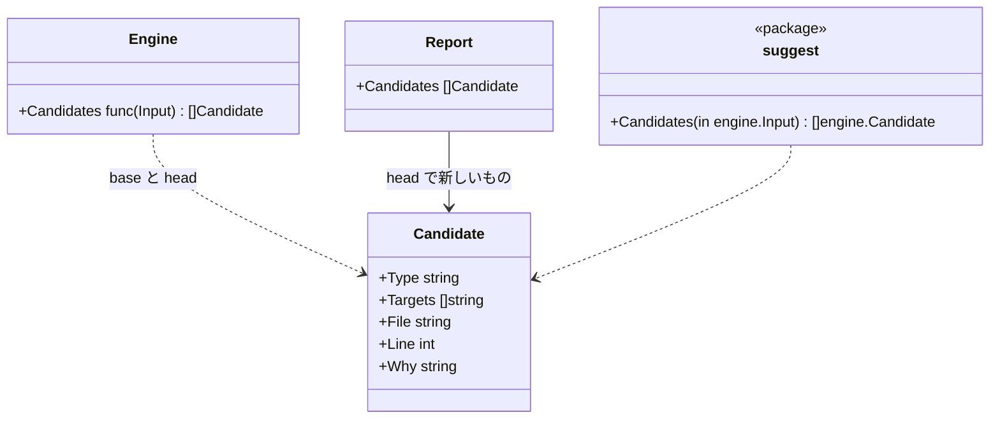

# 不変条件の候補と入口

## 責務

この文書が扱うのは、次の2つのための部分です。

- 人が hadome を設定しなくて済むようにする
- エージェントが hadome を自分で探り当てなくて済むようにする

| 名前 | 何か |
|---|---|
| **不変条件の候補** | 不変条件を持つことが多いのに、まだ誰も書き出していないコードの場所（パッケージ `internal/suggest`） |
| **`hadome suggest`** | 候補を、`.hadome.yml` にそのまま貼れるエントリとして出す |
| **`hadome agents`** | エージェントに hadome を伝えるブロックを出す、またはファイルに書き込む |
| **`hadome init`** | 最小の `.hadome.yml` を書く |

しないこと:

- 何かを決めること。候補は情報です。終了コードを変えず、hadome が自分で設定に足すこともありません
- 候補が正しいかを判断すること。例: `CreatePost` という関数が冪等である必要はないかもしれません。決めるのは人です

## 候補

候補はテストでも生成されたものでもないコードのシンボルから見つけます。数えるのは公開されたシンボルだけです。不変条件はそれらの入口について書くものだからです。

| 種類 | シンボルが候補になる条件 |
|---|---|
| `idempotent` | 名前が `Create`、`Add`、`Insert`、`Register`、`Submit`、`Enqueue` で始まり、入出力に届き、やり直されうる入口から届く（下の「`idempotent` の条件」） |
| `erasable` | 名前が `Delete`、`Remove`、`Erase`、`Purge` で始まる |
| `isolated` | 名前が `Get`、`List`、`Find`、`Search`、`Read`、`Load`、`Fetch`、`Query` で始まり、範囲の引数を持つ。範囲の引数は、名前が user、tenant、owner、account、org、team、workspace、customer、project を表す引数（[rules-tests.ja.md](rules-tests.ja.md) を参照） |
| `round-trip` | 同じユニット・同じレシーバにある組の1つ目である。組は `Export`/`Import`、`Encode`/`Decode`、`Marshal`/`Unmarshal`、`Serialize`/`Deserialize`、`Save`/`Load` の後に、同じ残りの名前が続くもの。例: `ExportRows` と `ImportRows` |

- **「で始まる」**: 名前の書き方ごとに、次のように決めます。語が名前全体である場合も含みます。

  | 書き方 | 例 | 語の後に続くもの |
  |---|---|---|
  | PascalCase | `DeleteRow` | 大文字か数字 |
  | camelCase | `deleteRow` | 大文字か数字 |
  | snake_case | `delete_row` | `_` |

  - camelCase と snake_case では、語の最初の文字を小文字にして比べます。例: `deleteRow` も `delete_row` も `Delete` で始まります
  - `Address` と `address` は `Add` で始まるとはみなしません
  - `round-trip` の組は、同じ書き方で探します。例: `exportRows` と `importRows`、`export_rows` と `import_rows`
- **UI のコンポーネント**: `.tsx` か `.jsx` のファイルにある、名前が大文字で始まる関数は候補にしません。React では、大文字で始まる関数がコンポーネントです。コンポーネントは画面の部品で、操作ではありません。例: `DeleteRowDialog`
- **候補から外すもの**: 同じ種類の設定済みの不変条件がすでに名指ししているシンボルは、候補になりません
- **対象の書き方**: 候補の対象は設定と同じ書き方で書きます。ユニットのパスの最後の要素に、名前を続けます。例: `api.CreatePost`、`store.Store.Delete`。この形で2つのシンボルが同じ名前になるときは、見分けられる最も短いパスで書きます（[rules-tests.ja.md](rules-tests.ja.md)）。例: `shops/[id].load` と `orders/[id].load`

### `idempotent` の条件

名前だけで決めると、値を返すだけの関数も候補になります。例: `AddDays`、`Add(a, b)`、値だけを作る `createAuthCookie`、ルートを登録するだけの `Register`。冪等かどうかが問題になるのは、やり直された要求が状態を2度変えうる関数だけです。そこで、次の3つがすべてそろうときだけ候補にします。

| 条件 | 中身 |
|---|---|
| **(a) 名前** | `Create`、`Add`、`Insert`、`Register`、`Submit`、`Enqueue` で始まる |
| **(b) 入出力に届く** | 関数の本体が、入出力をするものを使う。または、本体から hadome がたどれる呼び出しの先（その先も含む）が使う |
| **(c) 入口から届く** | やり直されうる入口から、hadome がたどれる呼び出しで届く。入口そのものも含む |

- 例: ハンドラから呼ばれ、DB に書く `CreateOrder` は候補です
- 例: 値だけを作る `createAuthCookie` は、(b) を満たさないので候補になりません
- 例: ルートを登録するだけの `Register` も、(b) を満たさないので候補になりません
- **入口が1つも無いリポジトリ**: ライブラリのように、見分けられる入口が1つも無いリポジトリでは、(a) と (b) だけで決めます

**入出力をするもの**: `tests/purity-lost` と同じ知識を使います（[adapters.ja.md](adapters.ja.md) の io の表と、設定の `io`）。

| 言語 | 本体が使うと入出力に届くもの |
|---|---|
| Go | io の表にあるパッケージの関数（`sql.Open`、`http.Get`）。io の表にあるパッケージの型の値のメソッド（フィールドが `*sql.DB` なら `s.db.ExecContext(…)`）。リポジトリのほかのパッケージの変数で、そのパッケージが入出力に届くもの |
| TypeScript | io の表にあるパッケージから import した名前。グローバルの入出力の API（`fetch` など）。リポジトリのモジュールから import した、関数でない値（`db` など）で、そのユニットが入出力に届くもの |

- ユニットが入出力に届くとは、ユニットが入出力をする import を持つか、それを持つリポジトリのユニットを import でたどれることです
- **たどれる呼び出し**: Go では、テストの呼び出し先と同じ読み方で特定できる呼び出しです（関数、宣言した型の値のメソッド）。TypeScript では、import した名前とファイルの直下で宣言した名前の呼び出しです。ローカルの変数が同じ名前を隠していても、名前だけで見ます

**やり直されうる入口**: 構文だけで見分けられるものです。

| 言語 | 入口 |
|---|---|
| Go | 引数が `(http.ResponseWriter, *http.Request)` の関数とメソッド（`ServeHTTP` と `http.HandlerFunc` の形）。`Handle`・`HandleFunc`・`Get`・`Post`・`Put`・`Patch`・`Delete` などで、文字列のパスと一緒に渡した関数（`mux.HandleFunc("/orders", h.CreateOrder)`）と、そこに書いた関数リテラル |
| TypeScript | SvelteKit の `+server.*` が export する `GET`・`POST` などと、`+page.server.*`・`+layout.server.*` の `load` と `actions`。Next.js の `app/` の `route.*` が export する `GET`・`POST` などと、`pages/api/` の default export。`'use server'` で始まるファイルが export する関数。Express・Hono などで、文字列のパスと一緒に `get`・`post`・`put`・`patch`・`delete`・`all`・`use`・`on` に渡した関数（`app.post('/orders', createOrder)`）と、そこに書いた関数 |

- `actions` のオブジェクトや、パスと一緒に書いた関数のように、シンボルでない入口のコードは、その中の呼び出しを入口から届くものとして数えます

**意図して入れなかったもの**:

- Python、Java、Kotlin、Rust の入口と、関数ごとの呼び出し。これらの言語では、(b) をユニットで決めます。シンボルのユニットが入出力に届けば満たすとします。(c) は見ません。関数ごとの呼び出しを、まだ事実として読んでいないからです
- Go と TypeScript のキューの消費者と、定期的に走るジョブ。構文で見分ける決まった形が無いためです
- インターフェースの値や、引数で受け取った関数の呼び出しの先。どこへ行くかは、構文では決まりません

### 候補が出る場所

| 場所 | どの候補か | 理由 |
|---|---|---|
| `hadome check` | この変更で新しく出たもの: head では候補で、base では候補でなかったもの | チェックのほかのすべてと同じく、変更についての話だから。前からある候補を毎回繰り返さない |
| `hadome suggest` | 作業ツリーのすべて | 不変条件を探す人やエージェントは一覧全体が欲しい |

どちらも終了コードを変えません。



エンジンが知っているのは、関数の型だけです。`cmd/hadome` が `suggest.Candidates` を渡すので、エンジンは候補を出すロジックに依存しません。

## `hadome suggest`

作業ツリーをその設定で解析し、候補を `invariants:` のエントリとして出します。

- 各エントリには、どこにあり、なぜ候補にしたかを書いたコメントが付きます
- 受け入れるには、エントリを `.hadome.yml` に写します

## `hadome agents`

| 形 | すること |
|---|---|
| `hadome agents` | ブロックを出す |
| `hadome agents --lang ja` | 日本語で出す |
| `hadome agents --write <file>...` | ブロックを、並べたファイルそれぞれに入れる |

英語のブロックは README のクイックスタートにあるものと同じです。両者が食い違うと、テストが落ちます。

### ファイルに入れる

書き先は、必ず人かエージェントが指定します。hadome は書き先を探しません。

- エージェントが読むファイルの名前は、ツールごとに違います。例: `AGENTS.md`、`CLAUDE.md`、`.github/copilot-instructions.md`
- その名前は増えたり変わったりします
- hadome がその一覧を持つと、名前が変わるたびに直し続けることになります

```sh
hadome agents --write AGENTS.md CLAUDE.md
```

| ファイルの状態 | すること |
|---|---|
| 印（`<!-- hadome:begin -->` と `<!-- hadome:end -->`）がある | 印の間を置き換える |
| 印が無い | ファイルの末尾にブロックを足す |
| ファイルが無い | ファイルを作り、ブロックだけを入れる |
| ファイルを置くディレクトリが無い | 失敗にする。打ち間違い（`.githbu/`）でディレクトリができるのを防ぐため |
| 印が片方しか無い | 失敗にする。どこまでが hadome のブロックか分からないため |

- **パス**: 相対でも絶対でもかまいません。相対パスはコマンドを実行したディレクトリから見た場所を指します
- **書く前の確認**: 並べたファイルを、書く前にすべて確かめます。1つでも失敗にあたるものがあれば、どのファイルも書き換えません。問題をすべて出して、終了コード `2` を返します。半分だけ書き換わった状態を残さないためです
- **書けたとき**: 書いたファイルを1行ずつ出して、終了コード `0` を返します

## `hadome init`

`.hadome.yml` を書きます。中身は次のとおりです。既存のファイルは上書きしません。

- `schema: 1`
- 見つけた言語のコメント
- `hadome suggest` と `hadome explain` を指すコメント

**言語の見つけ方**: ファイルの拡張子で見つけます。Ansible の YAML は拡張子では見分けられません。そのため、Ansible のアダプタが受け持つ配置にファイルがあれば、Ansible を見つけたとします。例: `roles/…`、`playbooks/…`、ルートの `site.yml` と `playbook.yml`。受け持つかどうかはアダプタの決め方をそのまま使って判断します。

**`mutation` の設定**: これもコメントにして書きます（[mutation.ja.md](mutation.ja.md)）。

- 見つけた言語ごとに、よく使うテストのコマンドを並べます。ただし、そのコマンドが動くのに要るファイル（下表）がルートにある言語だけです。例: ルートに `package.json` が無ければ `npm test` は動かないので、書きません
- 要るファイルがルートに無い言語には、コマンドの代わりに、そのことを書いたコメントを1行書きます
- 1つ目のコマンドはコメントを1段、2つ目からは2段にします。設定の行のコメントを1度外すと、1つ目のコマンドだけが有効になります。`test` のキーが2つになって設定が不正になることはありません
- ほかの言語のテストを流すときは、利用者が1つ目のコマンドを書き換えます
- 推測したコマンドなので、有効にはしません

| 言語 | テストのコマンド | ルートに要るファイル（どれか1つ） |
|---|---|---|
| Go | `[go, test, ./...]` | `go.mod` |
| TypeScript | `[npm, test]` | `package.json` |
| Python | `[python, -m, pytest]` | `pyproject.toml`、`setup.py`、`setup.cfg`、`pytest.ini` |
| Rust | `[cargo, test]` | `Cargo.toml` |
| Java、Kotlin | `[./gradlew, test]` | `gradlew` |
| Terraform、Ansible | 書かない。壊す関数が無い | |

hadome はこのファイルが無くても動きます。`init` は近道で、必須ではありません。

## 不変条件

1. 候補は終了コードを変えない
2. `hadome agents --write` を2回実行しても、ファイルは1回目の後と同じまま
3. `hadome agents --write` が失敗したときは、どのファイルも書き換わっていない
4. `hadome init` はファイルを上書きしない

## 意図して入れなかったもの

- **コードの振る舞いから出す候補**: 例: 何を書くか、どの表に触るか。事実が持っているのは、名前と引数だけです
- **候補を受け入れる対話的なモード**: 出力はそのまま有効な設定で、受け入れるのは貼るだけで済みます
- **`hadome agents` の書き先を探すこと**: 理由は「ファイルに入れる」にあります
- **`hadome agents` の書き先を対話で聞くこと**: `hadome agents` をいちばんよく実行するのはエージェントで、エージェントは問いに答えられません。CI でも止まってしまいます
