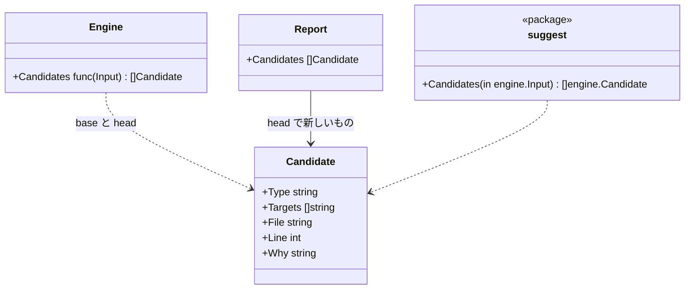

# 不変条件の候補と入口

## 責務

この文書は、人が hadome を設定しなくて済み、エージェントが hadome を自分で探り当てなくて済むようにする部分を扱う。

- **不変条件の候補**: まだ誰も書き出していない不変条件を持つことが多い、コードの場所（パッケージ `internal/suggest`）
- **`hadome suggest`**: 候補を `.hadome.yml` にそのまま貼れるエントリとして出す
- **`hadome agents`**: エージェントに hadome を伝えるブロックを出す、またはファイルに書き込む
- **`hadome init`**: 最小の `.hadome.yml` を書く

しないこと:

- 何かを決めること。候補は情報で、終了コードを変えず、hadome が自分で設定に足すこともない
- 候補が正しいかを判断すること。`CreatePost` という関数が冪等である必要はないかもしれない。決めるのは人である

## 候補

候補は、テストでも生成されたものでもないコードのシンボルから見つける。数えるのは公開されたシンボルだけで、不変条件はそれらの入口について書くものだからだ。

| 型 | シンボルが候補になる条件 |
|---|---|
| `idempotent` | 名前が `Create`、`Add`、`Insert`、`Register`、`Submit`、`Enqueue` で始まる |
| `erasable` | 名前が `Delete`、`Remove`、`Erase`、`Purge` で始まる |
| `isolated` | 名前が `Get`、`List`、`Find`、`Search`、`Read`、`Load`、`Fetch`、`Query` で始まり、範囲の引数（名前が user、tenant、owner、account、org、team、workspace、customer、project を表す引数。[rules-tests.ja.md](rules-tests.ja.md) を参照）を持つ |
| `round-trip` | 同じユニット・同じレシーバにある組の1つ目である: `Export`/`Import`、`Encode`/`Decode`、`Marshal`/`Unmarshal`、`Serialize`/`Deserialize`、`Save`/`Load` の後に同じ残りの名前が続く（`ExportRows` と `ImportRows`） |

「で始まる」は、その語が名前全体であるか、後に大文字か数字が続くことを指す。なので `Address` は `Add` ではない。

同じ型の設定済みの不変条件がすでに名指ししているシンボルは候補にならない。候補の対象は設定と同じ書き方で書く。ユニットのパスの最後の要素、続けて名前（`api.CreatePost`、`store.Store.Delete`）。

### 候補が出る場所

| 場所 | どの候補か | 理由 |
|---|---|---|
| `hadome check` | この変更で新しく出たもの: head では候補で、base では候補でなかったもの | チェックのほかのすべてと同じく、変更についての話だから。前からある候補を毎回繰り返さない |
| `hadome suggest` | 作業ツリーのすべて | 不変条件を探す人やエージェントは一覧全体が欲しい |

どちらも終了コードを変えない。



エンジンが知っているのは関数の型だけである。`cmd/hadome` が `suggest.Candidates` を渡すので、エンジンは候補を出すロジックに依存しない。

## `hadome suggest`

作業ツリーをその設定で解析し、候補を `invariants:` のエントリとして出す。各エントリには、どこにあり、なぜ候補にしたかを書いたコメントが付く。受け入れるには `.hadome.yml` に写せばよい。

## `hadome agents`

| 形 | すること |
|---|---|
| `hadome agents` | ブロックを出す |
| `hadome agents --lang ja` | 日本語で出す |
| `hadome agents --write <file>...` | ブロックを、並べたファイルそれぞれに入れる |

英語のブロックは README のクイックスタートにあるものと同じで、両者が食い違うとテストが落ちる。

### ファイルに入れる

書き先は必ず人かエージェントが指定する。エージェントが読むファイルの名前はツールごとに違い、増えたり変わったりする（`AGENTS.md`、`CLAUDE.md`、`.github/copilot-instructions.md` など）。hadome がその一覧を持つと、名前が変わるたびに直し続けることになる。そのため、書き先は探さない。

```sh
hadome agents --write AGENTS.md CLAUDE.md
```

| ファイルの状態 | すること |
|---|---|
| 印（`<!-- hadome:begin -->` と `<!-- hadome:end -->`）がある | 印の間を置き換える |
| 印が無い | ファイルの末尾にブロックを足す |
| ファイルが無い | ファイルを作り、ブロックだけを入れる |
| ファイルを置くディレクトリが無い | 失敗にする。打ち間違い（`.githbu/`）でディレクトリができるのを防ぐため |
| 印が片方しか無い | 失敗にする。どこまでが hadome のブロックか分からないため |

- パスは相対でも絶対でもよい。相対パスはコマンドを実行したディレクトリから見た場所を指す
- 書く前に、並べたファイルをすべて確かめる。1つでも失敗にあたるものがあれば、どのファイルも書き換えず、問題をすべて出して終了コード `2` を返す。半分だけ書き換わった状態を残さないため
- すべて書けたら、書いたファイルを1行ずつ出して終了コード `0` を返す

## `hadome init`

`schema: 1`、見つけた言語のコメント、`hadome suggest` と `hadome explain` を指すコメントを入れた `.hadome.yml` を書く。既存のファイルは上書きしない。

言語はファイルの拡張子で見つける。Ansible の YAML は拡張子では見分けられないので、Ansible のアダプタが受け持つ配置（`roles/…`、`playbooks/…`、ルートの `site.yml` と `playbook.yml`）にファイルがあれば、Ansible を見つけたとする。受け持つかどうかはアダプタの決め方をそのまま使って判断する。

`mutation` の設定もコメントにして書く（[mutation.ja.md](mutation.ja.md)）。見つけた言語ごとに、よく使うテストのコマンドを1行ずつ並べる。利用者は1つを残し、そのコメントを外して使う。推測したコマンドなので、有効にはしない。

| 言語 | テストのコマンド |
|---|---|
| Go | `[go, test, ./...]` |
| TypeScript | `[npm, test]` |
| Python | `[python, -m, pytest]` |
| Rust | `[cargo, test]` |
| Java、Kotlin | `[./gradlew, test]` |
| Terraform、Ansible | 書かない。壊す関数が無い |

hadome はこのファイルが無くても動くので、`init` は近道であって必須ではない。

## 不変条件

1. 候補は終了コードを変えない
2. `hadome agents --write` を2回実行しても、ファイルは1回目の後と同じまま
3. `hadome agents --write` が失敗したときは、どのファイルも書き換わっていない
4. `hadome init` はファイルを上書きしない

## 意図して入れなかったもの

- コードの振る舞い（何を書くか、どの表に触るか）から出す候補。事実が持っているのは名前と引数だけである
- 候補を受け入れる対話的なモード。出力はそのまま有効な設定で、受け入れるのは貼るだけでよい
- `hadome agents` の書き先を探すこと。理由は「ファイルに入れる」にある
- `hadome agents` の書き先を対話で聞くこと。`hadome agents` をいちばんよく実行するのはエージェントで、エージェントは問いに答えられない。CI でも止まってしまう
