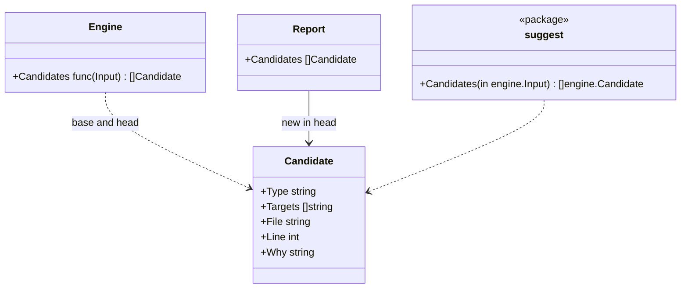

# Invariant candidates and the entry points

## Responsibility

This document covers the parts that spare people from configuring hadome and spare agents from discovering it on their own:

- **Invariant candidates**: places in the code that usually carry an invariant nobody has written down yet (package `internal/suggest`)
- **`hadome suggest`**: prints the candidates as entries ready to paste into `.hadome.yml`
- **`hadome agents`**: prints, or writes into a file, the block that tells agents about hadome
- **`hadome init`**: writes a minimal `.hadome.yml`

It does not:

- Decide anything. A candidate is information: it never changes an exit code, and hadome never adds one to the configuration itself
- Judge whether a candidate is right. A function named `CreatePost` may not need to be idempotent; a person decides

## Candidates

A candidate is found from the symbols of non-test, non-generated code. Only exported symbols count: they are the entry points an invariant is written about.

| Type | A symbol is a candidate when |
|---|---|
| `idempotent` | Its name begins with `Create`, `Add`, `Insert`, `Register`, `Submit` or `Enqueue`, it reaches input or output, and it is reached from an entry point that can be retried ("Conditions of `idempotent`" below) |
| `erasable` | Its name begins with `Delete`, `Remove`, `Erase` or `Purge` |
| `isolated` | Its name begins with `Get`, `List`, `Find`, `Search`, `Read`, `Load`, `Fetch` or `Query`, and it has a scope parameter (a parameter whose name says user, tenant, owner, account, org, team, workspace, customer or project; see [rules-tests.md](rules-tests.md)) |
| `round-trip` | It is the first of a pair in the same unit and receiver: `Export`/`Import`, `Encode`/`Decode`, `Marshal`/`Unmarshal`, `Serialize`/`Deserialize` or `Save`/`Load`, followed by the same rest of the name (`ExportRows` and `ImportRows`) |

- **"Begins with"**: decided by how the name is spelled. The word may also be the whole name.

  | Spelling | Example | What follows the word |
  |---|---|---|
  | PascalCase | `DeleteRow` | an upper-case letter or digit |
  | camelCase | `deleteRow` | an upper-case letter or digit |
  | snake_case | `delete_row` | `_` |

  - In camelCase and snake_case the word is compared with its first letter in lower case. For example, both `deleteRow` and `delete_row` begin with `Delete`
  - `Address` and `address` do not begin with `Add`
  - The pairs of `round-trip` are looked for in the same spelling. For example, `exportRows` and `importRows`, `export_rows` and `import_rows`
- **UI components**: a function in a `.tsx` or `.jsx` file whose name starts with an upper-case letter is not a candidate. In React, such a function is a component. A component is a part of a screen, not an operation. For example, `DeleteRowDialog`

A symbol already named by a configured invariant of the same type is not a candidate. The target of a candidate is written the way configuration writes it: the unit's last path element, then the name (`api.CreatePost`, `store.Store.Delete`). When two symbols would have the same name in this form, each is written with the shortest path that tells them apart ([rules-tests.md](rules-tests.md)), such as `shops/[id].load` and `orders/[id].load`.

### Conditions of `idempotent`

Deciding by the name alone makes functions that only return a value candidates too. For example, `AddDays`, `Add(a, b)`, a `createAuthCookie` that only builds a value, and a `Register` that only registers routes. Idempotency matters only for functions that a retried request can make change state twice. So a symbol is a candidate only when all three of these hold.

| Condition | What it means |
|---|---|
| **(a) Name** | It begins with `Create`, `Add`, `Insert`, `Register`, `Submit` or `Enqueue` |
| **(b) Reaches input or output** | The function's body uses something that does input or output. Or the functions its body calls, as far as hadome can follow the calls (and the functions they call), use one |
| **(c) Reached from an entry point** | It is reached from an entry point that can be retried, through calls hadome can follow. The entry point itself counts |

- Example: a `CreateOrder` that a handler calls and that writes to the database is a candidate
- Example: a `createAuthCookie` that only builds a value fails (b), so it is not a candidate
- Example: a `Register` that only registers routes fails (b) too, so it is not a candidate. A call that registers a route or a subscription is not input or output
- **A repository with no entry point**: in a repository with no recognisable entry point at all, such as a library, (a) and (b) alone decide
- The three conditions mean the same in every language hadome reads

**What does input or output**: the same knowledge `tests/purity-lost` uses ([adapters.md](adapters.md)'s io table, and the configuration's `io`). A body reaches input or output when it uses one of these.

| Language | What reaches input or output |
|---|---|
| Go | A function of a package in the io table (`sql.Open`, `http.Get`). A method of a value whose type is from a package in the io table (`s.db.ExecContext(…)` when the field is a `*sql.DB`) |
| TypeScript | A name imported from a package in the io table. A global input or output API (`fetch` and the like) |
| Python | A name imported from a module in the io table (`psycopg.connect`) |
| Java, Kotlin | A static method of a class imported from a package in the io table, and a method of a value of such a type (a field typed `JdbcTemplate` or `Connection`) |
| Rust | A path into a crate in the io table (`sqlx::query`) and the names `use` brings in from one. A method of a value of such a type |

- In every language, using a value of a unit of the repository reaches input or output when that unit does. A value is anything but a function: a variable, a constant, a value of a class or interface that declares no such function. For example, TypeScript's `db`, or a value of a Spring Data repository interface
- A unit reaches input or output when it has an import that does input or output, or when imports lead from it to a unit of the repository that has one
- Using a value declared at the top of the file (`const db = drizzle(pool)`, a Python module variable, a Kotlin top-level property, a Rust `const` or `static`) also uses what its initial value uses

**Calls hadome can follow**: calls whose callee the syntax decides as one function.

| Language | Calls it follows |
|---|---|
| Go | The calls whose callee is identified the way a test's call targets are (functions, and methods of values of declared types) |
| TypeScript | Calls of imported names and of names declared at the top of the file |
| Python | Calls of imported names and of names the module declares. Methods on `self` and `cls`. Methods of an object made in place (`Ledger().submit(…)`) |
| Java, Kotlin | Methods of the same class. Methods of fields, parameters and locals of declared types (constructor properties included). Static methods of imported classes and of classes of the same package. Methods of an object made with `new`. Kotlin's top-level functions |
| Rust | Functions of the same module. Names and paths brought in with `use` (`crate::store::append`). `Self::f` and methods on `self`. Methods of parameters, locals and struct fields of declared types |

- In TypeScript and Python only the name is looked at: a local variable that hides an imported name is still read as that name

**Entry points that can be retried**: the ones recognisable from the syntax. They are HTTP handlers, queue consumers and scheduled jobs.

| Language | Entry points |
|---|---|
| Go | Functions and methods whose parameters are `(http.ResponseWriter, *http.Request)` (the shape of `ServeHTTP` and `http.HandlerFunc`). Functions handed with a string to `Handle`, `HandleFunc`, `Get`, `Post`, `Put`, `Patch`, `Delete` and the like (`mux.HandleFunc("/orders", h.CreateOrder)`, asynq's `mux.HandleFunc("email:send", h)`). Functions handed to NATS's `Subscribe` and `QueueSubscribe` and to robfig/cron's `AddFunc`. Function literals written there |
| TypeScript | `GET`, `POST` and the like exported by SvelteKit's `+server.*`, and `load` and `actions` of `+page.server.*` and `+layout.server.*`. `GET`, `POST` and the like exported by a Next.js `route.*` under `app/`, and the default export under `pages/api/`. The functions exported by a file that starts with `'use server'`. Functions handed with a string to `get`, `post`, `put`, `patch`, `delete`, `all`, `use` or `on` in Express, Hono and the like (`app.post('/orders', createOrder)`). Functions handed to node-cron's `schedule`, amqplib's `consume`, BullMQ's `new Worker('name', fn)`, Bull's `process`, kafkajs's `eachMessage` and `eachBatch`, and sqs-consumer's `handleMessage` and `handleMessageBatch`. Functions written there |
| Python | Decorators written with a path (`@app.route`, `@app.get`, `post` and the like, `@router.post`, `@app.api_route`). `@shared_task`, `@app.task`, `@periodic_task`, `@scheduler.scheduled_job`, `@api_view`, and Dramatiq's `@actor`. View functions handed to Django's `path`, `re_path` and `url`, and the methods of a class given with `as_view()`. The methods of a view set handed to `router.register` |
| Java, Kotlin | Spring's `@GetMapping`, `@PostMapping`, `@PutMapping`, `@PatchMapping`, `@DeleteMapping` and `@RequestMapping`. JAX-RS's `@GET`, `@POST`, `@PUT`, `@PATCH` and `@DELETE`. Methods with `@KafkaListener`, `@RabbitListener`, `@JmsListener`, `@SqsListener`, `@Scheduled` or Quarkus's `@Incoming`. Lambdas handed to Ktor's `get`, `post`, `put`, `patch`, `delete`, `head` and `options` in Kotlin |
| Rust | Functions with an actix-web or Rocket attribute (`#[get("/")]`, `#[post(…)]` and the like). Functions and closures handed to axum's `route("/orders", post(create))`. Functions handed to actix-web's `.to(create)` |

- Entry code that is not a symbol, such as the `actions` object or a function written next to a path, counts the calls in it as reached from an entry point

**Deliberately left out**:

- Queue consumers and scheduled jobs with no fixed form in the syntax. For example, code that receives messages in a loop, jobs registered in a configuration file, and Rust's consumers. The syntax alone cannot decide which function is the entry point. A repository whose only entry points are of this kind is decided by (a) and (b), as one with no entry point
- Where calls of interface values, and of functions received as parameters, go. The syntax does not decide it
- Methods of Python values without a type annotation (`self.repo.save(…)`). The syntax does not decide whose class the value is

### Where candidates appear

| Where | Which candidates | Why |
|---|---|---|
| `hadome check` | Those that are new in this change: candidates in head that were not candidates in base | Like everything else in a check, it is about the change. A long-standing candidate is not repeated on every run |
| `hadome suggest` | All of them, for the working tree | A person or agent looking for invariants wants the whole list |

Neither changes the exit code.



The engine knows only the function's type. `cmd/hadome` passes `suggest.Candidates`, so the engine never depends on the suggestion logic.

## `hadome suggest`

Analyses the working tree with its configuration and prints the candidates as `invariants:` entries, each with a comment saying where it is and why it was suggested. Accepting one is copying it into `.hadome.yml`.

## `hadome agents`

| Form | Does |
|---|---|
| `hadome agents` | Prints the block |
| `hadome agents --lang ja` | Prints it in Japanese |
| `hadome agents --write <file>...` | Puts the block into each of the files listed |

The English block is the one in the README's quick start; a test fails when the two differ.

### Writing into files

A person or an agent always names the files. The files agents read have different names in each tool, and the names keep being added and changed (`AGENTS.md`, `CLAUDE.md`, `.github/copilot-instructions.md` and so on). If hadome kept a list of them, it would have to be fixed each time a name changed. So hadome does not search for where to write.

```sh
hadome agents --write AGENTS.md CLAUDE.md
```

| State of the file | What happens |
|---|---|
| It has the markers (`<!-- hadome:begin -->` and `<!-- hadome:end -->`) | What is between them is replaced |
| It has no markers | The block is appended to the end of the file |
| It does not exist | The file is created with only the block |
| Its directory does not exist | A failure, so that a typo (`.githbu/`) does not create a directory |
| It has only one of the markers | A failure, because where hadome's block ends is unknown |

- A path may be relative or absolute. A relative path is taken from the directory the command runs in
- Every file listed is checked before any is written. If any of them is a failure, no file is changed, every problem is reported, and the exit code is `2`. This leaves no half-written state
- When all are written, each file written is printed on its own line, and the exit code is `0`

## `hadome init`

Writes `.hadome.yml` with `schema: 1`, the detected languages as a comment, and comments pointing at `hadome suggest` and `hadome explain`. It refuses to overwrite an existing file.

Languages are detected by file extension. Ansible's YAML cannot be told apart by extension, so Ansible is detected when a file is in the layout the Ansible adapter claims (`roles/…`, `playbooks/…`, `site.yml` and `playbook.yml` at the root), decided by the adapter's own rule.

hadome works without the file, so `init` is a shortcut, never a requirement.

It writes the `mutation` setting too, as a comment ([mutation.md](mutation.md)).

- For each language found it lists the usual test command, but only for a language whose file the command needs (table below) is at the root. Example: without a `package.json` at the root `npm test` cannot run, so it is not written
- A language without that file at the root gets a one-line comment saying so instead of a command
- The first command is commented once, the others twice. Uncommenting the setting's lines once turns on the first command only; the setting never gets two `test` keys and becomes invalid
- To run another language's tests, the user rewrites the first command
- The commands are guesses, so none is turned on

| Language | Test command | File needed at the root (any one) |
|---|---|---|
| Go | `[go, test, ./...]` | `go.mod` |
| TypeScript | `[npm, test]` | `package.json` |
| Python | `[python, -m, pytest]` | `pyproject.toml`, `setup.py`, `setup.cfg`, `pytest.ini` |
| Rust | `[cargo, test]` | `Cargo.toml` |
| Java, Kotlin | `[./gradlew, test]` | `gradlew` |
| Terraform, Ansible | None: there are no functions to break | |

## Invariants

1. Candidates never change an exit code
2. `hadome agents --write` run twice leaves the file as it was after the first run
3. When `hadome agents --write` fails, no file has changed
4. `hadome init` never overwrites a file

## Deliberately left out

- Candidates from how code behaves (what it writes, which tables it touches). Names and parameters are all the facts hold
- An interactive mode for accepting candidates. The output is valid configuration; accepting is pasting
- Searching for where `hadome agents` writes. The reason is in "Writing into files"
- Asking where `hadome agents` writes, interactively. Agents run `hadome agents` most, and an agent cannot answer a question. It would also stop CI
