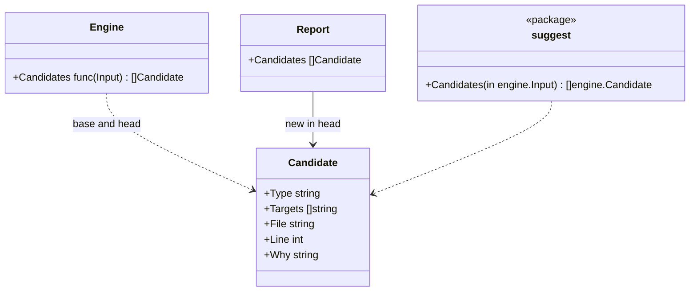

# Invariant candidates and the entry points

## Responsibility

This document covers the parts that spare people from configuring hadome and spare agents from discovering it on their own:

- **Invariant candidates**: places in the code that usually carry an invariant nobody has written down yet (package `internal/suggest`)
- **`hadome suggest`**: prints the candidates as entries ready to paste into `.hadome.yml`
- **`hadome agents`**: prints, or writes into a file, the block that tells agents about hadome
- **`hadome init`**: writes a minimal `.hadome.yml`

It does not:

- Decide anything. A candidate is information: it never changes an exit code, and hadome never adds one to the configuration itself
- Judge whether a candidate is right. A function named `CreatePost` may not need to be idempotent; a person decides

## Candidates

A candidate is found from the symbols of non-test, non-generated code. Only exported symbols count: they are the entry points an invariant is written about.

| Type | A symbol is a candidate when |
|---|---|
| `idempotent` | Its name begins with `Create`, `Insert`, `Submit` or `Enqueue`. Or its name begins with `Add` or `Register`, and the symbol's unit has an import that does input or output (`Import.IO`) |
| `erasable` | Its name begins with `Delete`, `Remove`, `Erase` or `Purge` |
| `isolated` | Its name begins with `Get`, `List`, `Find`, `Search`, `Read`, `Load`, `Fetch` or `Query`, and it has a scope parameter (a parameter whose name says user, tenant, owner, account, org, team, workspace, customer or project; see [rules-tests.md](rules-tests.md)) |
| `round-trip` | It is the first of a pair in the same unit and receiver: `Export`/`Import`, `Encode`/`Decode`, `Marshal`/`Unmarshal`, `Serialize`/`Deserialize` or `Save`/`Load`, followed by the same rest of the name (`ExportRows` and `ImportRows`) |

- **"Begins with"**: decided by how the name is spelled. The word may also be the whole name.

  | Spelling | Example | What follows the word |
  |---|---|---|
  | PascalCase | `DeleteRow` | an upper-case letter or digit |
  | camelCase | `deleteRow` | an upper-case letter or digit |
  | snake_case | `delete_row` | `_` |

  - In camelCase and snake_case the word is compared with its first letter in lower case. For example, both `deleteRow` and `delete_row` begin with `Delete`
  - `Address` and `address` do not begin with `Add`
  - The pairs of `round-trip` are looked for in the same spelling. For example, `exportRows` and `importRows`, `export_rows` and `import_rows`
- **Why `Add` and `Register` have a condition**: these two words also name many functions that only return a value, such as `AddDays` or `Add(a, b)`. Idempotency matters only for functions that change state. Among the facts, only an import that does input or output says that code changes state, so that is the condition
  - The other four words (`Create`, `Insert`, `Submit`, `Enqueue`) almost always change state, so they have no condition
- **UI components**: a function in a `.tsx` or `.jsx` file whose name starts with an upper-case letter is not a candidate. In React, such a function is a component. A component is a part of a screen, not an operation. For example, `DeleteRowDialog`

A symbol already named by a configured invariant of the same type is not a candidate. The target of a candidate is written the way configuration writes it: the unit's last path element, then the name (`api.CreatePost`, `store.Store.Delete`).

### Where candidates appear

| Where | Which candidates | Why |
|---|---|---|
| `hadome check` | Those that are new in this change: candidates in head that were not candidates in base | Like everything else in a check, it is about the change. A long-standing candidate is not repeated on every run |
| `hadome suggest` | All of them, for the working tree | A person or agent looking for invariants wants the whole list |

Neither changes the exit code.



The engine knows only the function's type. `cmd/hadome` passes `suggest.Candidates`, so the engine never depends on the suggestion logic.

## `hadome suggest`

Analyses the working tree with its configuration and prints the candidates as `invariants:` entries, each with a comment saying where it is and why it was suggested. Accepting one is copying it into `.hadome.yml`.

## `hadome agents`

| Form | Does |
|---|---|
| `hadome agents` | Prints the block |
| `hadome agents --lang ja` | Prints it in Japanese |
| `hadome agents --write <file>...` | Puts the block into each of the files listed |

The English block is the one in the README's quick start; a test fails when the two differ.

### Writing into files

A person or an agent always names the files. The files agents read have different names in each tool, and the names keep being added and changed (`AGENTS.md`, `CLAUDE.md`, `.github/copilot-instructions.md` and so on). If hadome kept a list of them, it would have to be fixed each time a name changed. So hadome does not search for where to write.

```sh
hadome agents --write AGENTS.md CLAUDE.md
```

| State of the file | What happens |
|---|---|
| It has the markers (`<!-- hadome:begin -->` and `<!-- hadome:end -->`) | What is between them is replaced |
| It has no markers | The block is appended to the end of the file |
| It does not exist | The file is created with only the block |
| Its directory does not exist | A failure, so that a typo (`.githbu/`) does not create a directory |
| It has only one of the markers | A failure, because where hadome's block ends is unknown |

- A path may be relative or absolute. A relative path is taken from the directory the command runs in
- Every file listed is checked before any is written. If any of them is a failure, no file is changed, every problem is reported, and the exit code is `2`. This leaves no half-written state
- When all are written, each file written is printed on its own line, and the exit code is `0`

## `hadome init`

Writes `.hadome.yml` with `schema: 1`, the detected languages as a comment, and comments pointing at `hadome suggest` and `hadome explain`. It refuses to overwrite an existing file.

Languages are detected by file extension. Ansible's YAML cannot be told apart by extension, so Ansible is detected when a file is in the layout the Ansible adapter claims (`roles/…`, `playbooks/…`, `site.yml` and `playbook.yml` at the root), decided by the adapter's own rule.

hadome works without the file, so `init` is a shortcut, never a requirement.

It writes the `mutation` setting too, as a comment ([mutation.md](mutation.md)).

- For each language found it lists the usual test command, but only for a language whose file the command needs (table below) is at the root. Example: without a `package.json` at the root `npm test` cannot run, so it is not written
- A language without that file at the root gets a one-line comment saying so instead of a command
- The first command is commented once, the others twice. Uncommenting the setting's lines once turns on the first command only; the setting never gets two `test` keys and becomes invalid
- To run another language's tests, the user rewrites the first command
- The commands are guesses, so none is turned on

| Language | Test command | File needed at the root (any one) |
|---|---|---|
| Go | `[go, test, ./...]` | `go.mod` |
| TypeScript | `[npm, test]` | `package.json` |
| Python | `[python, -m, pytest]` | `pyproject.toml`, `setup.py`, `setup.cfg`, `pytest.ini` |
| Rust | `[cargo, test]` | `Cargo.toml` |
| Java, Kotlin | `[./gradlew, test]` | `gradlew` |
| Terraform, Ansible | None: there are no functions to break | |

## Invariants

1. Candidates never change an exit code
2. `hadome agents --write` run twice leaves the file as it was after the first run
3. When `hadome agents --write` fails, no file has changed
4. `hadome init` never overwrites a file

## Deliberately left out

- Candidates from how code behaves (what it writes, which tables it touches). Names and parameters are all the facts hold
- An interactive mode for accepting candidates. The output is valid configuration; accepting is pasting
- Searching for where `hadome agents` writes. The reason is in "Writing into files"
- Asking where `hadome agents` writes, interactively. Agents run `hadome agents` most, and an agent cannot answer a question. It would also stop CI
