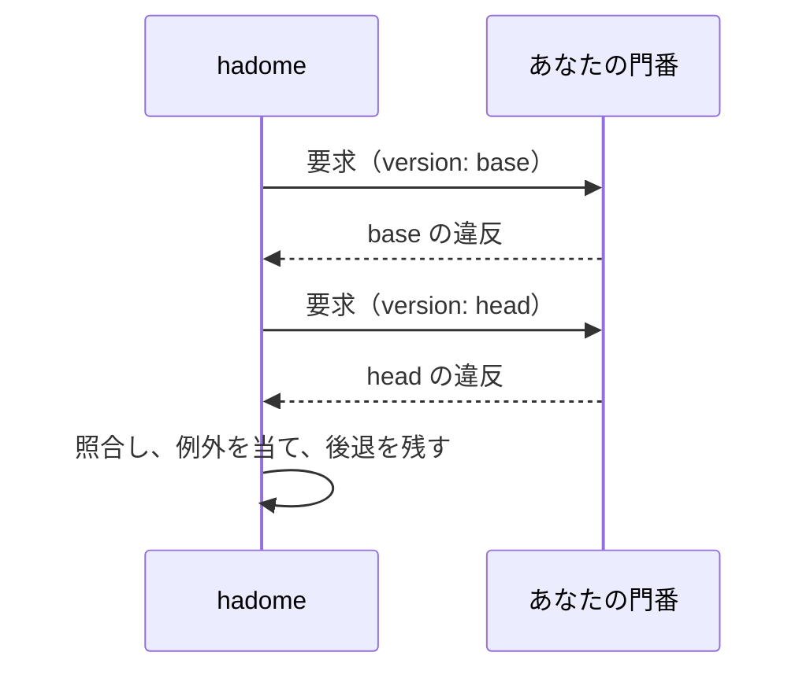

# 製品固有の門番（外部コマンド）

製品固有の門番は、その製品だけが知っているルールを検査する小さなプログラムです。あなたのリポジトリに置き、hadome が実行します。hadome の組み込みのルールは汎用です。

例: 「ログの置き場に UPDATE を書かない」「マイグレーションはすべて冪等にする」「画面からデータベースの層を import しない」

門番にも、組み込みのルールと同じ次のものが付きます。

- 落ちるのは後退だけ。既存の違反は止めない
- 理由つきの例外（`gate:allow <your-gate-id> reason: …`）
- 同じ報告、JSON の出力、終了コード
- 自己テスト

製品についての知識はあなたのリポジトリに置いたままでかまいません。hadome がそれを知る必要はありません。

## 宣言する

```yaml
# .hadome.yml
gates:
  - id: acme/log-append-only          # <namespace>/<name>。namespace はあなたのもの
    kind: finding                     # finding | measure
    run: [scripts/gates/log-append-only]
    paths: ["internal/store/log/**"]  # 任意: このファイルだけを渡す
    timeout: 30s                      # 任意。既定は 60s
    options:                          # 任意: 手を加えずに渡す
      forbidden: [UPDATE, DELETE]
```

## hadome の呼び方

1回のチェックで、hadome はあなたのコマンドを2回呼びます。base の版で1回、head の版で1回です。

- コマンドが見るのは、常に1つのツリーだけです。そこで見えたものを報告します。
- 2つを比べるのは hadome です。



- **作業ディレクトリ**: チェックする版のルートです。たいていは、hadome が用意してあとで消す、その版の写しです。そこへは書き込みません。
- **コマンドの探し方**: `run` のコマンドが `/` を含むなら、hadome を実行したディレクトリから探します。これはあなたのリポジトリの作業ツリーです。そのため、変更で足した門番も base で動きます。`/` を含まないコマンドは `PATH` から探します。引数は探しません（[門番の場所を引数で渡すとき](#門番の場所を引数で渡すとき)）。
- **要求**: 標準入力に JSON で届きます。
- **応答**: コマンドが標準出力に JSON で書きます。
- **標準エラー**: 出したものは診断として利用者に見せます。

### 門番の場所を引数で渡すとき

`run` の2つ目以降（引数）は探さずに、そのまま渡します。そのため、引数の相対パスは作業ディレクトリ、つまりチェックする版の写しを基準にします。

例: `run: [go, run, ./tools/gates/mygate]` は、base の写しにある `./tools/gates/mygate` を動かそうとします。変更で足した門番は base にまだ無いので、門番が実行できず、hadome は `2` で終わります。

門番の横に起動口のスクリプトを置き、それを `run` の1つ目にすると、変更で足した門番も base で動きます。

```sh
#!/bin/sh
# tools/gates/mygate/run
exec go -C "$(dirname "$0")" run . "$@"
```

```yaml
run: [tools/gates/mygate/run]
```

- **`$0`**: `/` を含む1つ目は絶対パスにして呼ぶので、作業ツリーの中を指します。
- **`"$@"`**: hadome が足す引数（`--self-test` など）を門番に渡します。
- **`go -C`**: 作業ディレクトリが門番のディレクトリに変わります。門番はチェックする版を、作業ディレクトリではなく要求の `version.root` から読みます。`go -C` は Go 1.20 以降で使えます。

### 要求

```json
{
  "schema": 1,
  "gate": "acme/log-append-only",
  "version": { "label": "head", "root": "/abs/path/to/version" },
  "files": ["internal/store/log/append.go", "internal/store/log/read.go"],
  "options": { "forbidden": ["UPDATE", "DELETE"] }
}
```

- **`files`**: `root` からの相対パスです。`paths` で絞り込み、並べ替えてあります。
- **`label`**: 表示のための名前です。git から読むときは、リビジョンの名前か `working tree` になります。

### finding の門番の応答

```json
{
  "schema": 1,
  "findings": [
    {
      "file": "internal/store/log/append.go",
      "line": 42,
      "anchor": "func compact",
      "message": "UPDATE statement in the log store",
      "why": "The log is append-only; rewriting rows destroys history",
      "fix": "Append a new row that records the change instead"
    }
  ]
}
```

`anchor` は、行が動いても、違反が同じものだと分かるようにするための値です。無関係な編集で変わらないものを選びます。例: 囲んでいる関数の名前、空白をそろえた問題の行。行番号は入れません。

### measure の門番の応答

measure の門番は守っているものを報告します。base で守っていたものが head で無くなると、後退になります。

```json
{
  "schema": 1,
  "items": [
    { "key": "endpoint:/health", "detail": "covered by api/health_test.go" }
  ]
}
```

項目が消えると、hadome はそれが正当だったかをもう1度コマンドに聞きます。正当な例: エンドポイントそのものを消した。

```json
{ "schema": 1, "gate": "acme/endpoint-coverage", "mode": "removed",
  "version": { "label": "head", "root": "/abs/path" }, "keys": ["endpoint:/health"] }
```

```json
{ "schema": 1, "legitimate": ["endpoint:/health"] }
```

正当として挙げなかったキーは後退になります。`mode: removed` に対応しない門番は空の一覧を返せばかまいません。

## コマンドの終了状態

| コマンドの終了 | hadome の扱い |
|---|---|
| `0` で有効な JSON | この版の結果 |
| それ以外、不正な JSON、時間切れ | 門番が実行できなかったものとし、hadome は `2` で終わる。実行できなかったチェックは決して通らない |

## 自己テスト

コマンドは `--self-test` に答えます。自分の事例を実行し、すべて通ったときだけ `0` で終わります。

- **`hadome self-test`**: 組み込みのルールと並べて、これを実行します。
- **`hadome check`**: 門番を使う前に `--self-test` を1回実行します。`0` で終わらなければ、門番の結果を使わずに、終了コード `2` で止まります。

## 門番が守ること

- **1つのツリーだけ。** `root` の外を見ません。版を比べません。
- **通信しない、時刻を読まない。** 同じツリーには常に同じ答えを返します。
- **書き込まない。** `root` の下のファイルを変えません。
- **順序は問わない。** 返したものは hadome が並べ替えます。

## 信頼

hadome はリポジトリの設定に並んだコマンドを、そのリポジトリのほかのスクリプトと同じ権限で実行します。門番のコマンドもリポジトリのほかのコードと同じように確認します。
