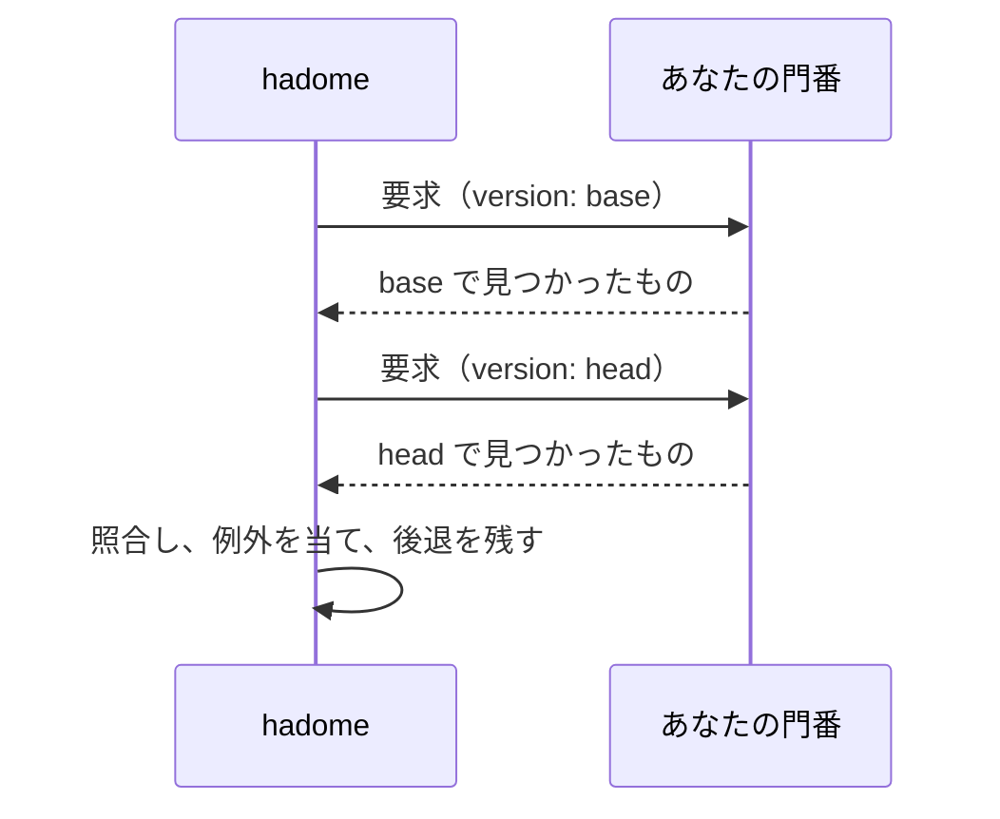

# 製品固有の門番（外部コマンド）

hadome の組み込みのルールは汎用である。どの製品にも、その製品だけが知っているルールがある。「ログの置き場に UPDATE を書かない」「マイグレーションはすべて冪等にする」「画面からデータベースの層を import しない」。そうしたルールはあなたのリポジトリに小さなプログラムとして書き、hadome がそれを実行する。

門番にも、組み込みのルールと同じ次のものが付く。

- 落ちるのは後退だけ。既存の違反は止めない
- 理由つきの例外（`gate:allow <your-gate-id> reason: …`）
- 同じ報告、JSON の出力、終了コード
- 自己テスト

製品についての知識はあなたのリポジトリに置いたままでよい。hadome がそれを知る必要はない。

## 宣言する

```yaml
# .hadome.yml
gates:
  - id: acme/log-append-only          # <namespace>/<name>。namespace はあなたのもの
    kind: finding                     # finding | measure
    run: [scripts/gates/log-append-only]
    paths: ["internal/store/log/**"]  # 任意: このファイルだけを渡す
    timeout: 30s                      # 任意。既定は 60s
    options:                          # 任意: 手を加えずに渡す
      forbidden: [UPDATE, DELETE]
```

## hadome の呼び方

1回のチェックで、hadome はあなたのコマンドを2回呼ぶ。base の版で1回、head の版で1回。コマンドが見るのは常に1つのツリーだけで、そこで見えたものを報告する。2つを比べるのは hadome の仕事である。



- 作業ディレクトリはチェックする版のルートである。たいていは hadome が用意して後で消す、その版の写しになる。そこへは書き込まない
- `run` のコマンドが `/` を含むなら、hadome を実行したディレクトリ（あなたのリポジトリの作業ツリー）から探す。なので変更で足した門番も base で動く。それ以外のコマンドは `PATH` から探す
- 要求は標準入力に JSON で届く
- コマンドは応答を標準出力に JSON で書く
- 標準エラーに出したものは、診断として利用者に見せる

### 要求

```json
{
  "schema": 1,
  "gate": "acme/log-append-only",
  "version": { "label": "head", "root": "/abs/path/to/version" },
  "files": ["internal/store/log/append.go", "internal/store/log/read.go"],
  "options": { "forbidden": ["UPDATE", "DELETE"] }
}
```

`files` は `root` からの相対パスで、`paths` で絞り込み済み、並べ替え済みである。

### finding の門番の応答

```json
{
  "schema": 1,
  "findings": [
    {
      "file": "internal/store/log/append.go",
      "line": 42,
      "anchor": "func compact",
      "message": "UPDATE statement in the log store",
      "why": "The log is append-only; rewriting rows destroys history",
      "fix": "Append a new row that records the change instead"
    }
  ]
}
```

`anchor` は、行が動いても見つかったものを同じものと分かるようにする。無関係な編集で変わらないものを選ぶ。囲んでいる関数の名前や、空白を揃えた問題の行など。行番号は入れない。

### measure の門番の応答

measure の門番は守っているものを報告し、後退は base で守っていたものが head で無くなったものになる。

```json
{
  "schema": 1,
  "items": [
    { "key": "endpoint:/health", "detail": "covered by api/health_test.go" }
  ]
}
```

項目が消えると、hadome はそれが正当だったか（たとえばエンドポイントそのものを消した）をもう1度コマンドに聞く。

```json
{ "schema": 1, "gate": "acme/endpoint-coverage", "mode": "removed",
  "version": { "label": "head", "root": "/abs/path" }, "keys": ["endpoint:/health"] }
```

```json
{ "schema": 1, "legitimate": ["endpoint:/health"] }
```

正当として挙げなかったキーは後退になる。`mode: removed` に対応しない門番は空の一覧を返せばよい。

## コマンドの終了状態

| コマンドの終了 | hadome の扱い |
|---|---|
| `0` で有効な JSON | この版の結果 |
| それ以外、不正な JSON、時間切れ | 門番が実行できなかった → hadome は `2` で終わる（実行できなかったチェックは決して通らない） |

## 自己テスト

コマンドは `--self-test` に答える。自分の事例を実行し、すべて通ったときだけ `0` で終わる。`hadome self-test` は組み込みのルールと並べてこれを実行する。動く自己テストを持たない門番は読み込まない。

## 門番が守ること

- **1つのツリーだけ。** `root` の外を見ない、版を比べない
- **通信しない、時刻を読まない。** 同じツリーには常に同じ答えを返す
- **書き込まない。** `root` の下のファイルを変えない
- **順序は問わない。** 返したものは hadome が並べ替える

## 信頼

hadome はリポジトリの設定に並んだコマンドを、そのリポジトリのほかのスクリプトと同じ権限で実行する。門番のコマンドはリポジトリのほかのコードと同じように確認すること。
