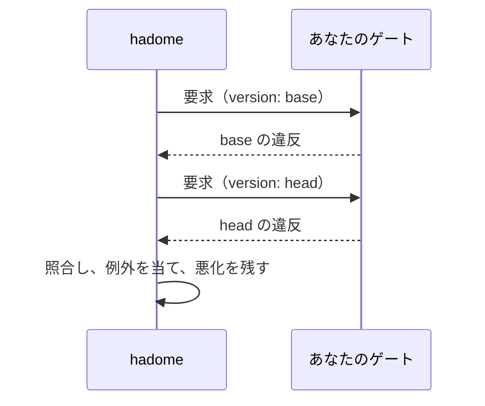

# 製品固有のゲート（外部コマンド）

製品固有のゲートは、その製品だけが知っているルールを検査する小さなプログラムです。あなたのリポジトリに置き、hadome が実行します。hadome の組み込みのルールは汎用です。

例: 「ログの置き場に UPDATE を書かない」「マイグレーションはすべて冪等にする」「画面からデータベースの層を import しない」

ゲートにも、組み込みのルールと同じ次のものが付きます。

- 落ちるのは悪化だけ。既存のルール違反は止めない
- 理由つきの例外（`gate:allow <your-gate-id> reason: …`）
- 同じ報告、JSON の出力、終了コード
- 自己テスト

製品についての知識はあなたのリポジトリに置いたままでかまいません。hadome がそれを知る必要はありません。

## 宣言する

```yaml
# .hadome.yml
gates:
  - id: acme/log-append-only          # <namespace>/<name>。namespace はあなたのもの
    kind: finding                     # finding | measure
    run: [scripts/gates/log-append-only]
    paths: ["internal/store/log/**"]  # 任意: このファイルだけを渡す
    timeout: 30s                      # 任意。既定は 60s
    options:                          # 任意: 手を加えずに渡す
      forbidden: [UPDATE, DELETE]
```

## hadome の呼び方

1回のチェックで、hadome はあなたのコマンドを2回呼びます。base のバージョンで1回、head のバージョンで1回です。

- コマンドが見るのは、常に1つのツリーだけです。そこで見えたものを報告します。
- 2つを比べるのは hadome です。



- **作業ディレクトリ**: チェックするバージョンのルートです。たいていは、hadome が用意してあとで消す、そのバージョンの写しです。そこへは書き込みません。
- **コマンドの探し方**: `run` のコマンドが `/` を含むなら、hadome を実行したディレクトリから探します。これはあなたのリポジトリの作業ツリーです。`/` を含まないコマンドは `PATH` から探します。引数は探しません（[ゲートの場所を引数で渡すとき](#ゲートの場所を引数で渡すとき)）。
- **足したゲート、コマンドを変えたゲート**: `hadome check` は実行しません。実行するのは、base の設定に同じ `id` と同じ `run` があるゲートだけです。それ以外のゲートは `config/gate-not-run` として人の確認に回り、hadome は `3` で終わります。変更が基準のブランチに入ると、以降のチェックで実行されます。足したゲートが動くかは、手元の `hadome self-test` で確かめます。
- **要求**: 標準入力に JSON で届きます。
- **応答**: コマンドが標準出力に JSON で書きます。
- **標準エラー**: 出したものは診断として利用者に見せます。

### ゲートの場所を引数で渡すとき

`run` の2つ目以降（引数）は探さずに、そのまま渡します。そのため、引数の相対パスは作業ディレクトリ、つまりチェックするバージョンの写しを基準にします。

例: `run: [go, run, ./tools/gates/mygate]` は、base のバージョンでは base の写しにある `./tools/gates/mygate` を、head のバージョンでは head の写しにあるものを動かします。変更でゲートを直すと、2つのバージョンを違うコードで判定することになり、直したことで増えた分が悪化に見えます。

ゲートの横に起動口のスクリプトを置き、それを `run` の1つ目にすると、両方のバージョンを作業ツリーにある同じゲートで判定します。

```sh
#!/bin/sh
# tools/gates/mygate/run
exec go -C "$(dirname "$0")" run . "$@"
```

```yaml
run: [tools/gates/mygate/run]
```

- **`$0`**: `/` を含む1つ目は絶対パスにして呼ぶので、作業ツリーの中を指します。
- **`"$@"`**: hadome が足す引数（`--self-test` など）をゲートに渡します。
- **`go -C`**: 作業ディレクトリがゲートのディレクトリに変わります。ゲートはチェックするバージョンを、作業ディレクトリではなく要求の `version.root` から読みます。`go -C` は Go 1.20 以降で使えます。

### 要求

```json
{
  "schema": 1,
  "gate": "acme/log-append-only",
  "version": { "label": "head", "root": "/abs/path/to/version" },
  "files": ["internal/store/log/append.go", "internal/store/log/read.go"],
  "options": { "forbidden": ["UPDATE", "DELETE"] }
}
```

- **`files`**: `root` からの相対パスです。`paths` で絞り込み、並べ替えてあります。
- **`label`**: 表示のための名前です。git から読むときは、リビジョンの名前か `working tree` になります。

### finding のゲートの応答

```json
{
  "schema": 1,
  "findings": [
    {
      "file": "internal/store/log/append.go",
      "line": 42,
      "anchor": "func compact",
      "message": "UPDATE statement in the log store",
      "why": "The log is append-only; rewriting rows destroys history",
      "fix": "Append a new row that records the change instead"
    }
  ]
}
```

`anchor` は、行が動いても、違反が同じものだと分かるようにするための値です。無関係な編集で変わらないものを選びます。例: 囲んでいる関数の名前、空白をそろえた問題の行。行番号は入れません。

### measure のゲートの応答

measure のゲートは守っているものを報告します。base で守っていたものが head で無くなると、悪化になります。

```json
{
  "schema": 1,
  "items": [
    { "key": "endpoint:/health", "detail": "covered by api/health_test.go" }
  ]
}
```

項目が消えると、hadome はそれが正当だったかをもう1度コマンドに聞きます。正当な例: エンドポイントそのものを消した。

```json
{ "schema": 1, "gate": "acme/endpoint-coverage", "mode": "removed",
  "version": { "label": "head", "root": "/abs/path" }, "keys": ["endpoint:/health"] }
```

```json
{ "schema": 1, "legitimate": ["endpoint:/health"] }
```

正当として挙げなかったキーは悪化になります。`mode: removed` に対応しないゲートは空の一覧を返せばかまいません。

## コマンドの終了状態

| コマンドの終了 | hadome の扱い |
|---|---|
| `0` で有効な JSON | このバージョンの結果 |
| それ以外、不正な JSON、時間切れ | ゲートが実行できなかったものとし、hadome は `2` で終わる。実行できなかったチェックは決して通らない |

## 自己テスト

コマンドは `--self-test` に答えます。自分の事例を実行し、すべて通ったときだけ `0` で終わります。

- **`hadome self-test`**: 組み込みのルールと並べて、これを実行します。
- **`hadome check`**: ゲートを使う前に `--self-test` を1回実行します。`0` で終わらなければ、ゲートの結果を使わずに、終了コード `2` で止まります。実行しないゲート（足したゲート、コマンドを変えたゲート）の自己テストも実行しません。

## ゲートが守ること

- **1つのツリーだけ。** `root` の外を見ません。バージョンを比べません。
- **通信しない、時刻を読まない。** 同じツリーには常に同じ答えを返します。
- **書き込まない。** `root` の下のファイルを変えません。
- **順序は問わない。** 返したものは hadome が並べ替えます。

## 信頼

hadome はリポジトリの設定に並んだコマンドを、そのリポジトリのほかのスクリプトと同じ権限で実行します。ゲートのコマンドもリポジトリのほかのコードと同じように確認します。

- **`hadome check` が実行するコマンド**: 基準のブランチの設定にすでにあるゲートのコマンドだけです。プルリクエストが `.hadome.yml` にゲートを足しても、人が確かめて基準のブランチに入れるまで、そのコマンドは実行しません。
- **防げないもの**: 基準のブランチにあるゲートのスクリプトをプルリクエストが書き換えると、書き換えた中身が実行されます。`run[0]` を作業ツリーから探すためです。信頼できないプルリクエストでは、ゲートのスクリプトへの変更を先に確かめます。
