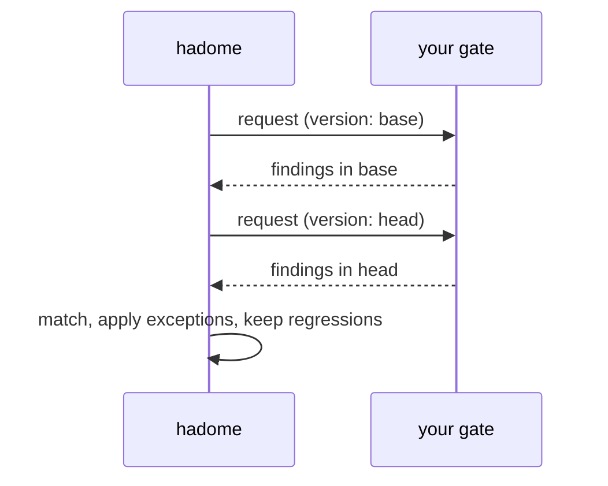

# Product-specific gates (external commands)

hadome's built-in rules are generic. Every product also has rules only it knows — "never write UPDATE in the log store", "every migration must be idempotent", "screens must not import the database layer". You write those as a small program in your repository, and hadome runs it for you.

A gate gets the following, the same as a built-in rule:

- Only regressions fail — existing violations never block
- Reasoned exceptions (`gate:allow <your-gate-id> reason: …`)
- The same report, JSON output and exit codes
- Self-tests

Knowledge about your product can stay in your repository. hadome never needs to know it.

## Declare it

```yaml
# .hadome.yml
gates:
  - id: acme/log-append-only          # <namespace>/<name>; the namespace is yours
    kind: finding                     # finding | measure
    run: [scripts/gates/log-append-only]
    paths: ["internal/store/log/**"]  # optional: only these files are passed in
    timeout: 30s                      # optional; default 60s
    options:                          # optional: passed through untouched
      forbidden: [UPDATE, DELETE]
```

## How hadome calls it

For one check, hadome calls your command twice: once for the base version, once for the head version. Your command only ever looks at one tree and reports what it sees there. Comparing the two is hadome's job.



- The working directory is the root of the version being checked: usually a copy of that version that hadome prepares and removes afterwards. Never write to it
- A command in `run` that contains a `/` is found from the directory hadome runs in (your repository's working tree), so a gate added in a change runs on base as well; other commands are looked up on `PATH`
- The request arrives as JSON on standard input
- Your command writes its response as JSON on standard output
- Anything on standard error is shown to the user as diagnostics

### Request

```json
{
  "schema": 1,
  "gate": "acme/log-append-only",
  "version": { "label": "head", "root": "/abs/path/to/version" },
  "files": ["internal/store/log/append.go", "internal/store/log/read.go"],
  "options": { "forbidden": ["UPDATE", "DELETE"] }
}
```

`files` are relative to `root`, already filtered by `paths`, and sorted. `label` is a name for display: when reading from git it is the revision's name or `working tree`.

### Response for a finding gate

```json
{
  "schema": 1,
  "findings": [
    {
      "file": "internal/store/log/append.go",
      "line": 42,
      "anchor": "func compact",
      "message": "UPDATE statement in the log store",
      "why": "The log is append-only; rewriting rows destroys history",
      "fix": "Append a new row that records the change instead"
    }
  ]
}
```

`anchor` is what keeps a finding recognisable when lines move. Choose something that survives unrelated edits: the enclosing function's name, or the offending line with whitespace normalised. Never put a line number in it.

### Response for a measure gate

A measure gate reports what is guarded, and a regression is something guarded in base that is gone in head.

```json
{
  "schema": 1,
  "items": [
    { "key": "endpoint:/health", "detail": "covered by api/health_test.go" }
  ]
}
```

When an item disappears, hadome asks your command once more whether that was legitimate (for example, the endpoint itself was removed):

```json
{ "schema": 1, "gate": "acme/endpoint-coverage", "mode": "removed",
  "version": { "label": "head", "root": "/abs/path" }, "keys": ["endpoint:/health"] }
```

```json
{ "schema": 1, "legitimate": ["endpoint:/health"] }
```

Keys not listed as legitimate are regressions. A gate that does not support `mode: removed` simply answers with an empty list.

## Exit status of your command

| Your command exits | hadome treats it as |
|---|---|
| `0` with valid JSON | The result for this version |
| anything else, invalid JSON, or a timeout | The gate failed to run → hadome exits `2` (a check that could not run never passes) |

## Self-test

Your command must answer `--self-test`: run its own cases and exit `0` only if all pass. `hadome self-test` runs it alongside the built-in rules. `hadome check` also runs `--self-test` once before using the gate; if it does not exit `0`, the check stops with exit code `2` without using the gate's results.

## Rules your gate must follow

- **One tree only.** Never look outside `root`, never compare versions
- **No network, no clock.** The same tree must always give the same answer
- **No writes.** Never modify files under `root`
- **Order does not matter.** hadome sorts what you return

## Trust

hadome runs the commands listed in your repository's configuration, with the same permissions as any script in that repository. Review gate commands like any other code in your repository.
