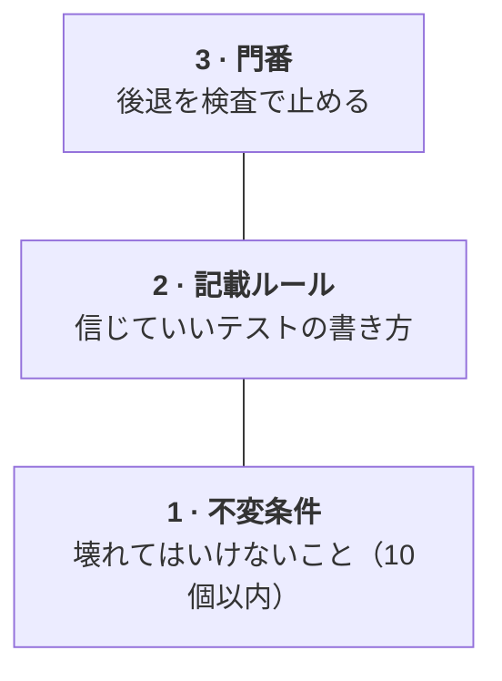

# テストを信じるための3つの段

hadomeはテストを信じるための3つの段のうち、3段目にあたります。

| 段 | 中身 | 例 |
|---|---|---|
| 1. 不変条件 | 壊れてはいけないことの短い一覧。守るテストを紐付ける | 「ログの置き場は追記だけ」。紐付けたテストを消すと落ちる |
| 2. 記載ルール | 信じていいテストの書き方 | 外から見える振る舞いだけを確かめる。期待値を実装からコピーしない。時刻を読まない。sleepで待たない。黙ってスキップしない |
| 3. 門番 | 1と2が守られているかを、変更ごとに検査する | hadome |

人が見るのは、1つずつのテストケースではなく、1と2の中身です。テストを書くのがAIエージェントでも、1と2が守られていれば、そのテストを信じられます。

不変条件の書き方は[エージェント向けの手引き](for-agents.ja.md)にあります。
