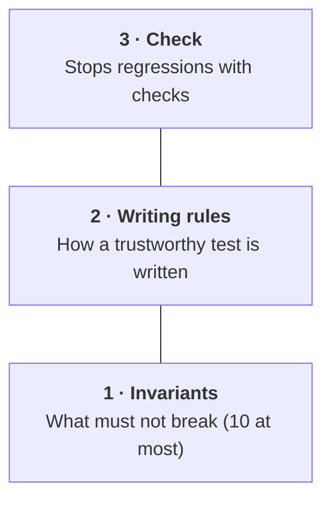

# Three layers for trusting tests

hadome is the third of three layers for trusting tests.

| Layer | What it is | Example |
|---|---|---|
| 1. Invariants | A short list of what must not break, each tied to the tests that guard it | "The log store is append-only". Deleting the tied test fails |
| 2. Writing rules | How a trustworthy test is written | Test observable behaviour only. Never copy expected values from the implementation. Never read the clock. Never wait with sleep. Never skip silently |
| 3. Check | Checks every change for whether 1 and 2 still hold | hadome |

People review layers 1 and 2, not each test case. Even when AI agents write the tests, the tests can be trusted as long as 1 and 2 hold.

How to write invariants is in [the guide for agents](for-agents.md).
