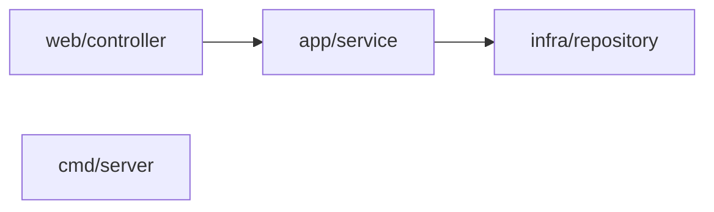
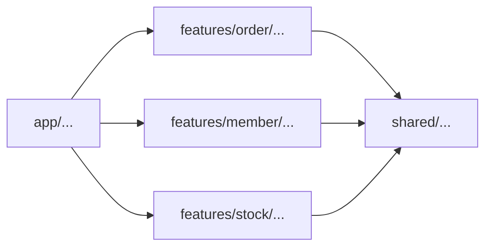
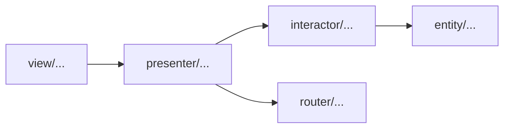
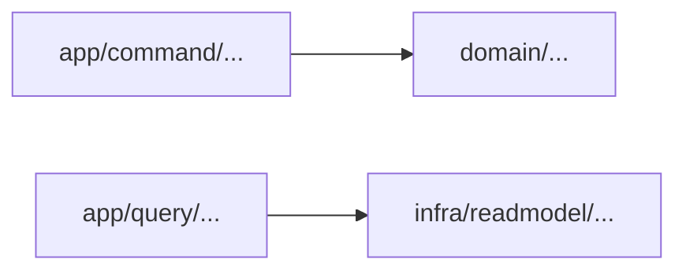
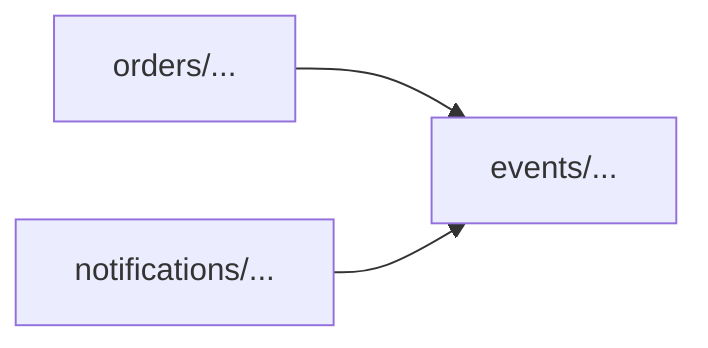
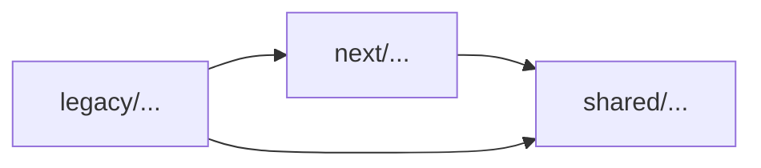
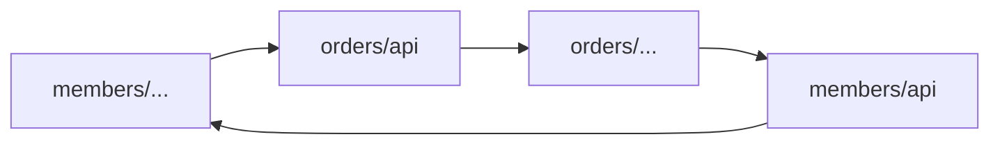
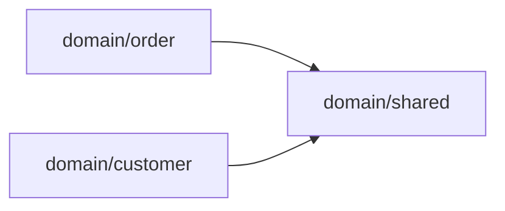

# 設計のパターンを hadome で守る

アーキテクチャのパターンや GoF のデザインパターンを、hadome の設定でどう守るかの例です。どのパターンにも使えるわけではないので、守れないものも理由と一緒に書きます。

このページは、パターンを使うことを勧めるものではありません。リポジトリがすでにそのパターンの形をしているときに、その形を崩さないための書き方です。

## hadome が見るもの

hadome が見るのは、リポジトリのユニット（Go のパッケージ、Kotlin のパッケージ、TypeScript のディレクトリ、Terraform のモジュール、Ansible のロールなど）の間の import と呼び出しの向きです。そのため、「どのディレクトリからどのディレクトリへ依存してよいか」で言い表せるパターンを守れます。クラスの中の形や、実行時に何が起きるかだけで決まるパターンは守れません。

| 道具 | 設定 | 止める変更 |
|---|---|---|
| 依存の図 | `rules.deps.diagram`（Mermaid の flowchart） | 図に矢印の無い import（`deps/not-in-diagram`） |
| 呼び出しの図 | `rules.deps.calls` | 図に矢印の無い呼び出し（`deps/call-not-in-diagram`）。インターフェースを通した呼び出しは、実装のユニットへの呼び出しとして数える |
| 層 | `rules.deps.layers` | 内側の層から外側の層への import（`deps/layer`） |
| 循環 | 設定は要らない。許す組は `rules.deps.cycles.allow` | ユニットの間に新しい循環を作る import（`deps/cycle`） |

- どれも、比べる元の版（ふつうは main）にある違反は落としません。変更で増えたものだけを落とします。
- 図の叩き台は `hadome suggest diagram` と `hadome suggest calls` で作れます。いまのコードのとおりに描くので、そこから、あるべき形へ矢印を減らしていきます。
- 矢印や層を書き足す変更、許す組を足す変更は、人の確認（終了コード `3`）に回ります。

## アーキテクチャのパターン

### クリーンアーキテクチャ・ヘキサゴナル・オニオン

依存が外側から内側へ向かうことを、層で書きます。

```yaml
rules:
  deps:
    layers:
      - name: domain
        paths: [domain/**]
      - name: usecase
        paths: [usecase/**]
      - name: adapters
        paths: [infra/**, web/**]
      - name: main
        paths: [cmd/**, di/**]
```

- 止まる変更の例: `domain` が `infra` を import する。
- ポート（リポジトリのインターフェースなど）は内側の層に置き、アダプタ（データベースや HTTP の実装）は外側の層に置きます。アダプタはポートを import するので、向きは内向きです。
- DI コンテナやつなぎ込みの場所はすべての層を import します。いちばん外側の層に置けば、その import はどれも内向きなので落ちません。どの層にも入れないこともできます。
- 層は import で判定します。呼び出しの向きは、インターフェースを通すと外向きになるのが正しい形だからです。例: usecase は `UserRepository` を通して infra の実装を呼びます。呼び出しまで見るときは、呼び出しの図に `usecase --> infra` を描きます。

### レイヤードアーキテクチャ

controller → service → repository のように、層を1つずつ通ることを決めたいときは、呼び出しの図に隣の層への矢印だけを描きます。



- 止まる変更の例: controller が service を飛ばして repository を呼ぶ。
- 層の設定（`rules.deps.layers`）は、内側の層ならどこでも使ってよい、という決まりです。隣の層だけを許すなら、図を使います。
- `wiring` を付けた箱（ここでは `cmd/server`）からの呼び出しは、照らし合わせから外れます。全部を組み立てる場所のためのものです。

### 機能ごとのモジュール

機能（注文、会員、在庫など）ごとにディレクトリを分け、機能どうしは共通の部品を通してだけつながる形です。依存の図で、機能の箱どうしに矢印を描きません。



- 止まる変更の例: `features/order` が `features/member` の中のクラスを直接 import する。
- 機能の間で共有したいものが出たら、`shared` に移すか、矢印を描いて人の確認を受けます。

### MVC・MVP・MVVM

View・ViewModel（Presenter）・Model をディレクトリで分けているなら、層で向きを書けます。

```yaml
rules:
  deps:
    layers:
      - name: model
        paths: [model/**]
      - name: viewmodel
        paths: [viewmodel/**]
      - name: view
        paths: [view/**]
```

- 止まる変更の例: ViewModel が View を import する。
- MVP で View と Presenter が互いを参照する設計なら、その循環は設計どおりです。許す組に書くと、`deps/cycle` がその組の循環を数えなくなります。

```yaml
rules:
  deps:
    cycles:
      allow:
        - app/ui/** <-> app/presenter/**
```

### Coordinator・Router

画面の遷移を Coordinator（Router）に集め、画面どうしは互いを知らない形です。依存の図で、画面の箱から Coordinator へ矢印を描かず、Coordinator から画面へだけ描きます。画面が Coordinator に遷移を頼むのは、画面の側に置いたプロトコル（Delegate）を通します。

- 止まる変更の例: 画面 A が画面 B を import して直接開く。
- 画面と Coordinator が互いを import する設計なら、許す組に書きます。

### 循環しないこと

設定は要りません。`deps/cycle` は図が無くても動き、ユニットの間に新しい循環を作る import を落とします。

- 止まる変更の例: `store → domain` があるところに、`domain → store` を足す。メッセージには戻る道（`store → domain → store`）が出ます。
- Rust・Java・Kotlin では、ディレクトリとその祖先の間の import はたどりません。Rust のクレートのルートと `mod` で宣言したモジュールは、互いを参照するのがふつうの書き方だからです。

## フロントエンドのパターン

### Feature-Sliced Design

層を下から順に書きます。上の層は下の層だけを import できます。

```yaml
rules:
  deps:
    layers:
      - name: shared
        paths: [src/shared/**]
      - name: entities
        paths: [src/entities/**]
      - name: features
        paths: [src/features/**]
      - name: widgets
        paths: [src/widgets/**]
      - name: pages
        paths: [src/pages/**]
      - name: app
        paths: [src/app/**]
```

- 止まる変更の例: `entities/user` が `features/auth` を import する。
- 同じ層のスライスどうし（`features/auth` と `features/cart` など）の import は、層では止まりません。止めるなら、依存の図でスライスの箱どうしに矢印を描きません。

### Atomic Design

部品の大きさの順に、層を書きます。

```yaml
rules:
  deps:
    layers:
      - name: atoms
        paths: [src/components/atoms/**]
      - name: molecules
        paths: [src/components/molecules/**]
      - name: organisms
        paths: [src/components/organisms/**]
      - name: templates
        paths: [src/components/templates/**]
      - name: pages
        paths: [src/pages/**]
```

- 止まる変更の例: atom が organism を import する。

### Flux・Redux

データが一方向に流れる形です。store（reducer・action・selector）を内側、画面のコンポーネントを外側の層に置きます。

- 止まる変更の例: reducer が画面のコンポーネントを import する。
- 層の書き方は上の Atomic Design と同じ形です。`store/**` を先に、`components/**` を後に書きます。

## モバイルのパターン

### Android の推奨アーキテクチャ

UI 層・ドメイン層・データ層に分ける形です。Android の推奨では、ドメイン層がデータ層のリポジトリを使うので、いちばん内側はデータ層になります。

```yaml
rules:
  deps:
    layers:
      - name: data
        paths: [app/src/main/kotlin/com/example/data/**]
      - name: domain
        paths: [app/src/main/kotlin/com/example/domain/**]
      - name: ui
        paths: [app/src/main/kotlin/com/example/ui/**]
```

- 止まる変更の例: データ層が UI 層の ViewModel を import する。
- ドメイン層を置かない構成なら、`domain` の層を消します。

### feature と core のモジュール

機能ごとの `feature` モジュールと、共通の `core` モジュールに分ける形です（Now in Android など）。

- 層で `core/**` を内側、`feature/**` をその外、`app/**` をいちばん外に置きます。止まる変更の例: core が feature を import する。
- feature どうしの import は、層では止まりません。止めるなら、依存の図で feature の箱どうしに矢印を描きません。

### VIPER

View・Interactor・Presenter・Entity・Router を役ごとのディレクトリに分けているなら、依存の図で向きを描きます。



- 止まる変更の例: Interactor が View を import する。
- Presenter から View への呼び出しは、Presenter の側に置いたプロトコルを通します。プロトコルを View の側に置くと、View と Presenter が互いを import するので、許す組に書くことになります。
- 1つの画面の役者を1つのディレクトリにまとめる構成では、役の間の向きは1つのユニットの中の話になり、hadome は見ません。

## バックエンドと全体の構成のパターン

### CQRS

書き込み（command）と読み取り（query）のコードを分ける形です。依存の図で、query の箱から command の箱へ矢印を描きません。



- 止まる変更の例: 読み取りのコードが書き込みのコードを import する。

### プラグイン（マイクロカーネル）

コアがプラグインの約束（インターフェース）を宣言し、プラグインがそれを実装する形です。層でコアを内側、プラグインを外側に置きます。

- 止まる変更の例: コアが特定のプラグインを import する。

### イベント駆動（発行と購読）

イベントの型を共通のユニットに置き、発行する側と購読する側の両方がそれを import する形です。依存の図で、発行する側から購読する側へ矢印を描きません。



- 止まる変更の例: 注文のコードが通知のコードを直接 import して呼ぶ。

### モノレポの apps と packages

アプリ（`apps/`）が共有のパッケージ（`packages/`）を使い、逆は無い形です。

```yaml
rules:
  deps:
    layers:
      - name: packages
        paths: [packages/**]
      - name: apps
        paths: [apps/**]
```

- 止まる変更の例: 共有のパッケージが特定のアプリを import する。

### Strangler Fig

古いコードを少しずつ新しいコードに置き換える形です。依存の図で、新しいコードから古いコードへ矢印を描きません。



- 止まる変更の例: 新しいコードが古いコードへの依存を足す。
- 図に描いていない import でも、main にすでにあるものは落ちません。新しいコードから古いコードへの依存が残っていても、図には描かずにおけます。そうすると、いまある依存はそのまま通り、増やす変更だけが落ちます。置き換えのあいだに依存が増えていきません。

## DDD（ドメイン駆動設計）

DDD はドメインのモデルの作り方と、そのためのパターンの集まりです。ヘキサゴナル（ポートとアダプタ）とは別のもので、一緒に使われることが多い組み合わせです。

### 境界づけられたコンテキスト（モジュラーモノリス）

コンテキスト（注文、会員など）ごとにディレクトリを分け、ほかのコンテキストへは公開の窓口だけを通す形です。依存の図で、ほかのコンテキストからは窓口の箱にだけ矢印を描きます。



- 止まる変更の例: 会員のコードが注文の内部のクラスを直接 import する。
- `orders/...` の箱は `orders/api` も含みますが、ユニットはいちばん細かく合う箱に入ります。`orders/api` のユニットは `ordersAPI` の箱に入ります。
- 窓口から自分のコンテキストの中へは矢印を描きます（`ordersAPI --> orders`）。窓口が中の実装に処理を渡すためです。

### コンテキストマップ

コンテキストどうしの関係（コンテキストマップ）は、依存の図の矢印で描けます。

| 関係 | 書き方 |
|---|---|
| 公開ホストサービス・公表された言語 | ほかのコンテキストへは、公開の窓口の箱にだけ矢印を描く |
| 共有カーネル | 共有する箱を置き、両方のコンテキストからそこへ矢印を描く |
| 顧客と供給者 | 顧客から供給者への片方向の矢印だけを描く |
| 別々の道 | コンテキストの間に矢印を1本も描かない |
| パートナーシップ | 両向きの矢印を描く。ディレクトリの間で循環になるなら、許す組にも書く |
| 腐敗防止層 | 相手のコンテキストへ矢印を描いてよいのは、腐敗防止層の箱（`orders/acl` など）だけにする |

- 腐敗防止層を図で守れるのは、相手がリポジトリの中のコンテキストのときです。相手が外部のライブラリやサービスのときは、「[守れないこと](#守れないこと)」のとおりです。
- 順応者（相手のモデルをそのまま使う）は、依存の向きには表れないので守れません。

### 集約

集約ごとにディレクトリを分けているなら、依存の図で集約の箱どうしに矢印を描きません。ほかの集約は ID で参照するという決まりを、import の向きで守れます。



- 止まる変更の例: 注文の集約が顧客の集約のオブジェクトを持つために `domain/customer` を import する。
- ID の型は共通の場所（`domain/shared` など）に置きます。各集約の中に置くと、ID を使うだけで相手の集約を import することになるためです。

集約の不変条件は import の向きではなく、不変条件とテストで守ります。`.hadome.yml` に ID を付けて書き、それを確かめるテストの doc コメントに `guards: <id>` を付けます。

```yaml
invariants:
  - id: order-total
    says: "注文の合計は 0 以上"
```

```go
// guards: order-total
func TestOrderTotalNeverGoesBelowZero(t *testing.T) {
```

- 守るテストの無い不変条件と、守るテストを消す変更は落ちます。
- 中のエンティティを集約のルートを通してだけ変えることと、1つのトランザクションで1つの集約だけを変えることは、守れません。前者は1つのユニットの中の話で、後者は実行時の性質です。

### リポジトリとサービスの層

リポジトリのインターフェースをドメインに置き、実装をインフラに置きます。アプリケーションサービスはドメインの外側に置きます。

```yaml
rules:
  deps:
    layers:
      - name: domain
        paths: [domain/**]
      - name: application
        paths: [application/**]
      - name: infrastructure
        paths: [infrastructure/**]
```

- 止まる変更の例: ドメインのコードがリポジトリの実装やアプリケーションサービスを import する。
- ドメインサービスはドメインの層に置きます。

### ドメインイベント

イベントの型を置くユニットを、発行する集約と購読する側の両方が import する形です。書き方は「[イベント駆動（発行と購読）](#イベント駆動発行と購読)」と同じです。

### 守れない DDD のパターン

| パターン | 理由 |
|---|---|
| エンティティ・値オブジェクト・ファクトリ | 1つのユニットの中の話。値オブジェクトが変更できないことは、実行時の性質 |
| ユビキタス言語 | 名前の付け方の話 |

## インフラのパターン

### Terraform の環境とモジュール

再利用するモジュール（`modules/`）と、それを呼ぶ環境（`envs/`）に分ける形です。

```yaml
rules:
  deps:
    layers:
      - name: modules
        paths: [modules/**]
      - name: envs
        paths: [envs/**]
```

- 止まる変更の例: モジュールが環境のディレクトリを `source` で呼ぶ。
- import として数えるのは、`source = "./…"` か `"../…"` のローカルのモジュールの呼び出しです。

### Ansible の基盤のロールとアプリのロール

OS の設定や監視のような基盤のロールを内側、アプリのロールを外側の層に置きます。ユニットが2つの層に合うときは先に書いた層に入るので、基盤のロールを先に書きます。

```yaml
rules:
  deps:
    layers:
      - name: base
        paths: [roles/common/**, roles/monitoring/**]
      - name: apps
        paths: [roles/**]
```

- 止まる変更の例: 基盤のロールの `meta/main.yml` がアプリのロールを `dependencies` に足す。

## GoF のデザインパターン

GoF のパターンの多くは、クラスの中や、近くのクラスの組の形の話です。hadome が守れるのは、パターンの役者が別々のユニットに分かれていて、その向きに決まりがあるときだけです。

### 守れるもの

| パターン | ユニットに分けたときの形 | 書き方 |
|---|---|---|
| Facade | 外からはサブシステムの窓口だけを使う | 依存の図で、外の箱から窓口の箱へだけ矢印を描き、サブシステムの中の箱へは描かない |
| Mediator | 仲間どうしは互いを知らず、仲介役だけを知る | 依存の図で、仲間の箱どうしに矢印を描かない。仲介役と仲間が互いを import するなら許す組に書く |
| Adapter | 内側が宣言したインターフェースを、外側のアダプタが実装する | 層。アダプタを外側の層に置く |
| Strategy | 使う側（Context）がインターフェースを持ち、戦略の実装は別のユニットに置く | 層か依存の図。実装から Context への向きだけを許す |
| Observer | 通知する側がリスナーのインターフェースを宣言し、受け取る側が実装する | 層か依存の図で、通知する側から受け取る側への import を止める。通知の呼び出しは実装へ届くので、呼び出しの図には矢印を描く |
| Abstract Factory・Factory Method | 作るもののインターフェースは内側に、具体的な工場は外側に置く | 層。具体的な工場を外側の層に置く |
| Bridge | 抽象と実装の階層を別のユニットに置く | 依存の図で、抽象の側から実装のインターフェースへの向きだけを描く |
| Command | 呼ぶ側はコマンドのインターフェースだけを知り、コマンドの実装は別のユニットに置く | 依存の図で、呼ぶ側からコマンドの実装の箱へ矢印を描かない |
| Decorator・Proxy | 包む側と包まれる側が同じインターフェースを実装する | 層か依存の図。包む側からインターフェースのユニットへの向きだけを許す |
| Template Method | 基底クラスと、それを継承するクラスを別のユニットに置く | 層か依存の図。継承する側から基底クラスへの向きだけを許す |
| Visitor | Visitor と要素が互いを参照する | 別のディレクトリに置くなら循環になるので、許す組に書く |

### 守れないもの

| パターン | 理由 |
|---|---|
| Singleton | 守りたいこと（インスタンスが1つ）が実行時の性質で、import の向きでは表せない |
| Builder・Prototype | 1つのクラスか、その近くで閉じる形の話 |
| Composite・Flyweight | 1つのユニットの中の構造の話 |
| Chain of Responsibility・State・Iterator・Memento・Interpreter | 1つのユニットの中の振る舞いの話。ユニットに分けても、向きの決まりは上の Command や Strategy と同じ形になる |

### Delegate と弱参照

iOS の `weak var delegate` のような Delegate は、Observer や Strategy と同じ形です。Delegate のプロトコルを使う側（通知する側）のユニットに置き、受け取る側がそれを実装すれば、import は受け取る側から通知する側への1本だけになります。

- 弱参照（`weak`）は、実行時に循環参照でメモリが解放されなくなるのを避けるためのものです。hadome が見るのはソースコードの依存の循環で、メモリの参照の循環ではありません。
- hadome には、まだ Swift のアダプタがありません。

## 守れないこと

- **リフレクションやフレームワークの自動の呼び出し**: Spring の `@EventListener` や、名前の文字列で呼ぶ `getattr` などです。構文に呼び先が無いので、呼び出しをたどれません。
- **外部のライブラリを使ってよい場所**: 「データベースのドライバを import してよいのは `infra/` だけ」のような決まりです。外部のライブラリやサービスに対する腐敗防止層も、この形です。図に描くのはリポジトリの中のユニットだけなので、書けません。確かめるスクリプトを自分で書けば、検査に加えられます（下の段）。
- **データの層**: メダリオン（bronze・silver・gold）や ELT の段の決まりです。段の間は、テーブルや置き場所の名前、パイプラインの定義でつながっていて、import や呼び出しには表れないので、追えません。これも、確かめるスクリプトを自分で書けば、検査に加えられます（下の段）。
- **クラウドデザインパターン**: Circuit Breaker、Retry、Bulkhead、Sidecar、Cache-Aside などの多くは、実行時の振る舞いか、サービスの配置の話です。ソースコードの依存には表れません。Terraform も、見るのはモジュールの呼び出しの向きだけで、リソースのつながりは見ません。CQRS と Strangler Fig は、コードの構成の話として上に書きました。
- **ほかのモジュールを通した依存**: hadome はリポジトリの外のライブラリを読まないので、ライブラリを通って戻る循環は数えません。
- **1つのユニットの中の形**: クラスの責務の分け方や、メソッドの長さ以外の形は見ません。大きさは `size/` のルールが見ます。

ここで守れない決まりも、確かめる小さなプログラムを自分のリポジトリに書けば、hadome の検査に加えられます。例: 「`models/gold/` の SQL に `bronze` が出てこない」を確かめるスクリプトです。hadome はそれを組み込みのルールと同じように扱い、main より悪くなったときだけ落とします。書き方は[製品固有のゲート](external-gates.ja.md)にあります。
