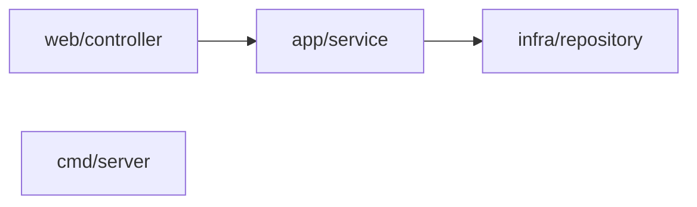
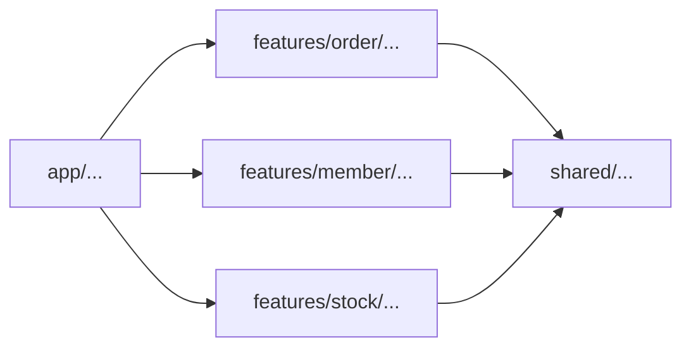

# 設計のパターンを hadome で守る

アーキテクチャのパターンや GoF のデザインパターンを、hadome の設定でどう守るかの例です。どのパターンにも使えるわけではないので、守れないものも理由と一緒に書きます。

## hadome が見るもの

hadome が見るのは、リポジトリのユニット（Go のパッケージ、Kotlin のパッケージ、TypeScript のディレクトリ、Terraform のモジュール、Ansible のロールなど）の間の import と呼び出しの向きです。そのため、「どのディレクトリからどのディレクトリへ依存してよいか」で言い表せるパターンを守れます。クラスの中の形や、実行時に何が起きるかだけで決まるパターンは守れません。

| 道具 | 設定 | 止める変更 |
|---|---|---|
| 依存の図 | `rules.deps.diagram`（Mermaid の flowchart） | 図に矢印の無い import（`deps/not-in-diagram`） |
| 呼び出しの図 | `rules.deps.calls` | 図に矢印の無い呼び出し（`deps/call-not-in-diagram`）。インターフェースを通した呼び出しは、実装のユニットへの呼び出しとして数える |
| 層 | `rules.deps.layers` | 内側の層から外側の層への import（`deps/layer`） |
| 循環 | 設定は要らない。許す組は `rules.deps.cycles.allow` | ユニットの間に新しい循環を作る import（`deps/cycle`） |

- どれも、比べる元の版（ふつうは main）にある違反は落としません。変更で増えたものだけを落とします。
- 図の叩き台は `hadome suggest diagram` と `hadome suggest calls` で作れます。いまのコードのとおりに描くので、そこから、あるべき形へ矢印を減らしていきます。
- 矢印や層を書き足す変更、許す組を足す変更は、人の確認（終了コード `3`）に回ります。

## アーキテクチャのパターン

### クリーンアーキテクチャ・ヘキサゴナル・オニオン

依存が外側から内側へ向かうことを、層で書きます。

```yaml
rules:
  deps:
    layers:
      - name: domain
        paths: [domain/**]
      - name: usecase
        paths: [usecase/**]
      - name: adapters
        paths: [infra/**, web/**]
      - name: main
        paths: [cmd/**, di/**]
```

- 止まる変更の例: `domain` が `infra` を import する。
- ポート（リポジトリのインターフェースなど）は内側の層に置き、アダプタ（データベースや HTTP の実装）は外側の層に置きます。アダプタはポートを import するので、向きは内向きです。
- DI コンテナやつなぎ込みの場所はすべての層を import します。いちばん外側の層に置けば、その import はどれも内向きなので落ちません。どの層にも入れないこともできます。
- 層は import で判定します。呼び出しの向きは、インターフェースを通すと外向きになるのが正しい形だからです。例: usecase は `UserRepository` を通して infra の実装を呼びます。呼び出しまで見るときは、呼び出しの図に `usecase --> infra` を描きます。

### レイヤードアーキテクチャ

controller → service → repository のように、層を1つずつ通ることを決めたいときは、呼び出しの図に隣の層への矢印だけを描きます。



- 止まる変更の例: controller が service を飛ばして repository を呼ぶ。
- 層の設定（`rules.deps.layers`）は、内側の層ならどこでも使ってよい、という決まりです。隣の層だけを許すなら、図を使います。
- `wiring` を付けた箱（ここでは `cmd/server`）からの呼び出しは、照らし合わせから外れます。全部を組み立てる場所のためのものです。

### 機能ごとのモジュール

機能（注文、会員、在庫など）ごとにディレクトリを分け、機能どうしは共通の部品を通してだけつながる形です。依存の図で、機能の箱どうしに矢印を描きません。



- 止まる変更の例: `features/order` が `features/member` の中のクラスを直接 import する。
- 機能の間で共有したいものが出たら、`shared` に移すか、矢印を描いて人の確認を受けます。

### MVC・MVP・MVVM

View・ViewModel（Presenter）・Model をディレクトリで分けているなら、層で向きを書けます。

```yaml
rules:
  deps:
    layers:
      - name: model
        paths: [model/**]
      - name: viewmodel
        paths: [viewmodel/**]
      - name: view
        paths: [view/**]
```

- 止まる変更の例: ViewModel が View を import する。
- MVP で View と Presenter が互いを参照する設計なら、その循環は設計どおりです。許す組に書くと、`deps/cycle` がその組の循環を数えなくなります。

```yaml
rules:
  deps:
    cycles:
      allow:
        - app/ui/** <-> app/presenter/**
```

### Coordinator・Router

画面の遷移を Coordinator（Router）に集め、画面どうしは互いを知らない形です。依存の図で、画面の箱から Coordinator へ矢印を描かず、Coordinator から画面へだけ描きます。画面が Coordinator に遷移を頼むのは、画面の側に置いたプロトコル（Delegate）を通します。

- 止まる変更の例: 画面 A が画面 B を import して直接開く。
- 画面と Coordinator が互いを import する設計なら、許す組に書きます。

### 循環しないこと

設定は要りません。`deps/cycle` は図が無くても動き、ユニットの間に新しい循環を作る import を落とします。

- 止まる変更の例: `store → domain` があるところに、`domain → store` を足す。メッセージには戻る道（`store → domain → store`）が出ます。
- Rust・Java・Kotlin では、ディレクトリとその祖先の間の import はたどりません。Rust のクレートのルートと `mod` で宣言したモジュールは、互いを参照するのがふつうの書き方だからです。

## GoF のデザインパターン

GoF のパターンの多くは、クラスの中や、近くのクラスの組の形の話です。hadome が守れるのは、パターンの役者が別々のユニットに分かれていて、その向きに決まりがあるときだけです。

### 守れるもの

| パターン | ユニットに分けたときの形 | 書き方 |
|---|---|---|
| Facade | 外からはサブシステムの窓口だけを使う | 依存の図で、外の箱から窓口の箱へだけ矢印を描き、サブシステムの中の箱へは描かない |
| Mediator | 仲間どうしは互いを知らず、仲介役だけを知る | 依存の図で、仲間の箱どうしに矢印を描かない。仲介役と仲間が互いを import するなら許す組に書く |
| Adapter | 内側が宣言したインターフェースを、外側のアダプタが実装する | 層。アダプタを外側の層に置く |
| Strategy | 使う側（Context）がインターフェースを持ち、戦略の実装は別のユニットに置く | 層か依存の図。実装から Context への向きだけを許す |
| Observer | 通知する側がリスナーのインターフェースを宣言し、受け取る側が実装する | 層か依存の図で、通知する側から受け取る側への import を止める。通知の呼び出しは実装へ届くので、呼び出しの図には矢印を描く |
| Abstract Factory・Factory Method | 作るもののインターフェースは内側に、具体的な工場は外側に置く | 層。具体的な工場を外側の層に置く |
| Bridge | 抽象と実装の階層を別のユニットに置く | 依存の図で、抽象の側から実装のインターフェースへの向きだけを描く |
| Command | 呼ぶ側はコマンドのインターフェースだけを知り、コマンドの実装は別のユニットに置く | 依存の図で、呼ぶ側からコマンドの実装の箱へ矢印を描かない |
| Decorator・Proxy | 包む側と包まれる側が同じインターフェースを実装する | 層か依存の図。包む側からインターフェースのユニットへの向きだけを許す |
| Template Method | 基底クラスと、それを継承するクラスを別のユニットに置く | 層か依存の図。継承する側から基底クラスへの向きだけを許す |
| Visitor | Visitor と要素が互いを参照する | 別のディレクトリに置くなら循環になるので、許す組に書く |

### 守れないもの

| パターン | 理由 |
|---|---|
| Singleton | 守りたいこと（インスタンスが1つ）が実行時の性質で、import の向きでは表せない |
| Builder・Prototype | 1つのクラスか、その近くで閉じる形の話 |
| Composite・Flyweight | 1つのユニットの中の構造の話 |
| Chain of Responsibility・State・Iterator・Memento・Interpreter | 1つのユニットの中の振る舞いの話。ユニットに分けても、向きの決まりは上の Command や Strategy と同じ形になる |

### Delegate と弱参照

iOS の `weak var delegate` のような Delegate は、Observer や Strategy と同じ形です。Delegate のプロトコルを使う側（通知する側）のユニットに置き、受け取る側がそれを実装すれば、import は受け取る側から通知する側への1本だけになります。

- 弱参照（`weak`）は、実行時に循環参照でメモリが解放されなくなるのを避けるためのものです。hadome が見るのはソースコードの依存の循環で、メモリの参照の循環ではありません。
- hadome には、まだ Swift のアダプタがありません。

## 守れないこと

- **リフレクションやフレームワークの自動の呼び出し**: Spring の `@EventListener` や、名前の文字列で呼ぶ `getattr` などです。構文に呼び先が無いので、呼び出しをたどれません。
- **ほかのモジュールを通した依存**: hadome はリポジトリの外のライブラリを読まないので、ライブラリを通って戻る循環は数えません。
- **1つのユニットの中の形**: クラスの責務の分け方や、メソッドの長さ以外の形は見ません。大きさは `size/` のルールが見ます。

どのルールにも当てはまらない決まりは、製品固有の門番として書けます（[製品固有の門番](external-gates.ja.md)）。
