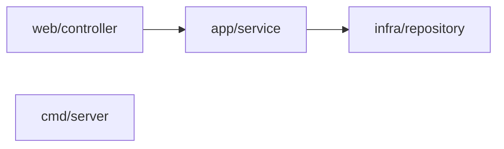
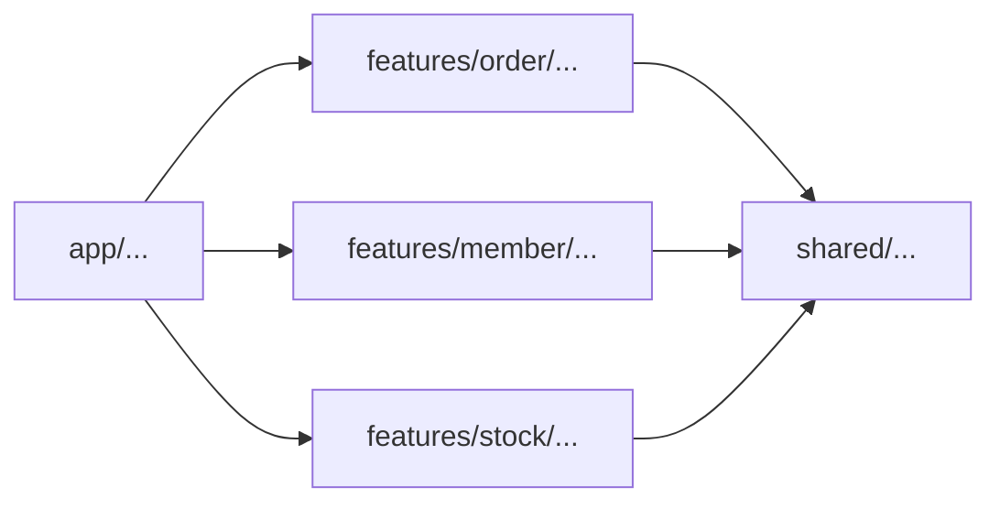
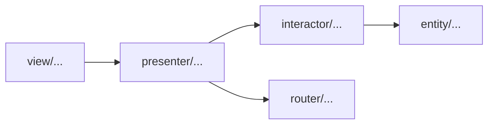
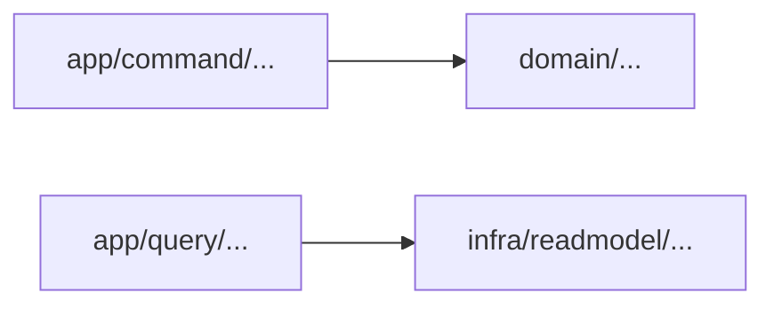
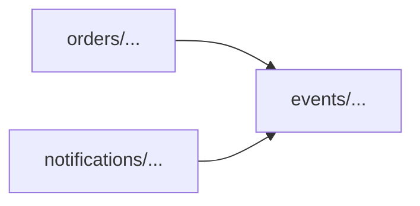
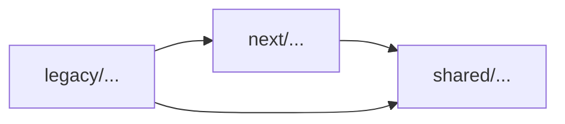
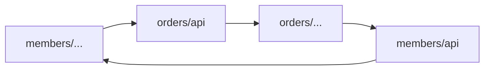
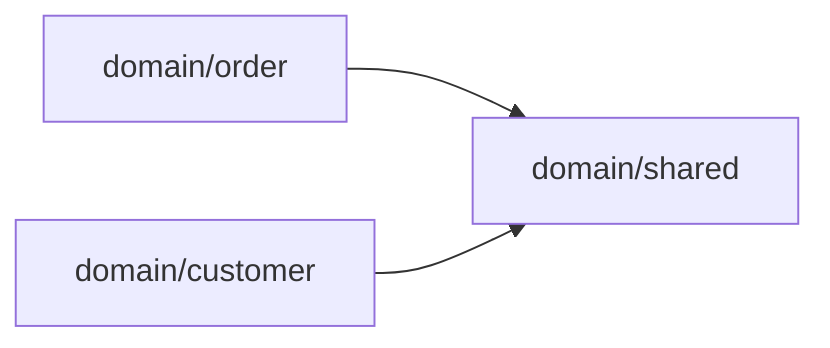

# Keeping design patterns with hadome

Examples of how hadome's configuration keeps architecture patterns and the GoF design patterns. Not every pattern can be kept, so those that cannot are listed too, with the reason.

This page does not recommend using any pattern. It shows how to keep the shape of a pattern the repository already has.

## What hadome looks at

hadome looks at the direction of imports and calls between the repository's units (a Go package, a Kotlin package, a TypeScript directory, a Terraform module, an Ansible role, and so on). So it keeps patterns that can be said as "which directory may depend on which". Patterns decided only by the shape inside a class, or by what happens at run time, it cannot keep.

| Tool | Configuration | Change it stops |
|---|---|---|
| Dependency diagram | `rules.deps.diagram` (a Mermaid flowchart) | An import the diagram draws no arrow for (`deps/not-in-diagram`) |
| Call diagram | `rules.deps.calls` | A call the diagram draws no arrow for (`deps/call-not-in-diagram`). A call through an interface counts as a call to the implementation's unit |
| Layers | `rules.deps.layers` | An import from an inner layer to an outer one (`deps/layer`) |
| Cycles | None needed. Allowed pairs go in `rules.deps.cycles.allow` | An import that makes a new cycle between units (`deps/cycle`) |

- None of them fails a violation the version compared against (usually main) already has. Only what the change adds fails.
- `hadome suggest diagram` and `hadome suggest calls` draft the diagrams. A draft draws the code as it is; from there, take arrows away toward the shape you want.
- A change that adds an arrow or a layer, or an allowed pair, goes to a person's review (exit code `3`).

## Architecture patterns

### Clean, hexagonal and onion architecture

Write that dependencies point from the outside in, as layers.

```yaml
rules:
  deps:
    layers:
      - name: domain
        paths: [domain/**]
      - name: usecase
        paths: [usecase/**]
      - name: adapters
        paths: [infra/**, web/**]
      - name: main
        paths: [cmd/**, di/**]
```

- A change it stops: `domain` imports `infra`.
- Ports (repository interfaces and the like) go in an inner layer, adapters (the database or HTTP implementations) in an outer one. An adapter imports its port, so the direction is inward.
- A DI container, or the place that wires everything, imports every layer. In the outermost layer, its imports all point inward and pass. It can also be left in no layer.
- Layers judge imports. Through an interface, the call rightly goes outward. Example: usecase calls infra's implementation through `UserRepository`. To check calls too, draw `usecase --> infra` in the call diagram.

### Layered architecture

To have each request go through the layers one at a time, controller → service → repository, draw in the call diagram only the arrows to the next layer.



- A change it stops: a controller calls a repository past the service.
- Layers (`rules.deps.layers`) let a layer use any inner layer. To allow only the next one, use the diagram.
- Calls from a box marked `wiring` (here `cmd/server`) are not checked. It is for the place that builds everything.

### Feature modules

Each feature (orders, members, stock) has its own directory, and features meet only through shared parts. In the dependency diagram, draw no arrows between feature boxes.



- A change it stops: `features/order` imports a class inside `features/member`.
- When features need to share something, move it to `shared`, or draw the arrow and have a person review it.

### MVC, MVP and MVVM

When View, ViewModel (Presenter) and Model are in directories of their own, layers can give the direction.

```yaml
rules:
  deps:
    layers:
      - name: model
        paths: [model/**]
      - name: viewmodel
        paths: [viewmodel/**]
      - name: view
        paths: [view/**]
```

- A change it stops: a ViewModel imports a View.
- In an MVP design where View and Presenter refer to each other, the cycle is as designed. Written as an allowed pair, `deps/cycle` no longer counts cycles between them.

```yaml
rules:
  deps:
    cycles:
      allow:
        - app/ui/** <-> app/presenter/**
```

### Coordinator and Router

Navigation is gathered in a Coordinator (Router), and screens do not know each other. In the dependency diagram, draw arrows only from the Coordinator to the screens, none from a screen to the Coordinator. A screen asks the Coordinator to navigate through a protocol (a delegate) kept on the screen's side.

- A change it stops: screen A imports screen B and opens it directly.
- In a design where screens and the Coordinator import each other, write them as an allowed pair.

### No cycles

No configuration is needed. `deps/cycle` works without a diagram and fails an import that makes a new cycle between units.

- A change it stops: adding `domain → store` where `store → domain` is. The message gives the way back (`store → domain → store`).
- In Rust, Java and Kotlin, imports between a directory and its ancestor are not followed. A Rust crate root and the modules it declares with `mod` refer to each other as a matter of course.

## Front-end patterns

### Feature-Sliced Design

Write the layers from the bottom up. A layer may import only the layers below it.

```yaml
rules:
  deps:
    layers:
      - name: shared
        paths: [src/shared/**]
      - name: entities
        paths: [src/entities/**]
      - name: features
        paths: [src/features/**]
      - name: widgets
        paths: [src/widgets/**]
      - name: pages
        paths: [src/pages/**]
      - name: app
        paths: [src/app/**]
```

- A change it stops: `entities/user` imports `features/auth`.
- Imports between slices of one layer (`features/auth` and `features/cart`) are not stopped by layers. To stop them, draw no arrows between the slices' boxes in the dependency diagram.

### Atomic Design

Write the layers in the order of the components' size.

```yaml
rules:
  deps:
    layers:
      - name: atoms
        paths: [src/components/atoms/**]
      - name: molecules
        paths: [src/components/molecules/**]
      - name: organisms
        paths: [src/components/organisms/**]
      - name: templates
        paths: [src/components/templates/**]
      - name: pages
        paths: [src/pages/**]
```

- A change it stops: an atom imports an organism.

### Flux and Redux

Data flows one way. Put the store (reducers, actions, selectors) in an inner layer and the screen components in an outer one.

- A change it stops: a reducer imports a screen component.
- The layers are written as for Atomic Design above, with `store/**` first and `components/**` after.

## Mobile patterns

### Android's recommended architecture

UI, domain and data layers. In Android's recommendation the domain layer uses the data layer's repositories, so the data layer is the innermost.

```yaml
rules:
  deps:
    layers:
      - name: data
        paths: [app/src/main/kotlin/com/example/data/**]
      - name: domain
        paths: [app/src/main/kotlin/com/example/domain/**]
      - name: ui
        paths: [app/src/main/kotlin/com/example/ui/**]
```

- A change it stops: the data layer imports a ViewModel of the UI layer.
- Without a domain layer, remove the `domain` layer.

### Feature and core modules

`feature` modules per feature and shared `core` modules, as in Now in Android.

- In layers, put `core/**` inside, `feature/**` around it, and `app/**` outermost. A change it stops: core imports a feature.
- Imports between features are not stopped by layers. To stop them, draw no arrows between feature boxes in the dependency diagram.

### VIPER

With View, Interactor, Presenter, Entity and Router in directories by role, draw their direction in the dependency diagram.



- A change it stops: an Interactor imports a View.
- The Presenter calls the View through a protocol kept on the Presenter's side. With the protocol on the View's side, View and Presenter import each other and have to be written as an allowed pair.
- When each screen keeps all its roles in one directory, the direction between roles is inside one unit, which hadome does not look at.

## Back-end and whole-system patterns

### CQRS

Writes (commands) and reads (queries) in separate code. In the dependency diagram, draw no arrow from the query box to the command box.



- A change it stops: read code imports write code.

### Plugins (microkernel)

The core declares the plugin contract (an interface), and plugins implement it. In layers, put the core inside and the plugins outside.

- A change it stops: the core imports one particular plugin.

### Event-driven (publish and subscribe)

The event types are in a shared unit, which publishers and subscribers both import. In the dependency diagram, draw no arrow from a publisher to a subscriber.



- A change it stops: order code imports notification code and calls it directly.

### Monorepo apps and packages

Apps (`apps/`) use shared packages (`packages/`), never the other way.

```yaml
rules:
  deps:
    layers:
      - name: packages
        paths: [packages/**]
      - name: apps
        paths: [apps/**]
```

- A change it stops: a shared package imports one particular app.

### Strangler Fig

Old code is replaced by new code bit by bit. In the dependency diagram, draw no arrow from the new code to the old.



- A change it stops: new code adds a dependency on old code.
- An import the diagram does not draw does not fail when main already has it. So the arrow can stay undrawn even while new code still depends on old code: the dependencies there today pass, and only changes adding more fail. Dependencies do not grow while the replacement goes on.

## DDD (domain-driven design)

DDD is a way of building the domain's model, and a set of patterns for it. It is not hexagonal architecture (ports and adapters), though the two are often used together.

### Bounded contexts (modular monolith)

Each context (orders, members) has its own directory, and other contexts go only through its public front. In the dependency diagram, draw arrows from other contexts only to the front's box.



- A change it stops: members' code imports a class inside orders directly.
- The box `orders/...` covers `orders/api` too, but a unit goes to the box that fits it most closely, so the unit `orders/api` is in the box `ordersAPI`.
- Draw the arrow from the front into its own context (`ordersAPI --> orders`): the front hands work to the implementation inside.

### Context map

The relations between contexts (the context map) can be drawn as arrows of the dependency diagram.

| Relation | How to write it |
|---|---|
| Open host service, published language | Draw arrows from other contexts only to the public front's box |
| Shared kernel | Put a shared box, with arrows to it from both contexts |
| Customer and supplier | Draw only the one-way arrow from customer to supplier |
| Separate ways | Draw no arrow at all between the contexts |
| Partnership | Draw arrows both ways. If that makes a cycle between directories, write them as an allowed pair too |
| Anti-corruption layer | Only the anti-corruption layer's box (`orders/acl` and the like) may have an arrow to the other context |

- The diagram keeps an anti-corruption layer when the other side is a context in the repository. When it is an external library or service, see "[What cannot be kept](#what-cannot-be-kept)".
- Conformist (using the other side's model as it is) does not show in the direction of dependencies, so it cannot be kept.

### Aggregates

With each aggregate in a directory of its own, draw no arrows between aggregate boxes in the dependency diagram. The rule that other aggregates are referred to by ID is then kept by the direction of imports.



- A change it stops: the order aggregate imports `domain/customer` to hold a customer object.
- Keep ID types in a shared place (`domain/shared` and the like). Kept inside each aggregate, using an ID alone would import the other aggregate.

An aggregate's invariants are kept by invariants and tests, not by the direction of imports. Write them in `.hadome.yml` with an ID, and put `guards: <id>` in the doc comment of a test that checks one.

```yaml
invariants:
  - id: order-total
    says: "An order's total is never below zero"
```

```go
// guards: order-total
func TestOrderTotalNeverGoesBelowZero(t *testing.T) {
```

- An invariant with no test guarding it fails, and so does a change that removes the test guarding it.
- Changing inner entities only through the aggregate root, and changing only one aggregate per transaction, cannot be kept. The first is inside one unit; the second is a run-time property.

### Repositories and the service layers

The repository interface goes in the domain, its implementation in the infrastructure. Application services go outside the domain.

```yaml
rules:
  deps:
    layers:
      - name: domain
        paths: [domain/**]
      - name: application
        paths: [application/**]
      - name: infrastructure
        paths: [infrastructure/**]
```

- A change it stops: domain code imports a repository implementation or an application service.
- Domain services go in the domain layer.

### Domain events

The unit holding the event types is imported by both the aggregate that publishes and the side that subscribes. It is written as in "[Event-driven (publish and subscribe)](#event-driven-publish-and-subscribe)".

### DDD patterns that cannot be kept

| Pattern | Why |
|---|---|
| Entities, value objects, factories | About what is inside one unit. That a value object cannot change is a run-time property |
| Ubiquitous language | About naming |

## Infrastructure patterns

### Terraform environments and modules

Reusable modules (`modules/`) and the environments that call them (`envs/`).

```yaml
rules:
  deps:
    layers:
      - name: modules
        paths: [modules/**]
      - name: envs
        paths: [envs/**]
```

- A change it stops: a module calls an environment's directory in `source`.
- What counts as an import is a local module call, `source = "./…"` or `"../…"`.

### Ansible base roles and app roles

Put base roles, such as OS settings and monitoring, in an inner layer and app roles in an outer one. A unit matching two layers is in the one written first, so write the base roles first.

```yaml
rules:
  deps:
    layers:
      - name: base
        paths: [roles/common/**, roles/monitoring/**]
      - name: apps
        paths: [roles/**]
```

- A change it stops: a base role's `meta/main.yml` adds an app role to its `dependencies`.

## GoF design patterns

Most GoF patterns are about the shape inside a class, or of a few classes near each other. hadome keeps one only when its participants are in separate units and their direction has a rule.

### What can be kept

| Pattern | Its shape across units | How to write it |
|---|---|---|
| Facade | From outside, only the subsystem's front is used | In the dependency diagram, draw arrows from outside boxes to the front's box only, never into the subsystem's boxes |
| Mediator | Colleagues know only the mediator, not each other | In the dependency diagram, draw no arrows between colleague boxes. If the mediator and the colleagues import each other, write them as an allowed pair |
| Adapter | An outer adapter implements an interface the inside declares | Layers, with the adapter in an outer layer |
| Strategy | The user (Context) holds the interface, and the strategies are in another unit | Layers or the dependency diagram, allowing only strategies → Context |
| Observer | The notifier declares the listener interface, and the receivers implement it | Layers or the dependency diagram, stopping imports from the notifier to the receivers. Notifications reach the implementations, so draw the arrow in the call diagram |
| Abstract Factory, Factory Method | The interface of what is made is inside, the concrete factories outside | Layers, with the concrete factories in an outer layer |
| Bridge | The abstraction and the implementation hierarchies are in separate units | In the dependency diagram, draw only abstraction → implementor interface |
| Command | The invoker knows only the command interface, and the commands are in another unit | In the dependency diagram, draw no arrow from the invoker to the commands' box |
| Decorator, Proxy | The wrapper and the wrapped implement the same interface | Layers or the dependency diagram, allowing only wrapper → the interface's unit |
| Template Method | The base class and the classes extending it are in separate units | Layers or the dependency diagram, allowing only extending classes → base class |
| Visitor | The visitor and the elements refer to each other | In separate directories they make a cycle, so write them as an allowed pair |

### What cannot be kept

| Pattern | Why |
|---|---|
| Singleton | What it keeps (one instance) is a run-time property, which no direction of imports says |
| Builder, Prototype | About one class, or what is close to it |
| Composite, Flyweight | About the structure inside one unit |
| Chain of Responsibility, State, Iterator, Memento, Interpreter | About behaviour inside one unit. Split across units, their rules of direction take the shape of Command or Strategy above |

### Delegates and weak references

A delegate such as iOS's `weak var delegate` has the shape of Observer or Strategy. With the delegate protocol in the unit of the side that uses it (the notifier), and the receiver implementing it, the only import goes from the receiver to the notifier.

- A weak reference keeps a reference cycle from holding memory at run time. hadome looks at cycles of source code dependencies, not cycles of references in memory.
- hadome has no Swift adapter yet.

## What cannot be kept

- **Reflection and calls a framework makes**: Spring's `@EventListener`, `getattr` calling by a name in a string, and the like. The syntax names no callee, so the call cannot be followed.
- **Where an external library may be used**: a rule such as "only `infra/` may import the database driver". An anti-corruption layer facing an external library or service has this shape too. The diagrams draw only the repository's own units, so this cannot be written there. It can be written as a product-specific gate.
- **Cloud design patterns**: most of them, such as Circuit Breaker, Retry, Bulkhead, Sidecar and Cache-Aside, are about behaviour at run time or about where services are deployed. They do not show in source code dependencies. In Terraform too, hadome looks only at the direction of module calls, not at how resources connect. CQRS and Strangler Fig are about how code is arranged, and are above.
- **Dependencies through other modules**: hadome does not read libraries outside the repository, so a cycle back through a library is not counted.
- **The shape inside one unit**: how a class's responsibilities are split, and any shape beyond the size of methods, is not looked at. Size is the `size/` rules' job.

A rule none of these covers can be written as a product-specific gate ([Product-specific gates](external-gates.md)).
