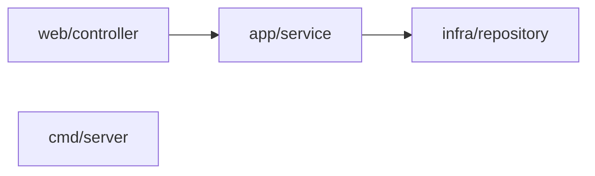
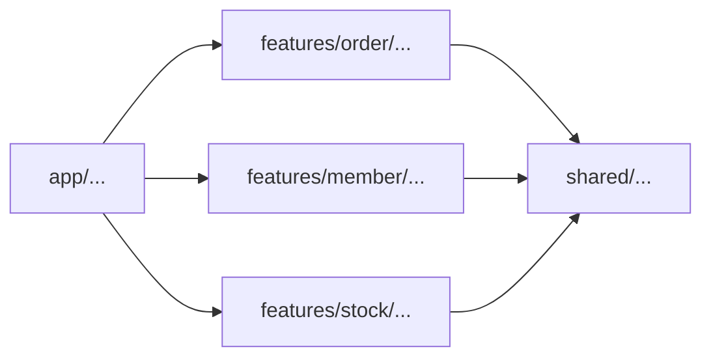

# Keeping design patterns with hadome

Examples of how hadome's configuration keeps architecture patterns and the GoF design patterns. Not every pattern can be kept, so those that cannot are listed too, with the reason.

## What hadome looks at

hadome looks at the direction of imports and calls between the repository's units (a Go package, a Kotlin package, a TypeScript directory, a Terraform module, an Ansible role, and so on). So it keeps patterns that can be said as "which directory may depend on which". Patterns decided only by the shape inside a class, or by what happens at run time, it cannot keep.

| Tool | Configuration | Change it stops |
|---|---|---|
| Dependency diagram | `rules.deps.diagram` (a Mermaid flowchart) | An import the diagram draws no arrow for (`deps/not-in-diagram`) |
| Call diagram | `rules.deps.calls` | A call the diagram draws no arrow for (`deps/call-not-in-diagram`). A call through an interface counts as a call to the implementation's unit |
| Layers | `rules.deps.layers` | An import from an inner layer to an outer one (`deps/layer`) |
| Cycles | None needed. Allowed pairs go in `rules.deps.cycles.allow` | An import that makes a new cycle between units (`deps/cycle`) |

- None of them fails a violation the version compared against (usually main) already has. Only what the change adds fails.
- `hadome suggest diagram` and `hadome suggest calls` draft the diagrams. A draft draws the code as it is; from there, take arrows away toward the shape you want.
- A change that adds an arrow or a layer, or an allowed pair, goes to a person's review (exit code `3`).

## Architecture patterns

### Clean, hexagonal and onion architecture

Write that dependencies point from the outside in, as layers.

```yaml
rules:
  deps:
    layers:
      - name: domain
        paths: [domain/**]
      - name: usecase
        paths: [usecase/**]
      - name: adapters
        paths: [infra/**, web/**]
      - name: main
        paths: [cmd/**, di/**]
```

- A change it stops: `domain` imports `infra`.
- Ports (repository interfaces and the like) go in an inner layer, adapters (the database or HTTP implementations) in an outer one. An adapter imports its port, so the direction is inward.
- A DI container, or the place that wires everything, imports every layer. In the outermost layer, its imports all point inward and pass. It can also be left in no layer.
- Layers judge imports. Through an interface, the call rightly goes outward. Example: usecase calls infra's implementation through `UserRepository`. To check calls too, draw `usecase --> infra` in the call diagram.

### Layered architecture

To have each request go through the layers one at a time, controller → service → repository, draw in the call diagram only the arrows to the next layer.



- A change it stops: a controller calls a repository past the service.
- Layers (`rules.deps.layers`) let a layer use any inner layer. To allow only the next one, use the diagram.
- Calls from a box marked `wiring` (here `cmd/server`) are not checked. It is for the place that builds everything.

### Feature modules

Each feature (orders, members, stock) has its own directory, and features meet only through shared parts. In the dependency diagram, draw no arrows between feature boxes.



- A change it stops: `features/order` imports a class inside `features/member`.
- When features need to share something, move it to `shared`, or draw the arrow and have a person review it.

### MVC, MVP and MVVM

When View, ViewModel (Presenter) and Model are in directories of their own, layers can give the direction.

```yaml
rules:
  deps:
    layers:
      - name: model
        paths: [model/**]
      - name: viewmodel
        paths: [viewmodel/**]
      - name: view
        paths: [view/**]
```

- A change it stops: a ViewModel imports a View.
- In an MVP design where View and Presenter refer to each other, the cycle is as designed. Written as an allowed pair, `deps/cycle` no longer counts cycles between them.

```yaml
rules:
  deps:
    cycles:
      allow:
        - app/ui/** <-> app/presenter/**
```

### Coordinator and Router

Navigation is gathered in a Coordinator (Router), and screens do not know each other. In the dependency diagram, draw arrows only from the Coordinator to the screens, none from a screen to the Coordinator. A screen asks the Coordinator to navigate through a protocol (a delegate) kept on the screen's side.

- A change it stops: screen A imports screen B and opens it directly.
- In a design where screens and the Coordinator import each other, write them as an allowed pair.

### No cycles

No configuration is needed. `deps/cycle` works without a diagram and fails an import that makes a new cycle between units.

- A change it stops: adding `domain → store` where `store → domain` is. The message gives the way back (`store → domain → store`).
- In Rust, Java and Kotlin, imports between a directory and its ancestor are not followed. A Rust crate root and the modules it declares with `mod` refer to each other as a matter of course.

## GoF design patterns

Most GoF patterns are about the shape inside a class, or of a few classes near each other. hadome keeps one only when its participants are in separate units and their direction has a rule.

### What can be kept

| Pattern | Its shape across units | How to write it |
|---|---|---|
| Facade | From outside, only the subsystem's front is used | In the dependency diagram, draw arrows from outside boxes to the front's box only, never into the subsystem's boxes |
| Mediator | Colleagues know only the mediator, not each other | In the dependency diagram, draw no arrows between colleague boxes. If the mediator and the colleagues import each other, write them as an allowed pair |
| Adapter | An outer adapter implements an interface the inside declares | Layers, with the adapter in an outer layer |
| Strategy | The user (Context) holds the interface, and the strategies are in another unit | Layers or the dependency diagram, allowing only strategies → Context |
| Observer | The notifier declares the listener interface, and the receivers implement it | Layers or the dependency diagram, stopping imports from the notifier to the receivers. Notifications reach the implementations, so draw the arrow in the call diagram |
| Abstract Factory, Factory Method | The interface of what is made is inside, the concrete factories outside | Layers, with the concrete factories in an outer layer |
| Bridge | The abstraction and the implementation hierarchies are in separate units | In the dependency diagram, draw only abstraction → implementor interface |
| Command | The invoker knows only the command interface, and the commands are in another unit | In the dependency diagram, draw no arrow from the invoker to the commands' box |
| Decorator, Proxy | The wrapper and the wrapped implement the same interface | Layers or the dependency diagram, allowing only wrapper → the interface's unit |
| Template Method | The base class and the classes extending it are in separate units | Layers or the dependency diagram, allowing only extending classes → base class |
| Visitor | The visitor and the elements refer to each other | In separate directories they make a cycle, so write them as an allowed pair |

### What cannot be kept

| Pattern | Why |
|---|---|
| Singleton | What it keeps (one instance) is a run-time property, which no direction of imports says |
| Builder, Prototype | About one class, or what is close to it |
| Composite, Flyweight | About the structure inside one unit |
| Chain of Responsibility, State, Iterator, Memento, Interpreter | About behaviour inside one unit. Split across units, their rules of direction take the shape of Command or Strategy above |

### Delegates and weak references

A delegate such as iOS's `weak var delegate` has the shape of Observer or Strategy. With the delegate protocol in the unit of the side that uses it (the notifier), and the receiver implementing it, the only import goes from the receiver to the notifier.

- A weak reference keeps a reference cycle from holding memory at run time. hadome looks at cycles of source code dependencies, not cycles of references in memory.
- hadome has no Swift adapter yet.

## What cannot be kept

- **Reflection and calls a framework makes**: Spring's `@EventListener`, `getattr` calling by a name in a string, and the like. The syntax names no callee, so the call cannot be followed.
- **Dependencies through other modules**: hadome does not read libraries outside the repository, so a cycle back through a library is not counted.
- **The shape inside one unit**: how a class's responsibilities are split, and any shape beyond the size of methods, is not looked at. Size is the `size/` rules' job.

A rule none of these covers can be written as a product-specific gate ([Product-specific gates](external-gates.md)).
